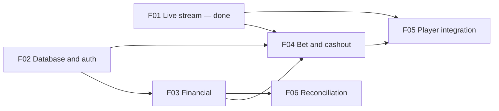

# Product Plan: Crash Game Operator

> Status: Approved
> Steering: @.ai/steering/product.md · @.ai/steering/tech-stack.md · @.ai/steering/conventions.md

## Vision

Build a server-side operator that safely proxies player actions to game engines, maintains wallet correctness, and keeps clients synchronized with real-time game state through provider failures.

## Steering Context

- Product: @.ai/steering/product.md
- Tech Stack: @.ai/steering/tech-stack.md
- Conventions: @.ai/steering/conventions.md

## Personas

- **Player:** needs accurate game state, balance, and bet outcomes.
- **Operator maintainer:** needs clear provider boundaries and recoverable integrations.

## MVP Boundary

### Must Have

- Keep the engine private behind the operator and protect provider credentials.
- Persist player identity, wallets, and financial operations in PostgreSQL through reviewed migrations.
- Authenticate players before starting engine sessions or accepting bet/cashout commands.
- Keep wallet debits and credits idempotent and concurrency-safe.
- Support Crashsim bet and cashout commands, including unknown-outcome reconciliation.
- Keep clients synchronized with the round and the authoritative wallet balance.

### Won't Have Yet

- A second game provider or dynamic adapter registry.
- Multi-instance fan-out infrastructure such as Redis Pub/Sub.
- Durable replay of engine events unless the provider adds a replay contract.
- A full production design system or advanced gameplay UI.

## Feature Map

### Phase 1 — Operator MVP (Must Have)

| ID | Feature | Module | Description |
|----|---------|--------|-------------|
| F01 | Crashsim live state relay and debug client | Operator / game | Keep one direct Crashsim integration in a small `game` module, resynchronize the engine stream, fan out state over SSE, and inspect it in a minimal React debug client. |
| F02 | Database foundation and player authentication | Operator / auth + persistence | Configure PostgreSQL/Drizzle and migrations, then add player accounts and authenticated operator sessions. Auth owns its identity tables; later modules own their tables. Login method: email/password. |
| F03 | Wallet ledger and engine webhooks | Operator / financial | Resolve webhook `playerId` to the operator player and wallet; process signed debit/credit operations idempotently and safely under concurrent requests, independently of browser sessions. |
| F04 | Crashsim bet and cashout commands | Operator / game | Create engine sessions when the authenticated player opens the game, using the operator player ID; enforce session/bet ownership, call the engine REST API, and reconcile timeouts without creating duplicate bets or cashouts. |
| F05 | End-to-end player integration | Operator + Client | Connect authenticated player flows, balance, game commands, and the existing SSE round stream in the React client. |

### Later phases

| ID | Feature | Module | Description |
|----|---------|--------|-------------|
| F06 | Operational reconciliation | Operator | Add operator-facing visibility and recovery workflows for pending or failed engine settlements. |

## Dependencies

## Risks

| Risk | Impact | Mitigation |
|------|--------|------------|
| Repeated or concurrent debit webhooks change balance more than once or below zero | High | Unique `txId`, same-transaction ledger and balance mutation, atomic conditional debit, and concurrent-request tests. |
| Engine accepts a bet/cashout but the operator times out before receiving the response | High | Persist command state and reconcile by engine bet ID; add request idempotency for bet creation if the engine contract supports it. |
| Cashout is reported successful before the asynchronous credit webhook commits | High | F04 persists the cashout outcome; F06 reconciles engine bet state against the financial ledger, with one credit per `betId` even if the original webhook arrives late. |
| Invalid/replayed webhook reaches wallet endpoints | High | Verify HMAC against the raw body, compare signatures safely, and enforce timestamp freshness. |

## Open Decisions

- F02 requirements, REST design, and tasks are approved. Implementation was deferred earlier; the user has now authorized implementation, starting with F02 T1.
- F03 requirements, design, and tasks are approved in `.ai/sdd/specs/003-financial-wallet-ledger/`. F03 implementation depends on F02 and follows it. The design defines USD-only currency, local test top-up, stable `402` replay, persist-before-`200` webhook acknowledgement, and F04/F06 cashout recovery. The user chose an operator-side `Number.MAX_SAFE_INTEGER` limit: unsafe payouts are rejected without mutation, logged as precision incidents, and cannot be automatically recovered by F06 through the current numeric engine contract.
- F04 requirements, design, and tasks are approved in `.ai/sdd/specs/004-crashsim-bet-cashout/`. The engine contract stays unchanged: allow at most one accepted or unknown bet per player/round, never retry an ambiguous `POST /bets`, correlate through the persisted debit where possible, and allow a fresh command key after a definitive `402` while betting remains open. Unknown outcomes block another bet for that player/round. F04 implementation follows completed and verified F02/F03.
- The user chose not to add automatic compensation for the rare case where the engine rejects a bet after the debit commit but all acknowledgements are lost; the local MVP design records this as a residual risk, without changing approved requirements.

## Next Actions

- [x] Approve narrowed requirements for `.ai/sdd/specs/001-crashsim-realtime-proxy/`
- [x] Approve the initial design for `.ai/sdd/specs/001-crashsim-realtime-proxy/`
- [x] Draft implementation tasks for feature F01
- [x] Review and approve tasks for feature F01
- [x] Approve the simplified Crashsim-only design and task plan
- [x] Implement feature F01, aligning existing code with the direct Crashsim structure
- [x] Commit feature F01 as `ebb9f95`
- [x] Approve this revised roadmap
- [x] Create requirements for F02: database foundation and player authentication
- [x] Approve F02 requirements
- [x] Create F02 design
- [x] Approve F02 REST design
- [x] Create F02 tasks
- [x] Approve F02 tasks
- [x] Defer F02 implementation at user request
- [x] Create F03 requirements draft
- [x] Resolve F03 questions
- [x] Approve F03 requirements
- [x] Create F03 design draft
- [x] Approve F03 design
- [x] Create F03 tasks
- [x] Approve F03 tasks
- [x] Create F04 requirements draft: Crashsim bet and cashout commands
- [x] Resolve F04 requirements questions about bet idempotency and `402` retry behavior
- [x] Approve F04 requirements
- [x] Resolve F04 design-discovered rejected-bet/debit-committed edge case (no automatic compensation in local MVP)
- [x] Create F04 design draft
- [x] Approve F04 design
- [x] Create F04 tasks draft
- [x] Approve F04 tasks
- [ ] Implement F02 T1–T4, then F03 T1–T5, then F04 T1–T7
