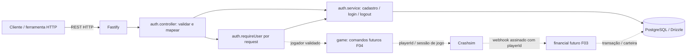
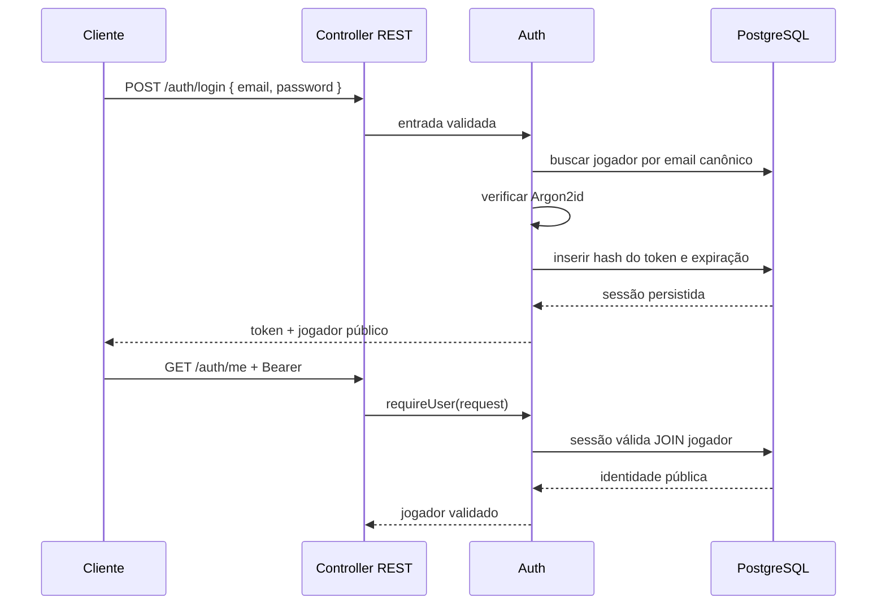

# Design: Base de persistência e autenticação de jogadores

> Requirements: @requirements.md
> Status: Approved
> Stack: Bun, TypeScript, Fastify, PostgreSQL, Drizzle, Valibot; REST para API HTTP e SSE para eventos realtime

## 1. Resumo

Adicionar persistência e um módulo `auth` pequeno. PostgreSQL armazena jogadores e sessões do operador; Drizzle define as tabelas e migrações. Cadastro, login, logout e usuário atual são expostos como endpoints REST no Fastify. As rotas atuais de saúde e SSE continuam disponíveis.

Auth oferece `requireUser(request)` como contrato público para rotas protegidas. O resultado contém o ID persistente da conta; futuros fluxos de game e financial recebem esse ID como entrada. A sessão Crashsim será criada pelo módulo `game` ao abrir o jogo na F04, independentemente do login.

## 2. Mapeamento dos requisitos

| Requisito | Cobertura |
|-----------|-----------|
| FR-001 / US-001 | Seções 5–8: jogador persistente, validação e cadastro |
| FR-002 | Seções 5, 7, 9: email normalizado e constraint única |
| FR-003 / US-002 | Seções 6–8: login, verificação de senha e sessão opaca |
| FR-004 | Seções 4, 6: `me` e DTO público |
| FR-005 / US-003 | Seções 5, 8, 9: expiração, revogação e logout idempotente |
| FR-006 / US-005 | Seções 3, 4, 6, 8: contrato público por solicitação |
| FR-007 / US-004 | Seções 5, 11, 12: banco persistente e migrações versionadas |
| FR-008 | Seções 9, 11: falhas controladas, sem sucesso ou identidade por fallback |
| NFR-001 | Seções 6, 7, 11: hashes, validação, limites e proteção de logs |
| NFR-002 | Seções 5, 8, 9: constraints, operações atômicas e revogação persistente |
| NFR-003 | Seções 11, 12, 15: documentação, diagnóstico e verificações |

## 3. Arquitetura e comunicação



`server.ts` continua como composition root: cria a conexão, injeta o banco em auth, registra as rotas REST e o módulo game e controla o encerramento. Dependências entre módulos usam suas funções públicas. Não há uma camada global `domain/application`, repository genérico ou registry de providers nesta entrega.

A dependência de banco passa a ser necessária para inicializar o operador completo. Depois de iniciado, uma queda do banco invalida a prontidão e impede auth; a stream existente pode continuar distribuindo estado enquanto sua própria conexão estiver saudável.

## 4. Estrutura de arquivos e contrato público

```text
operator/
  drizzle.config.ts                     configuração de geração das migrações
  drizzle/                              SQL e metadados versionados
  src/
    db.ts                               conexão Drizzle, check e fechamento
    migrate.ts                          entry point do comando de migração
    config.ts                           configuração validada existente
    server.ts                           composição existente
    modules/auth/
      auth.schema.ts                    tabelas de jogadores e sessões
      auth.service.ts                   fluxos e consultas concretas com Drizzle
      auth.controller.ts                rotas REST, validação Valibot e handlers finos
      auth.module.ts                    composição e contrato para outras rotas
```

Os testes acompanham as responsabilidades; a lista acima descreve arquivos de produção. Não criar um arquivo por método nem separar interfaces de uma única implementação.

| Componente | Responsabilidade |
|------------|------------------|
| `db.ts` | Criar pool `postgres`, conexão Drizzle, verificar disponibilidade e fechar recursos. Sem dados de negócio. |
| `auth.schema.ts` | Definir tabelas, índices e constraints de auth. Futuro financial define suas próprias tabelas. |
| `auth.service.ts` | `register`, `login`, `logout`, `resolveSession`: executar os fluxos, projetar dados públicos e converter falhas conhecidas. Sem dependência do transporte HTTP. |
| `auth.controller.ts` | Registrar os endpoints REST, validar entrada, aplicar limites por rota, chamar o fluxo e mapear resultados para status e JSON. |
| `auth.module.ts` | Receber banco/config/logger; registrar rotas e expor `requireUser(request)` para a composição. Detalhes de token e tabelas ficam internos. |

**Contrato de identidade:** `AuthenticatedPlayer = { id, name, email }`. `requireUser(request)` retorna `Promise<AuthenticatedPlayer>` ou erro controlado. Resolve o header da solicitação e consulta auth; reutiliza a mesma Promise apenas dentro daquele request, com associação fraca à instância do request. Não mantém cache entre solicitações nem um `currentUser` global.

Os handlers REST usam esse contrato para rotas protegidas. O fluxo de aplicação recebe o jogador validado, sem precisar conhecer Fastify. Uma rota protegida registrada apenas no teste verifica a reutilização, sem adicionar uma rota de debug à API pública.

Auth pode revogar a sessão durante o mesmo request; nesse caso descarta sua resolução memoizada. A garantia de revogação vale para novas solicitações. Cancelamento de operações que já foram autorizadas não faz parte do logout.

## 5. Modelo de dados

### `players`

| Campo | Tipo / regra |
|-------|--------------|
| `id` | UUID, PK, gerado pelo operador; nunca derivado do email |
| `name` | varchar(100), obrigatório |
| `email` | varchar(254), obrigatório, normalizado; unique constraint nomeada `players_email_unique` |
| `password_hash` | text, obrigatório; Argon2id com salt e parâmetros no próprio hash |
| `created_at` | timestamptz, obrigatório, default do banco |

O email é aparado e convertido para minúsculas antes da consulta/escrita. A migração inclui uma CHECK para impedir email com espaços externos ou caixa diferente da forma canônica. Não remover pontos nem sufixos `+` e não aplicar regras específicas de provedores de email.

A constraint única é a autoridade para concorrência. Cadastro tenta inserir e trata SQLSTATE `23505` somente para `players_email_unique` como `EMAIL_IN_USE`; outros erros continuam falhas internas/de persistência.

### `auth_sessions`

| Campo | Tipo / regra |
|-------|--------------|
| `id` | UUID, PK |
| `player_id` | UUID, FK obrigatória para `players.id`, indexada |
| `token_hash` | char(64), SHA-256 em hexadecimal, unique |
| `created_at` | timestamptz, obrigatório |
| `expires_at` | timestamptz, obrigatório, maior que `created_at` |
| `revoked_at` | timestamptz nullable |

A FK impede sessões órfãs. Exclusão de jogadores não é exposta nesta spec; manter integridade referencial sem cascata de exclusão de contas. Datas persistidas em UTC; o banco avalia validade com `expires_at > now()` e `revoked_at IS NULL`.

O token tem 32 bytes aleatórios criptográficos, codificados em base64url sem padding. O token original é retornado uma vez no login; somente seu hash é armazenado. SHA-256 serve aqui para um segredo aleatório de alta entropia, não para senha. Não existe JWT ou refresh token nesta entrega.

Duração inicial: 24 horas, por `AUTH_SESSION_TTL_SECONDS=86400`, inteiro entre 60 e 604800. Alterar a configuração afeta sessões novas. Sessões independentes do mesmo jogador são permitidas; logout revoga somente a credencial apresentada. Registros expirados/revogados podem permanecer nesta entrega, sem autorizar acesso; limpeza periódica fica para uma evolução operacional.

## 6. API e integração

Usar REST sobre Fastify, alinhado ao formato pedido pelo assessment e às rotas HTTP que a engine já oferece. Cada handler é o controller de transporte: valida a requisição, chama o fluxo no service e transforma seu resultado em status e corpo HTTP. A API inicial é:

| Método e rota | Autenticação | Sucesso | Erros principais |
|---------------|--------------|---------|------------------|
| `POST /auth/register` | Não | `201 { user }` | `400` entrada inválida, `409` email em uso, `429` limite, `503` banco indisponível |
| `POST /auth/login` | Não | `200 { token, expiresAt, user }` | `400` entrada inválida, `401` credenciais inválidas, `429`, `503` |
| `GET /auth/me` | Bearer válido | `200 { user }` | `401` sessão ausente/inválida/expirada/revogada, `503` |
| `POST /auth/logout` | Bearer sintaticamente válido | `204` sem corpo | `400` header malformado, `503` falha ao persistir revogação |

- `register` cria a conta e retorna apenas os dados públicos; cadastro não cria sessão automaticamente. O cliente chama `login` para entrar.
- `login` retorna token, expiração ISO 8601 e jogador somente após persistir a sessão.
- `me` exige `Authorization: Bearer <token>`. Não recebe `playerId` no path ou body.
- `logout` calcula o hash do token e faz revogação condicional. Token desconhecido, expirado ou já revogado resulta em `204`, de forma idempotente. O header precisa estar sintaticamente correto. Se o banco falha antes da confirmação, retornar `503`, nunca afirmar logout concluído.
- Cadastro e login não dependem de token anterior. Futuras rotas protegidas usam `requireUser(request)` para obter o jogador autenticado.
- Todas as respostas de auth usam `Cache-Control: no-store`. Tokens e credenciais nunca aparecem em URLs.
- Erros têm corpo estável `{ error: { code, message } }`, com códigos como `VALIDATION_ERROR`, `EMAIL_IN_USE`, `INVALID_CREDENTIALS`, `UNAUTHENTICATED`, `RATE_LIMITED`, `SERVICE_UNAVAILABLE`, `INTERNAL_ERROR`. Mensagens são fixas e seguras; nunca serializar exceções do driver, SQL, valores recebidos, hashes ou stack.
- O body limit é 16 KiB. Auth aceita JSON; credenciais só são enviadas no corpo protegido por TLS ou no header Authorization, nunca em query string. Não expor documentação interativa nesta entrega.

## 7. Segurança e validação

Valibot valida os inputs antes de hashing ou consultas. Nome aparado, entre 1 e 100 caracteres; email aparado, máximo 254 caracteres e formato válido; senha entre 12 e 128 caracteres e no máximo 512 bytes UTF-8. Não aparar, normalizar ou truncar senha; não exigir regras artificiais de símbolos. Mensagens de validação não incluem valores recebidos.

Usar `Bun.password.hash/verify` assíncronos com Argon2id, parâmetros explícitos iniciais de 65536 KiB e timeCost 2. Bun oferece a operação nativamente; o custo será medido na implementação no ambiente Docker. [Documentação de hashing do Bun](https://bun.sh/guides/util/hash-a-password).

Login com email ausente executa verificação contra um hash dummy válido com o mesmo custo antes de retornar `INVALID_CREDENTIALS`, como senha incorreta. Isso reduz diferenças triviais de processamento; não promete tempos exatamente iguais. Falha no banco é indisponibilidade, não credencial inválida.

Usar `@fastify/rate-limit` com store local em memória, separado por rota/IP: login 10 tentativas/minuto e cadastro 5/minuto, contando também entradas inválidas. Aplicar o limite nas rotas de cadastro e login, antes de hashing/consulta; usar o plugin Fastify compatível com Fastify 5 e fixar a versão no lockfile. [Documentação oficial](https://github.com/fastify/fastify-rate-limit#manual-rate-limit).

Manter `trustProxy` desativado no ambiente direto atual; não confiar em `X-Forwarded-For` enviado pelo navegador. O limite é local ao processo, reinicia junto com ele e usuários no mesmo IP compartilham o orçamento. Sem Redis nesta etapa. Para limitar consumo simultâneo de memória, permitir no máximo duas operações de hash/verify em andamento no serviço de auth, rejeitando excesso com `RATE_LIMITED`, sem fila ilimitada; liberar vagas em `finally`.

Aceitar apenas um header Bearer com token no formato/tamanho definidos. Header inválido não fornece identidade. ID de jogador enviado no body nunca substitui o resultado de auth. Nunca retornar colunas de senha/sessão via seleção automática de linhas inteiras.

O cliente React autenticado e sua estratégia de armazenamento de credenciais serão definidos na F05. Não introduzir localStorage ou colocar token na URL da SSE nesta entrega. O operador continua vinculado a loopback; exposição pública exige TLS e o design de integração do cliente.

## 8. Fluxos

### Cadastro

Validar → normalizar email → derivar senha fora de transação → inserir jogador → projetar DTO. Um INSERT é atômico; não abrir transação longa durante Argon2id. Constraint única resolve cadastros concorrentes.

### Login e autenticação de uma operação



### Logout

Calcular hash da credencial e fazer UPDATE condicional `revoked_at IS NULL`, persistindo a revogação. Zero linhas afetadas também é sucesso idempotente. A próxima consulta protegida consulta o banco e rejeita a sessão.

### Futuras sessões de jogo

Na F04, depois do login, abrir o jogo dispara uma operação protegida do módulo game. A rota obtém `player.id` de auth e o fluxo chama `POST /players/:id/session` na engine com a chave do operador. O game controla `playerId ↔ sessionId`, reutiliza a sessão válida e verifica a propriedade das apostas. F02 não cria essas sessões nem condiciona login à engine.

O webhook financeiro futuro é autenticado pela assinatura da engine e resolve `playerId` para a carteira, sem exigir que o jogador continue logado. Logout não cancela liquidação válida.

## 9. Falhas e concorrência

| Caso | Comportamento esperado |
|------|------------------------|
| Dois cadastros para o mesmo email | Um INSERT vence; outro recebe `EMAIL_IN_USE`. Nenhum jogador parcial. |
| Email desconhecido / senha incorreta | Mesma mensagem e código `INVALID_CREDENTIALS`; nenhum token. |
| Token ausente/inválido/expirado/revogado em `me` | `UNAUTHENTICATED`; nenhuma identidade por fallback. |
| Requests simultâneos de jogadores diferentes | Identidade isolada por request. Sem cache compartilhado de usuário. |
| Logout repetido ou simultâneo | Revogação condicional idempotente; sessão nunca reativada. |
| Operação já autorizada quando ocorre logout | Pode concluir; novos requests são rejeitados após logout confirmado. |
| Banco cai durante cadastro/login/logout | Erro controlado, sem anunciar sucesso. Não repetir mutação automaticamente. |
| Commit ocorre, resposta se perde | Resultado pode ser desconhecido. Novo cadastro pode indicar email usado; login permite recuperar acesso. Sessão de login sem token entregue expira normalmente. |
| Banco cai durante consulta de sessão | `SERVICE_UNAVAILABLE`; jamais reutilizar identidade de request anterior. |
| Operador reinicia | Contas, expiração e revogação preservadas; limites locais são reiniciados. |
| Engine indisponível | Login permanece disponível quando banco está saudável. |
| Muitas tentativas de login/cadastro | Limite por rota/IP antes da validação e hashing; hashing concorrente também tem teto. |
| Migração ausente/falha | Operador não anuncia pronto; log seguro identifica estágio da falha. |

## 10. UX

Sem tela nova nesta entrega. Documentar endpoints REST, status HTTP e exemplos de header em README, com credenciais fictícias. A futura UI distingue erro de validação, credenciais inválidas, sessão encerrada, limite de tentativas e indisponibilidade. Não transformar falha de infraestrutura em pedido de cadastrar outra conta.

## 11. Operação, configuração e ciclo de vida

Adicionar `DATABASE_URL` obrigatório e validado como URL PostgreSQL, além de `AUTH_SESSION_TTL_SECONDS`. O modo smoke da engine não exige banco. Credenciais locais ficam exemplificadas no Compose; não adicionar fallback implícito de banco na API.

`db.ts` usa `postgres` com pool limitado inicialmente a 5 conexões, conexão com timeout de 5 segundos e statement timeout de 5 segundos. Drizzle oferece integração com esse driver. [Documentação PostgreSQL do Drizzle](https://orm.drizzle.team/docs/get-started-postgresql).

Antes de ouvir HTTP, verificar conexão e consultar as tabelas esperadas de auth sem retornar dados, detectando migração ausente. `/health` continua liveness; adicionar `/ready` com verificação de banco/schema: HTTP 200 quando disponível, HTTP 503 quando indisponível. Não incluir URL, consultas ou detalhes internos na resposta. Saúde da stream continua no contrato realtime já existente.

Construir/importar o servidor não abre socket nem executa migrações. Se registro de plugins, verificação inicial ou listen falhar, fechar os recursos criados. No shutdown: parar aceitação de requests, fechar stream e banco via hooks; migrador fecha sua própria conexão também em falha. A composição pode tornar `buildOperatorApp` assíncrona para registrar plugins; atualizar seus chamadores e testes existentes de forma consistente.

Logs registram operação, resultado seguro, requestId e playerId somente quando conhecido. Não registrar email, nome, senha, hash, token, header Authorization, corpo das requisições ou URL do banco. Não repassar erro bruto do driver ao logger. Ampliar a redação de configuração para segredos do banco; o redactor atual de chave da engine não substitui essas restrições.

## 12. Migrações e Docker

Dependências de runtime: `drizzle-orm`, `postgres`, `@fastify/rate-limit`. `drizzle-kit` fica em desenvolvimento. Selecionar versões estáveis compatíveis com Bun/Fastify 5 e fixar o conjunto no `bun.lock`; não adotar RC apenas porque aparece na documentação atual.

Definir `db:generate` com Drizzle Kit e `db:migrate` com `src/migrate.ts`, usando migrator runtime do driver escolhido. Versionar SQL e metadados gerados. `drizzle.config.ts` referencia schemas dos módulos; não usar `push` nem gerar migrations no startup. Drizzle documenta o fluxo de SQL versionado aplicado pelo migrator. [Documentação de migrações](https://orm.drizzle.team/docs/migrations).

Dockerfile copia as migrações e o entry point TypeScript, sem precisar instalar drizzle-kit na imagem. Compose adiciona serviço one-shot `operator-migrate` usando a mesma imagem e `DATABASE_URL`; depende do PostgreSQL saudável. Operator depende da conclusão bem-sucedida da migração e da engine. Volume PostgreSQL existente permanece.

Documentar runner único de migração: Compose usa um serviço e execução manual não deve ocorrer em paralelo com ele. Reexecutar após conclusão aplica somente migrations pendentes; não prometer exclusão mútua automática entre dois processos migradores.

A primeira migração só adiciona as tabelas/constraints de auth, sem alterações destrutivas. Nunca editar uma migração já aplicada; evolução requer nova migração. Rollback de aplicação mantém dados/tabelas; correção de schema segue migração adicional revisada. Para ambiente com dados reais, documentar backup antes de mudanças; não usar remoção de volumes como procedimento de upgrade.

## 13. Decisões técnicas

| ID | Decisão | Motivo / trade-off / alternativa |
|----|---------|---------------------------------|
| TD-001 | Módulo auth com quatro arquivos e Drizzle direto no service | Menos camadas para escopo concreto; queries e fluxo ficam juntos. Separar repository somente se surgir necessidade real. |
| TD-002 | Endpoints REST com handlers Fastify | Segue o formato solicitado no assessment e é direto para operações explícitas de auth. Mantém handlers REST simples; não adiciona GraphQL em paralelo. |
| TD-003 | Sessão opaca persistida, somente hash do token | Logout efetivo no próximo request e sobrevive reinício. Consulta ao banco por request; evita revogação complexa de JWT. |
| TD-004 | Argon2id nativo assíncrono do Bun | Dispensa pacote de hashing extra; custo consome memória e exige limite de concorrência. |
| TD-005 | Migração explícita antes da API | Schema reproduzível e falha de deploy clara; exige passo operacional. Alternativa de migrar em todo processo de API gera concorrência desnecessária. |
| TD-006 | Auth independente de engine | Login disponível durante falhas Crashsim; módulo game precisa gerenciar uma sessão própria na F04. |

O plugin de rate limit precisa ser compatível com Fastify 5; sua versão e comportamento serão confirmados durante a implementação. [Documentação oficial](https://github.com/fastify/fastify-rate-limit). A compatibilidade efetiva do conjunto com Bun será verificada na implementação; não tratá-la como já comprovada.

## 14. Riscos

| Risco | Impacto | Mitigação |
|-------|---------|-----------|
| Consulta de auth depende do banco | Alto | Timeout finito, prontidão e falha fechada; sem cache de sessão entre requests. |
| Hashing afeta latência realtime | Alto | Operação assíncrona, limite de tentativas/concorrência e medição junto da stream. |
| Dados sensíveis em erros HTTP/driver | Alto | Mensagens fixas, DTO explícito, logs com campos permitidos e verificações de vazamento. |
| Múltiplas réplicas contornam limite local | Médio | Entrega local/processo único; revisar store distribuído antes de escalar. |
| Futuro cliente persiste token de forma insegura | Alto | Política do navegador e auth SSE pertencem à F05; não criar token em URL. |

## 15. Estratégia de verificação

Verificações previstas para a implementação, sem executá-las nesta fase de design:

- Unitárias: normalização, limites Valibot, token/header, expiração, projeção pública, conversão de erros e liberação de vaga de hashing em falha.
- API com Fastify inject: cadastro/login/me/logout, erros fixos, requests isolados, rota protegida usando contrato público, métodos HTTP/body types inválidos, abuso e ausência de dados sensíveis em logs/respostas.
- PostgreSQL real em banco exclusivo de teste: migração de banco vazio/reexecução preservando dados, unique concorrente, FK, logout concorrente, persistência/revogação após recriar app e indisponibilidade. Constraints e atomicidade não podem ser aprovadas somente com mocks.
- Limpar apenas banco/schema de teste explicitamente dedicado; nunca o banco local de desenvolvimento como setup de teste.
- Regressão do game/client: contratos SSE, reconexão e estado mantidos; ajustes de composição não alteram o reducer.
- Docker: start com migração, falha de migração bloqueando API, restart mantendo sessão válida e `/ready` respondendo 503 em queda do banco.
- Typecheck operador/cliente, suite existente e Compose; observar latência de eventos durante tentativas de auth com limite de hashing. Registrar versões e evidências no review.

## 16. FAQ de implementação

**O que faz o papel de controller?** Os handlers Fastify de cada rota REST. Eles validam a requisição, chamam as funções do service e mapeiam o resultado para status e corpo HTTP. Não precisamos de uma classe controller por endpoint nem de camada GraphQL.

**Como o game pega o usuário?** Sua rota chama `auth.requireUser(request)` e passa `player.id` ao fluxo. Não consulta tabelas privadas de auth nem aceita `playerId` do navegador como identidade.

**Criar conta já cria carteira ou sessão da engine?** Não. Carteira é F03; sessão Crashsim e comandos são F04, conforme os limites aprovados.

**É necessário transacionar toda função?** Não. Um INSERT/UPDATE é atômico. Usar transação quando um fluxo introduzir múltiplas escritas que precisem concluir juntas; hashing permanece fora dela.

**SSE vai exigir esse Bearer agora?** Não nesta spec. A estratégia de sessão e transporte do navegador para a stream será desenhada na F05, preservando o cliente diagnóstico local atual.

**Pode prosseguir para código com este documento?** Apenas depois da aprovação do design e das tasks da spec 002.
