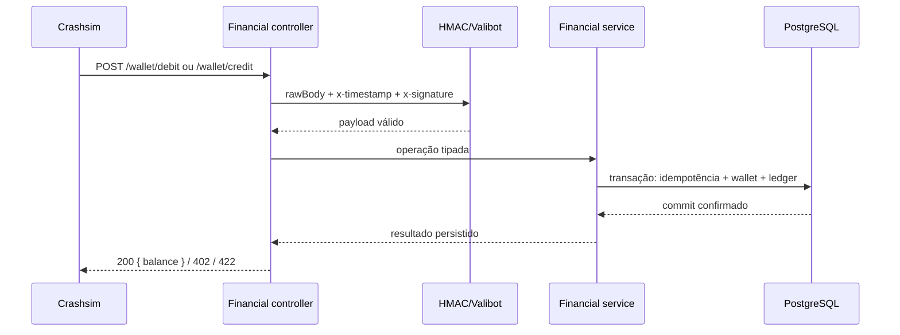
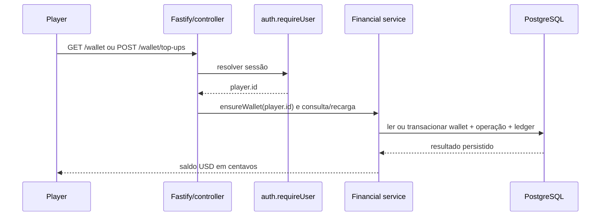

# Design: Carteira, ledger e webhooks financeiros

> Requirements: @requirements.md
> Status: Approved
> Stack: Bun, TypeScript, Fastify, PostgreSQL, Drizzle e Valibot

## 1. Resumo

Adicionar `modules/financial` como módulo direto do operador. Ele mantém uma carteira USD por jogador, o saldo disponível e o ledger append-only; valida e processa os webhooks Crashsim; expõe saldo e histórico próprios do jogador autenticado; e oferece uma operação local idempotente de crédito de teste.

Cada webhook financeiro é concluído em uma transação PostgreSQL antes da resposta `200`. O módulo não confirma um débito ou crédito apenas por enfileirá-lo. A idempotência fica persistida: `txId` identifica retries do webhook e `betId` identifica o crédito único daquele cashout, inclusive quando F06 fizer uma reconciliação. Valores e saldo ficam dentro da faixa inteira segura do JSON numérico; payout fora da faixa é rejeitado pelo operador e registrado como incidente sem mutação. A recuperação operacional fica em F04/F06; F03 não adiciona Inbox, worker ou Outbox.

## 2. Mapeamento dos requisitos

| Requisito | Cobertura no design |
|-----------|---------------------|
| US-001 / FR-001 | Seções 5–8: carteira USD em centavos, criação sob identidade autenticada, consulta de saldo sem `playerId` do browser |
| US-002 / FR-002 | Seções 5, 6, 8 e 9: débito atômico condicional, recusa `402` persistida e resposta idempotente |
| US-003 / FR-003 | Seções 5, 6, 8, 9 e TD-008: crédito síncrono, commit antes de `200`, uma liquidação por cashout e rejeição sem mutação de valores fora da faixa segura |
| US-004 / FR-006 | Seções 6–9: corpo bruto, HMAC, timestamp recente e validação antes de mutar saldo |
| US-005 / FR-004 | Seções 5, 8 e 9: ledger de movimentos confirmados, deduplicação por `txId` e `betId`, histórico paginado |
| FR-005 | Seções 5, 9 e 14: atualização condicional no PostgreSQL e constraints únicas sob concorrência |
| FR-007 | Seções 4 e 8: contrato público do módulo para saldo, histórico, provisionamento e recuperação de cashout |
| FR-008 | Seções 6–9, 11 e TD-008: respostas de retry, falhas seguras, logs sanitizados, reconciliação em F06 e exceção não reconciliável para payout inseguro |
| US-006 / FR-009 | Seções 6–9 e TD-006/TD-008: `POST /wallet/top-ups`, autenticação, chave de idempotência e habilitação exclusivamente local e dentro da faixa segura |
| NFR-001 | Seções 5, 6 e TD-001/TD-008: inteiros em centavos, PostgreSQL `BIGINT`, faixa JSON segura, nenhuma aritmética monetária em ponto flutuante |
| NFR-002 | Seções 5 e 9: operação, saldo, ledger e resultado idempotente na mesma transação; constraint para um cashout |
| NFR-003 | Seções 6, 7, 9 e 11: limites de payload, assinatura, identidade, segredos e logs |
| NFR-004 | Seções 11–12: configuração, migração, respostas, retries, readiness e diagnóstico |
| NFR-005 | Seções 6, 8, 12 e TD-006/TD-008: crédito de teste fechado por padrão, bloqueado em produção e limitado à faixa segura |

## 3. Abordagem técnica

O fluxo depende da base PostgreSQL/Drizzle e do contrato `auth.requireUser(request)` definidos na F02. `server.ts` continua sendo a composition root e injeta conexão, configuração, logger e contrato de auth no módulo `financial`. O módulo não importa tabelas nem detalhes privados de auth.

O saldo atual é uma projeção persistida na tabela `wallets`, atualizada junto com o ledger. Não há cache ou saldo em memória como autoridade. Uma operação financeira abre uma transação PostgreSQL que:

1. Reserva/confere a chave de idempotência e valida se um registro anterior tem o mesmo conteúdo.
2. Localiza a carteira existente; cria uma carteira zerada somente em fluxos internos originados de uma identidade autenticada.
3. Aplica débito condicional ou crédito, grava o resultado da operação e, se houver movimento, acrescenta uma linha ao ledger.
4. Faz commit antes de responder ao cliente ou à engine.

Antes da transação, o webhook exige `Number.isSafeInteger(amount) && amount > 0`. Um payout que falha nesse critério recebe `422`, não cria operação financeira nem ledger entry e emite `wallet.cashout.precision_incident`. Dentro da transação, crédito/top-up verifica que `balance_cents + amount_cents <= 9007199254740991`; caso contrário registra `outcome=balance_limit` e o saldo corrente, sem alterar carteira/ledger, e responde `422` estável para o mesmo identificador.

Um débito recusado grava o resultado `insufficient_funds` associado ao `txId`, mas não cria lançamento no ledger nem altera o saldo. A mesma tentativa continua `402` mesmo que o jogador receba saldo depois; uma aposta nova tem outro `txId`.

O webhook de cashout pode ser entregue antes ou depois da reconciliação. Ambos usam a chave de negócio `cashout:<betId>`. Se um já tiver creditado, o outro valida jogador e valor e devolve o resultado persistido sem criar outro lançamento. Diferenças de jogador ou valor para o mesmo `betId` são conflito e exigem investigação.

F03 não usa fila para aplicar as mutações. O `Outbox` resolve a publicação confiável de eventos gerados por uma transação; não substitui o processamento síncrono que a engine espera para saber se um débito foi aceito. Se no futuro uma mudança de saldo precisar publicar evento para outro sistema, a necessidade de Outbox será desenhada nessa integração.

## 4. Estrutura de módulos e arquivos

```text
operator/
  drizzle/
    <migration>_financial_wallet.sql
  src/
    config.ts                               # segredo HMAC e flag local de top-up
    server.ts                               # composition root (F02)
    db.ts                                   # pool/Drizzle (F02)
    modules/
      auth/                                 # contrato público requireUser (F02)
      financial/
        financial.schema.ts                # wallets, operations e ledger
        financial.service.ts                # transações e regras financeiras
        financial.controller.ts             # REST e webhook, handlers finos
        crashsim-webhook-auth.ts             # HMAC/raw body/freshness do Crashsim
        financial.module.ts                 # composição e contrato público
```

| Componente | Responsabilidade |
|------------|------------------|
| `financial.schema.ts` | Declarar as tabelas, índices, chaves únicas e checks do módulo. Não importa o schema privado de auth. |
| `financial.service.ts` | `ensureWallet`, `getBalance`, `listEntries`, top-up, débito/crédito e `creditCashoutOnce`; usa Drizzle diretamente. |
| `crashsim-webhook-auth.ts` | Verificar headers e HMAC do contrato Crashsim sobre bytes crus; validar frescor. Não contém abstração genérica de provider. |
| `financial.controller.ts` | Registrar rotas, validar entrada HTTP, obter a identidade autenticada, chamar auth helper/service e mapear resultado para HTTP. |
| `financial.module.ts` | Injetar config/db/logger/auth, registrar controller e expor somente o contrato usado por outros módulos. |
| `server.ts` | Montar `auth` e `financial` sobre a mesma conexão e fechar a conexão no ciclo de vida definido pela F02. |

Não criar repository genérico, camada `domain/application`, classe por rota, serviço de pagamentos, Outbox ou adapter de engine hipotética. As queries Drizzle ficam no service concreto, com limites transacionais explícitos.

### Contrato público de `financial`

- `ensureWallet(playerId)`: cria saldo zero para um ID recebido de um fluxo confiável após `auth.requireUser`.
- `getBalance(playerId)`: retorna `{ balance, currency: 'USD' }`.
- `listEntries(playerId, page)`: retorna somente movimentos confirmados daquele jogador.
- `creditCashoutOnce({ playerId, amount, betId, roundId, source })`: crédito único por `betId`, usado pelo webhook e futuramente por F06.

F04 deve chamar `ensureWallet` antes de abrir uma sessão Crashsim para o jogador. Os webhooks só alteram carteiras já provisionadas; `playerId` desconhecido ou sem carteira recebe erro e não cria uma carteira órfã. As rotas do jogador sempre obtêm seu ID de `auth.requireUser`, nunca do body/query.

## 5. Dados e estado

O schema acrescenta três tabelas próprias de `financial`; todas as alterações entram em uma migration Drizzle aditiva, depois da migration de auth.

### `wallets`

| Coluna | Tipo/regra |
|--------|------------|
| `player_id` | UUID, PK; provisionado somente por fluxo interno confiável; sem FK para a tabela privada de auth |
| `balance_cents` | `BIGINT NOT NULL DEFAULT 0`, `CHECK (balance_cents BETWEEN 0 AND 9007199254740991)` |
| `created_at`, `updated_at` | `timestamptz`, gerados no servidor/banco |

Uma linha representa a carteira USD única do jogador; a moeda é uma constante do módulo/DTO (`USD`), sem estrutura multi-moeda no MVP. F02 não oferece exclusão de conta. Uma futura exclusão/arquivamento de jogadores precisa definir o ciclo de vida da carteira antes de ser introduzida.

### `financial_operations`

Registra o resultado idempotente de cada solicitação financeira, inclusive recusas sem movimento.

| Campo | Uso |
|-------|-----|
| `id` | UUID PK |
| `player_id`, `kind`, `source`, `amount_cents` | `amount_cents BIGINT NOT NULL CHECK (amount_cents BETWEEN 1 AND 9007199254740991)`; `player_id` referencia `wallets.player_id` |
| `engine_tx_id` | `txId` do webhook, unique quando presente (`WHERE engine_tx_id IS NOT NULL`) |
| `business_key` | Unique quando presente (`WHERE business_key IS NOT NULL`); `cashout:<betId>` para cashout/reconciliação ou `top-up:<playerId>:<Idempotency-Key>` |
| `bet_id`, `round_id` | Correlação opcional com a aposta/rodada |
| `outcome` | `applied`, `insufficient_funds` ou `balance_limit`; estado intermediário não é commitado |
| `response_balance_cents` | Saldo original, restrito a `0..9007199254740991`, para replays de sucesso ou `balance_limit` |
| `created_at` | Momento UTC da operação |

Replays com `engine_tx_id` comparam jogador, tipo, valor e referências; conteúdo divergente retorna conflito sem mutação. A operação `insufficient_funds` persiste o resultado `402` sem linha de ledger. `balance_limit` persiste o `422` para o mesmo identificador, também sem linha de ledger. Para recuperação que ocorreu antes do webhook, uma entrega tardia encontra `business_key`, valida o conteúdo e associa o `txId` recebido ao resultado já aplicado, sem alterar o lançamento. Um webhook com `amount` que não seja inteiro seguro é rejeitado antes do banco, pois seu valor original não pode ser recuperado com certeza.

### `wallet_ledger_entries`

É o histórico append-only dos movimentos confirmados. Cada linha tem `id`, `operation_id` único com FK para `financial_operations.id`, `player_id` com FK para `wallets.player_id`, tipo/direção, `amount_cents BIGINT CHECK (amount_cents BETWEEN 1 AND 9007199254740991)`, `balance_after_cents` restrito ao limite da carteira, origem, referências `bet_id`/`round_id` opcionais e `created_at`. Um débito ou crédito de teste só altera o ledger dentro da mesma transação que atualiza `wallets` e conclui `financial_operations`. Recusas não aparecem como movimentos.

O service mantém valores como `bigint` internamente e aceita somente valores numéricos JSON para os quais `Number.isSafeInteger` é verdadeiro. Como o Crashsim converte payout de `BigInt` para `number`, valor fora dessa faixa é rejeitado antes da transação, sem mutação de saldo/ledger, e gera o evento crítico `wallet.cashout.precision_incident` correlacionado por `txId`/`betId`. O saldo resultante também não pode ultrapassar `Number.MAX_SAFE_INTEGER`; créditos ou top-ups que excederiam esse teto são recusados antes do commit. Nenhum valor é arredondado para caber no formato wire.

## 6. API e integrações

Todas as rotas de jogador usam REST/Fastify e `auth.requireUser(request)`. Não aceitam `playerId` como seletor de identidade.

| Método/rota | Auth | Entrada | Resposta de sucesso |
|-------------|------|---------|---------------------|
| `GET /wallet` | Jogador | — | `200 { balance, currency: 'USD' }`; cria idempotentemente a carteira zerada se ainda não existir |
| `GET /wallet/transactions?limit=&cursor=` | Jogador | paginação limitada | `200 { items, nextCursor }`, somente lançamentos próprios |
| `POST /wallet/top-ups` | Jogador; rota local habilitada | `{ amount }` inteiro seguro, header `Idempotency-Key` UUID | `201 { transactionId, balance, currency }`; replay devolve o resultado original; `422` se o saldo ultrapassaria o limite |
| `POST /wallet/debit` | HMAC Crashsim | `{ txId, playerId, amount, betId, roundId }` com `amount` inteiro seguro | `200 { balance }`, `402` por saldo insuficiente ou `422` fora da faixa |
| `POST /wallet/credit` | HMAC Crashsim | `{ txId, playerId, amount, betId, roundId }` com `amount` inteiro seguro | `200 { balance }` ou `422` fora da faixa/limite de saldo |

As rotas de webhook preservam a compatibilidade com a engine: ela aguarda a resposta de débito antes de aceitar a aposta e trata `402` como recusa. Persistência indisponível retorna `503` para retry. Payload inválido, HMAC inválido/antigo, jogador sem carteira ou chave idempotente conflitante retorna erro não-success; respostas 4xx não devem ser tratadas como retry pela engine atual, então o motivo é registrado com categoria segura. `422` por valor não seguro ou por limite do saldo também é terminal: registra incidente de precisão e não cria crédito aproximado.

`GET /wallet` resolve `player.id` via `auth.requireUser`, chama `ensureWallet(player.id)` e então retorna o saldo persistido. `GET /wallet/transactions` usa cursor estável `(created_at, id)`, `limit` padrão 50 e máximo 100. O DTO inclui tipo, origem, amount em centavos, saldo após o lançamento, referências disponíveis e data UTC. Não há rota de consulta cross-player ou de backoffice.

### Preservação do corpo e HMAC

Criar um escopo Fastify encapsulado para as duas rotas Crashsim com parser `application/json` baseado em `Buffer`. Ele guarda os bytes recebidos para a verificação HMAC e depois passa o texto pelo parser JSON seguro do Fastify. O parser é local ao plugin de financial, tem limite de corpo de 16 KiB e não duplica raw body em rotas de jogador. Fastify documenta `parseAs: 'buffer'` e o escopo encapsulado de content-type parsers na [referência de Content-Type Parser](https://fastify.dev/docs/latest/Reference/ContentTypeParser/).

`crashsim-webhook-auth.ts` valida `x-timestamp` decimal, `x-signature` hexadecimal de 64 caracteres e frescor de no máximo 60 segundos. A assinatura é HMAC-SHA256 do valor textual original do timestamp, ponto e bytes exatos do body: `${timestampHeader}.${rawBody}`. Compara digests de mesmo tamanho em tempo constante. Só depois da assinatura verifica JSON e Valibot. O segredo `ENGINE_WEBHOOK_SECRET` fica na configuração do servidor e é diferente da `ENGINE_OPERATOR_KEY`.

### Respostas e erros

- Webhook aplicado ou replay equivalente: `200 { balance }`, com o saldo salvo na operação original.
- Débito recusado: `402`; gravar o resultado para conservar a recusa no mesmo `txId`.
- Assinatura ausente/inválida/antiga: `401`; corpo/headers inválidos: `400`.
- `amount` não seguro: `422` antes do banco; para crédito de cashout, emitir incidente de precisão que o F06 não consegue liquidar automaticamente com o contrato atual.
- Saldo resultante acima do limite: `422`, persistindo o resultado `balance_limit` sem alterar carteira/ledger para replay estável.
- Operação conflitante: `409`; `playerId` sem carteira: `404`.
- Persistência indisponível ou commit não confirmado: `503`; nunca afirmar sucesso antes do commit.
- Top-up desabilitado: rota não registrada; chave repetida com outro valor: `409`; saldo acima do limite seguro: `422` persistido para a mesma chave.

As respostas REST para jogador seguem o envelope de erro acordado em F02 (`{ error: { code, message } }`). A engine decide por status HTTP; para débito, `402` mantém o significado esperado.

## 7. Segurança, autorização e privacidade

- A chave HMAC é exclusiva de servidor. Não usar sessão do jogador para autorizar callbacks, nem expor `ENGINE_WEBHOOK_SECRET` ou `ENGINE_OPERATOR_KEY` ao browser.
- Validar assinatura em bytes crus antes do parse; validar estrutura e ranges com Valibot antes de iniciar mutações.
- O top-up recebe apenas `amount`; `playerId` adicional é rejeitado. A identidade vem da sessão resolvida por auth.
- O top-up é fechado por padrão. `APP_ENV` tem valores `local`, `test` ou `production`; `WALLET_TEST_TOPUP_ENABLED` defaulta a `false`, e o operador falha ao iniciar se a flag estiver ligada fora de `APP_ENV=local`. O Compose local liga ambos explicitamente. Não usar apenas um default implícito de `NODE_ENV` para decidir se a rota existe.
- Nenhum segredo, assinatura, raw body, Authorization, credencial, valor integral, saldo ou dado pessoal vai para logs. Registrar apenas requestId, rota, resultado/categoria de erro e referências técnicas necessárias (`txId`/`betId`) com redação configurada.
- Tamanho, método e Content-Type são verificados na fronteira. Body inválido, player sem carteira e reuso conflitante não alteram saldo nem ledger.
- `GET /wallet` e histórico são sempre escopados ao ID de `auth.requireUser`. Não há endpoint que permita selecionar o jogador por query/path.

## 8. Fluxos

### Débito/crédito da engine



No débito, o service registra a chave, tenta `UPDATE wallets SET balance_cents = balance_cents - amount WHERE player_id = ? AND balance_cents >= amount RETURNING balance_cents`, grava ledger se houver saldo, e confirma o resultado. Nenhuma leitura de saldo seguida por escrita incondicional decide a aposta.

### Consulta e recarga local



### Recuperação de cashout (F04/F06)

F04 persiste o resultado conhecido do cashout e deixa liquidação pendente até o ledger confirmar o crédito. F06 consulta apostas pendentes via API da engine, compara `betId`/payout com o contrato `financial` e chama `creditCashoutOnce`. Se o webhook já tiver aplicado o crédito, devolve o movimento existente; se a reconciliação ganhar a corrida, um webhook tardio encontra a mesma chave de cashout. Se o payout não for um inteiro seguro, F06 deixa a liquidação em estado de incidente não resolvido, emite alerta e não credita o número aproximado.

No engine atual, `bets` é um `Map` em memória e `GET /bets/:id` não persiste atravessando reinício. F04 deve guardar a resposta de cashout que recebeu. Para timeout com resultado desconhecido, a consulta funciona enquanto a engine retiver a aposta; recuperação garantida após reinício exige persistência/replay durável do próprio engine, fora desta feature.

## 9. Concorrência e casos de falha

| Caso | Comportamento esperado |
|------|------------------------|
| Mesmo `txId` e mesmo conteúdo repetido | Ler operação persistida e devolver exatamente o resultado/saldo original; sem segundo lançamento. |
| Mesmo `txId` com jogador, valor, tipo ou referências diferentes | `409`, sem mutação; log categorizado para investigação. |
| Débito insuficiente, depois jogador recebe top-up | Mesmo `txId` continua `402`; uma nova aposta usa outro `txId`. Recusa não cria ledger entry. |
| Dois débitos diferentes concorrem pelo mesmo saldo | UPDATE condicional serializado pelo PostgreSQL; só saldo coberto é debitado. |
| Dois retries iguais chegam ao mesmo tempo | Unique `engine_tx_id` e transação fazem uma operação; outra espera e lê o resultado vencedor. |
| Webhook e F06 tentam pagar o mesmo cashout | Unique `business_key=cashout:<betId>`; um cria o crédito, outro valida conteúdo e devolve o existente. |
| Um crédito seguro ultrapassaria o teto do saldo | Persiste `outcome=balance_limit` e `422` pelo `txId`/`betId`, sem alterar carteira ou ledger; replay retorna a mesma recusa. |
| Mesmo `betId`, jogador ou valor divergente | Conflito sem crédito adicional; exige triagem, não ajuste automático. |
| Webhook de cashout com `amount` fora de `Number.MAX_SAFE_INTEGER` | Responder `422` antes do banco, sem mutar saldo/ledger; emitir alerta crítico. A engine não retrya 4xx e F06 não credita o payout aproximado da consulta. |
| Crédito/top-up faria saldo passar `Number.MAX_SAFE_INTEGER` | Rejeitar antes do commit e sinalizar limite de saldo; não serializar saldo arredondado. |
| `playerId` sem carteira provisionada | `404`; não criar saldo para uma identidade desconhecida. F04 provisiona carteira antes de abrir sessão Crashsim. |
| Body/HMAC/timestamp inválido | Rejeitar antes do banco; logar categoria e idade do timestamp, sem body/assinatura. |
| `CLOCK_SKEW=90s` do assessment | Rejeitar por frescor de 60s e gerar diagnóstico explícito; não remover o check para fazer o teste passar. |
| Banco indisponível antes do commit | `503`; não confirmar, engine pode retry. |
| Commit aconteceu, resposta se perdeu | Retry pelo mesmo `txId` devolve o resultado salvo sem repetir o efeito. |
| Credit top-up repete a mesma Idempotency-Key e mesmo valor | Retorna o resultado original, sem crédito repetido. |
| Idempotency-Key local repete com outro valor | `409`; não cria nova recarga. |
| Top-up não habilitado ou ambiente production | Rota ausente; se flag de top-up vier ligada fora de local, o operador não inicia. |
| Engine reinicia antes de F06 consultar aposta | API em memória pode não recuperar payout antigo; manter como limitação do simulador e não declarar settlement reconciliado sem fonte autoritativa. |
| Histórico consultado por outro jogador | Auth define `player.id`; nenhuma rota aceita ID de terceiro. |

## 10. UX e acessibilidade

F03 não adiciona interface visual. Rotas são consumidas pela futura UI e pelo cliente de diagnóstico autenticado quando F05 for definida. Os erros REST usam códigos estáveis para que o cliente mostre saldo insuficiente, sessão encerrada, top-up local desabilitado e indisponibilidade sem expor detalhes de banco.

## 11. Observabilidade e operação

- Registrar eventos estruturados `wallet.debit.applied`, `wallet.debit.declined`, `wallet.credit.applied`, `wallet.webhook.rejected`, `wallet.operation.replayed`, `wallet.operation.conflict`, `wallet.balance_limit.declined`, `wallet.cashout.precision_incident` e `wallet.test_top_up.applied`, com requestId e código de motivo.
- Não logar valores, saldos, raw body, assinatura, secrets ou Authorization. `txId`/`betId` podem ser usados como correlação técnica; `playerId` só se a política de logs aprovada permitir e com retenção local curta.
- Distinguir `invalid_signature`, `stale_timestamp`, `invalid_payload`, `unknown_wallet`, `idempotency_conflict` e falha de storage. O assessment simula `401` em crédito; a operação deve conseguir localizar aumento de rejeições sem desabilitar HMAC.
- Emitir log estruturado `ERROR` `wallet.cashout.precision_incident`, com `txId`/`betId` e sem valor/raw body, quando um payout exceder a faixa segura; F04/F06 persistem e expõem a liquidação explicitamente pendente/não resolvida. Alertas operacionais podem ser configurados sobre esse evento.
- Erro de banco retorna `503`. Health/readiness e ciclo de vida de PostgreSQL são mantidos pelo módulo de persistência criado na F02.
- README documenta os dois segredos separados, como compartilhar localmente o `WEBHOOK_SECRET` com o engine, códigos/status, janela HMAC, limite `Number.MAX_SAFE_INTEGER`, falta de recuperação automática para payout fora da faixa, retries observados, `APP_ENV` e flag de test top-up.
- F03 não cria scheduler ou fila de reconciliação. F06 define execução, observabilidade e procedimento operacional de recuperação.

## 12. Migração e rollout

Adicionar migration Drizzle depois da migration F02 com `wallets`, `financial_operations`, `wallet_ledger_entries`, índices únicos e checks. Não apagar/recriar auth, volume PostgreSQL ou histórico financeiro. Sem `drizzle push` no startup.

F02 fornece `DATABASE_URL`, `db.ts`, migrador e readiness. F03 adiciona `ENGINE_WEBHOOK_SECRET` à config/redactor e `WALLET_TEST_TOPUP_ENABLED`/`APP_ENV`. Compose local compartilha o valor de `WEBHOOK_SECRET` entre engine e operador e habilita top-up explicitamente com `APP_ENV=local`; ambiente de produção não recebe a flag.

Rollback de aplicação mantém as tabelas e dados. Correção ou alteração de schema exige nova migration; nunca usar remoção do volume como rollback. A mudança é aditiva e não requer migrar saldo anterior porque wallets começam em zero neste MVP.

## 13. Decisões técnicas

### TD-001: Saldo materializado e ledger append-only na mesma transação

- **Decisão:** atualizar `wallets`, `financial_operations` e `wallet_ledger_entries` em uma transação PostgreSQL; ledger só contém movimentos aplicados.
- **Por quê:** permite débito condicional rápido sem tornar uma soma de histórico a autoridade de cada aposta, mantendo trilha auditável.
- **Trade-off:** saldo e ledger são duas representações que devem ser escritas juntas.
- **Alternativas consideradas:** calcular saldo por `SUM(ledger)` em cada operação ou manter somente saldo sem histórico; ambas prejudicam concorrência ou auditabilidade.

### TD-002: Webhook síncrono e persist-before-200

- **Decisão:** só retornar sucesso depois do commit. Erro de persistência usa `503` e o mesmo `txId` permite retry.
- **Por quê:** o engine aguarda o débito para aceitar aposta e usa o status da resposta como resultado financeiro.
- **Trade-off:** latência do banco aparece na latência do webhook.
- **Alternativas consideradas:** Inbox+worker com confirmação antecipada, que cria saldo pendente e pode aceitar aposta antes do débito; Outbox, que é para publicação após commit e não resolve o comando recebido.

### TD-003: `txId` para retry e `betId` para liquidação única

- **Decisão:** guardar o resultado original por `txId` e impor uma chave única `cashout:<betId>` para o efeito de cashout entre webhook e reconciliação.
- **Por quê:** `txId` resolve timeout/replay da engine; `betId` é a referência estável disponível no GET de aposta e evita pagar uma liquidação duas vezes entre caminhos.
- **Trade-off:** o service precisa detectar e comparar conteúdo em conflito por ambas as chaves.
- **Alternativas consideradas:** deduplicar apenas por `txId`, insuficiente se F06 reconstruir crédito sem receber o txId que a engine gerou.

### TD-004: Validação HMAC em helper Crashsim específico

- **Decisão:** preservar `Buffer` cru com parser Fastify encapsulado somente nas duas rotas, validar HMAC-SHA256 e frescor antes de parsear JSON; sem pacote extra de raw-body.
- **Por quê:** mantém o contrato específico do Crashsim junto da fronteira financeira, sem duplicar o raw body globalmente.
- **Trade-off:** parser e typing de raw body exigem teste de integração próprio.
- **Alternativas consideradas:** parser global ou plugin externo; ambos aumentam cópia de payload/configuração fora das rotas que precisam da assinatura.

### TD-005: Carteira provisionada apenas por identidade confiável

- **Decisão:** `ensureWallet` é chamado por rotas após `auth.requireUser` e por F04 antes de criar sessão de jogo; webhook só atualiza carteira existente.
- **Por quê:** mantém auth/financial encapsulados e impede criação de carteira órfã com `playerId` desconhecido.
- **Trade-off:** F04 precisa provisionar a carteira antes de começar uma sessão/aposta.
- **Alternativas consideradas:** importar tabela privada de auth no módulo financeiro ou criar wallet em todo webhook; primeira acopla schemas e a segunda permite órfãos.

### TD-006: Crédito de teste explicitamente local e opt-in

- **Decisão:** flag default off; ativação exige `APP_ENV=local` e configuração explícita; flag ligada fora de local bloqueia startup.
- **Por quê:** não simula dinheiro real e falha fechado em deployment mal configurado.
- **Trade-off:** execução local precisa configurar duas variáveis.
- **Alternativas consideradas:** habilitar por `NODE_ENV !== 'production'` ou deixar sempre registrado; defaults ausentes poderiam abrir top-up fora do ambiente local.

### TD-007: Janela HMAC de 60 segundos

- **Decisão:** aceitar timestamp dentro de ±60 segundos do relógio do operador.
- **Por quê:** limita replay e faz o cenário de 90 segundos do assessment aparecer nos logs sem desabilitar validação.
- **Trade-off:** relógio do operador/engine precisa de sincronização; skew operacional causa falha 401 e exige correção de relógio/secret.
- **Alternativas consideradas:** janela ampla demais reduz detecção de replay; janela zero causa rejeições por atraso de rede.

### TD-008: Rejeitar valores acima da faixa segura do contrato JSON

- **Decisão:** sem alterar Crashsim, aceitar somente `amount` e saldo final menores ou iguais a `Number.MAX_SAFE_INTEGER`. `amount` fora da faixa recebe `422` antes do banco e emite incidente de precisão; crédito/top-up seguro que excederia o saldo máximo grava `outcome=balance_limit` sem alterar carteira/ledger. F06 não credita valor aproximado retornado pela mesma API numérica.
- **Por quê:** a engine converte payout de `BigInt` para `number`; depois dessa conversão o operador não consegue reconstruir o valor original com certeza.
- **Trade-off:** um cashout extremo fica sem liquidação automática e exige tratamento operacional fora do contrato atual; o teto de saldo também impede crescimento acima da faixa exata do wire format.
- **Alternativas consideradas:** aceitar o número recebido poderia gravar quantia diferente da fórmula exata do engine; mudar o formato/limite na engine foi descartado pelo usuário.

## 14. Riscos

| Risco | Impacto | Mitigação |
|-------|---------|-----------|
| Snapshot de saldo diverge do ledger após bug futuro | Alto | Toda escrita no mesmo commit; constraints; integração compara saldo/ledger em cenário de operação. |
| Crédito 4xx para de ser retryado pela engine | Alto | Logs por categoria/rota; F06 reconcilia apenas quando ainda tem payout exato e seguro; incidentes de precisão ficam não resolvidos pelo contrato atual. |
| Payout ultrapassa faixa segura e engine perde precisão antes do webhook | Alto | Rejeitar antes da mutação, emitir incidente crítico e marcar settlement como não resolvido; o contrato atual não permite recuperação automática exata. |
| Engine reinicia e perde aposta que F06 consultaria | Alto | Guardar respostas conhecidas em F04; registrar a limitação do simulador; produção exige estado durável do engine ou feed equivalente. |
| Cashout normal e recuperação concorrentes | Alto | Chave única por `betId`, transação e validação de jogador/valor. |
| Flag de top-up ativada fora do ambiente local | Alto | Default off, `APP_ENV` explícito, startup falha se combinação for inválida, rota não registrada quando off. |
| Relógios fora de sincronia | Médio | NTP/clock diagnostic, logar age e manter HMAC/freshness ativos. |
| Muitos retries de webhooks causam pressão no DB | Médio | Atualização idempotente curta, body pequeno, timeout/limite de conexão da F02; medir latência antes de aumentar pool. |

## 15. Estratégia de verificação

Verificações para a futura implementação; nenhuma suite é executada nesta etapa de design.

- **Unitária:** validação Valibot, valores em `Number.MAX_SAFE_INTEGER` e acima dele, limite do saldo resultante, fingerprint de payload, cálculo/verificação de HMAC, frescor e serialização segura de centavos.
- **Fastify/API:** rotas/status, parser limitado às rotas Crashsim, HMAC sobre bytes exatos, body alterado, falta de header, timestamp antigo/futuro, `auth.requireUser`, isolamento de histórico e ausência de top-up quando off.
- **PostgreSQL de teste dedicado:** migration/reexecução, carteira inicial zero, débito coberto/insuficiente, replay de recusa depois de top-up, mesma chave em paralelo, payload conflitante, débitos concorrentes, credit duplicate, top-up idempotente e rollback em falha.
- **Reconciliação/concurrency:** webhook e `creditCashoutOnce` concorrentes para o mesmo `betId`, reconciliação primeiro seguida de webhook tardio, valores divergentes e replay após resultado de commit desconhecido.
- **Reconciliação de precisão:** payout não seguro deve gerar incidente não resolvido; F06 nunca credita o valor aproximado do endpoint Crashsim.
- **Integração local com engine:** aposta só ativa após debit `200`; `402` recusa; cashout faz credit; duplicação `DUPLICATE_WEBHOOKS=1`; `CLOCK_SKEW=90` aparece como rejeição diagnosticável; `CASHOUT_TIMEOUT=1` consulta aposta em F04.
- **Compose/operacional:** migrations aditivas; segredo igual entre serviços sem aparecer nos logs; top-up ativo só no Compose local; banco indisponível não gera `200`.

## 16. FAQ de implementação

**O `402` reduz o saldo ou aparece no ledger?** Não. Persiste somente o resultado idempotente da tentativa; não cria movimento. O mesmo `txId` continua recusado depois de uma recarga.

**O que devolve um replay bem-sucedido depois de o saldo mudar?** O status e `balance` salvos na operação original, não o saldo atual da carteira.

**Por que deduplicar por `betId` além de `txId`?** F06 pode recuperar uma aposta consultando seu resultado sem possuir o `txId` aleatório original. Uma chave de cashout comum evita duplicidade quando o webhook chega antes ou depois da recuperação.

**O que o operador faz quando o webhook de cashout é definitivamente perdido?** F03 não tenta executar job em background. F04 preserva o resultado que recebeu; F06 consulta o engine e usa `financial.creditCashoutOnce`, sem SQL manual.

**E se o payout for maior que `Number.MAX_SAFE_INTEGER`?** O operador rejeita o webhook antes de mutar a carteira, emite um incidente e não tenta creditar o payout aproximado consultado pelo F06. O contrato atual da engine não contém a precisão necessária para recuperar esse caso automaticamente.

**A reconciliação funciona depois de reiniciar o engine atual?** Não há garantia: as apostas do simulador estão em memória. Para produção, o engine precisaria preservar estado/resultado ou oferecer replay durável.

**Como o jogador cria saldo local?** Autenticado, chama `POST /wallet/top-ups` com centavos positivos e `Idempotency-Key`; a rota só existe com a flag local explicitamente ligada.

**A F03 pode iniciar implementação agora?** Ainda não. É necessário criar e aprovar `tasks.md` antes de escrever código.
