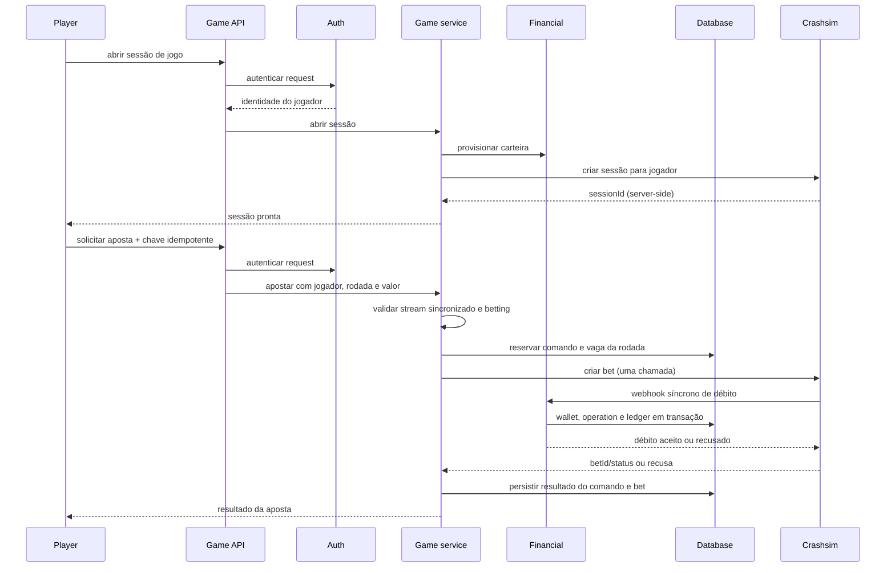
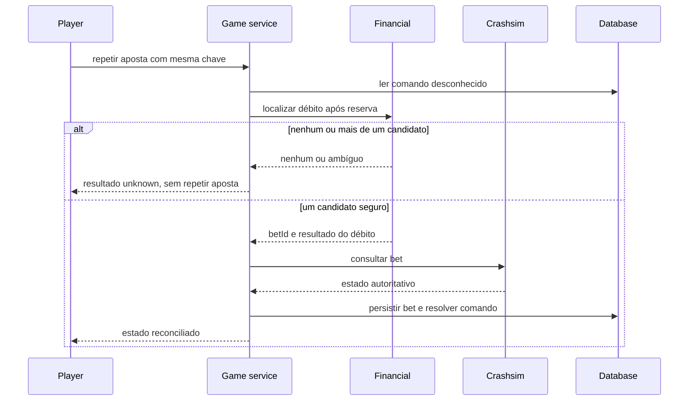
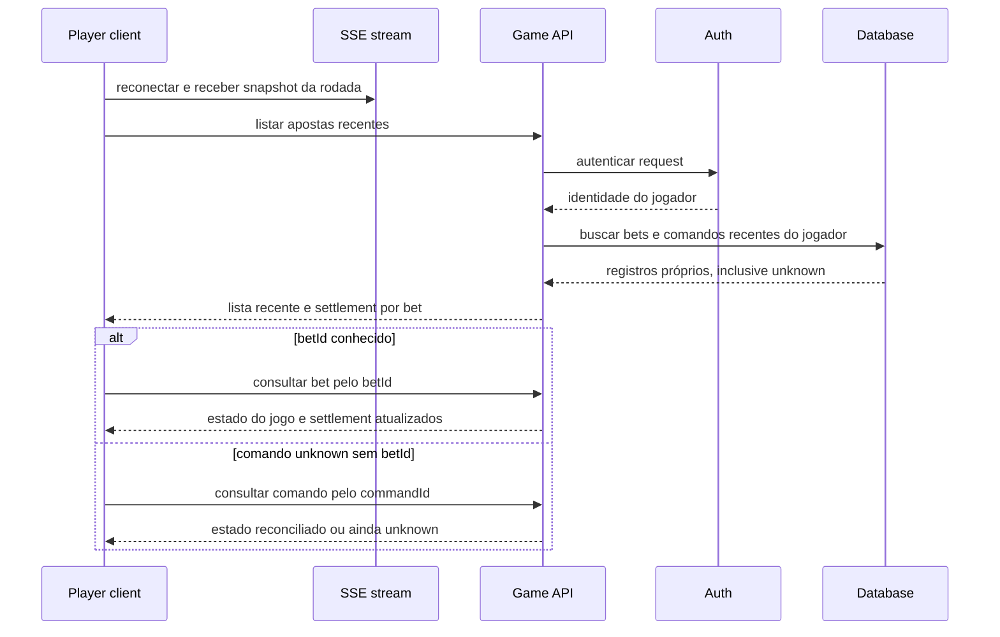

# Design: Sessão Crashsim, aposta e cashout

> Requirements: @requirements.md
> Status: Approved
> Stack: Bun, TypeScript, Fastify, PostgreSQL, Drizzle e Valibot; integração REST direta com Crashsim

## 1. Resumo

O módulo `game` mantém a integração direta com Crashsim e passa a expor comandos REST autenticados para abrir sessão, apostar, consultar aposta e solicitar cashout. Um serviço concreto de comandos coordena stream atual, auth, financial, persistência dos comandos e o cliente HTTP Crashsim. Controllers continuam finos; não há adapter, registry de jogos, camada global `application/domain` nem worker.

O operador persiste a intenção antes de chamar a engine e nunca repete às cegas uma criação de aposta. Respostas ambíguas são reconciliadas pelo débito persistido e por `GET /bets/:id` quando houver `betId`. O resultado do jogo e a liquidação do crédito são estados separados. O MVP não fará estorno automático se a engine confirmar `rejected` depois de o débito ter sido aplicado; esse caso fica registrado como risco conhecido.

## 2. Mapeamento dos requisitos

| Requisito | Cobertura do design |
|-----------|---------------------|
| FR-001 / US-001 | Seções 3–8: controller autenticado, `auth.requireUser`, `financial.ensureWallet` e sessão server-side |
| FR-002 | Seções 3, 6, 8 e 9: estado sincronizado, propriedade e fase local antes do comando; engine como autoridade final |
| FR-003 | Seções 5, 6 e 8: validação monetária, comando persistido antes de `POST /bets`, confirmação após débito |
| FR-004 | Seções 5, 8 e 9: chave de comando persistente, índice único parcial por jogador/rodada e liberação após `402` |
| FR-005 | Seções 5, 8 e 9: estado `unknown`, consulta ao financial e à aposta Crashsim; nenhuma repetição ambígua |
| FR-006 | Seções 5–7: propriedade local verificada antes de listar, consultar ou alterar aposta |
| FR-007 | Seções 5, 6, 8 e 9: estado `cashed_out` separado de `settlementStatus`; confirmação consultada no financial |
| FR-008 | Seções 6, 8 e 9: consulta Crashsim obrigatória após resultado de cashout ambíguo |
| FR-009 | Seções 3, 6, 8 e 9: sessão em memória, renovação somente após `session_not_found` definitivo |
| FR-010 | Seções 6, 7, 9 e 10: respostas estáveis e erros sem dados sensíveis |
| NFR-001 | Seções 5–7: centavos inteiros, precisão de `autoCashout` e limite do contrato numérico |
| NFR-002 | Seções 5, 8 e 9: constraints, transações curtas, estados duráveis e reconciliação idempotente |
| NFR-003 | Seção 7: auth por request, credenciais da engine privadas e autorização por jogador |
| NFR-004 | Seções 3, 6 e 8: health do stream bloqueia comandos até snapshot sincronizado |
| NFR-005 | Seção 11: logs por transição e estados incertos persistidos |

## 3. Abordagem técnica

`server.ts` continua como composition root. Ele cria PostgreSQL/Drizzle, `auth`, `financial` e `game`; `game` recebe somente os contratos públicos de `auth` e `financial`. As rotas REST de F04 são registradas ao lado da rota SSE existente `/game/events`.

O serviço de comandos fica no próprio módulo `game`, junto do cliente Crashsim concreto. Ele coordena apenas os fluxos reais desta feature: validar estado do stream, reservar chave idempotente no banco, chamar Crashsim, persistir o resultado e reconciliar uma resposta incerta. Não criar um use case por endpoint.

Antes de enviar aposta ou cashout, a rota exige `connection === 'connected'` e valida o estado/rodada aplicável no snapshot atual de `game-stream.service.ts`. Esse check evita comandos com estado stale; o Crashsim ainda decide a aceitação final porque a rodada pode mudar entre o check e a chamada.

Cada comando é gravado como `pending` antes de chamar a engine. A resposta é persistida em uma transação curta depois da chamada. Timeout, conexão interrompida ou resposta inválida depois do envio deixa o comando `unknown`; retentativas HTTP com a mesma chave consultam esse registro e tentam reconciliar, sem repetir `POST /bets`. Não manter transação PostgreSQL aberta durante chamadas de rede.

O serviço não executa polling de fundo. O retry do cliente com a mesma `Idempotency-Key` dispara a reconciliação de aposta; GET/cashout subsequente dispara a reconciliação de uma aposta conhecida. O F06 continua responsável por operação de recuperação persistente de créditos de cashout que não chegaram.

### Contratos entre módulos

- `auth.requireUser(request) -> AuthenticatedPlayer`: identidade persistente da sessão do operador.
- `financial.ensureWallet(playerId)`: provisiona a carteira antes de criar a sessão Crashsim.
- `financial.findBetDebitForCommand({ playerId, roundId, amount, createdAt })`: `createdAt` é o timestamp UTC exato da reserva, preservado como string com seis casas de microssegundos. Retorna nenhum, um ou vários débitos correspondentes criados estritamente depois dela, com `betId` e resultado (`applied` ou `insufficient_funds`). Mais de um candidato é ambíguo e não autoriza escolher um por heurística.
- `financial.getCashoutCreditStatus({ playerId, betId })`: informa `credited`, `pending` ou incidente conhecido sem expor tabelas do módulo.

Os dois últimos são leituras públicas sobre dados já definidos em F03 (`financial_operations` e chave de cashout por `betId`). Devem ser implementados/exportados pelo módulo `financial` antes da F04; `game` não consulta schema, tabela ou conexão privada de `financial`. `financial.creditCashoutOnce` continua sendo usado pelo webhook/F06, não pelo controller de cashout.

## 4. Componentes e arquivos

```text
operator/src/
  server.ts
  modules/
    game/
      game.module.ts                  # compõe rotas, stream e comandos
      game-stream.service.ts          # snapshot, estado de conexão e SSE existentes
      game-commands.controller.ts     # rotas REST finas, auth e validação Valibot
      game-command.service.ts         # reserva, chamadas Crashsim e reconciliação
      crashsim-http.client.ts         # endpoints HTTP concretos e schemas da engine
      game.schema.ts                  # game_commands e game_bets
    auth/
      auth.module.ts                  # contrato público: requireUser
    financial/
      financial.module.ts             # contratos de carteira e leituras públicas
```

`game.module.ts` recebe DB e os contratos públicos já montados pela raiz. `crashsim-http.client.ts` continua específico ao Crashsim: `createSession`, `placeBet`, `getBet` e `cashout`. `game-command.service.ts` pode depender do tipo público de `GameStreamService.getSnapshot()`, sem importar internals do controller/SSE.

O arquivo de schema e as rotas de comandos são responsabilidades concretas do novo fluxo. Não criar pastas para outros jogos, clients genéricos, ports, repositories genéricos ou um novo framework de erros. O controller valida transporte, chama o serviço e mapeia resultado tipado ao envelope REST de F02.

## 5. Modelo de dados e estado

### `game_commands`

Uma linha representa uma tentativa HTTP lógica protegida por chave do cliente.

| Campo | Regra |
|-------|-------|
| `id` | UUID gerado pelo operador |
| `player_id` | UUID retornado por auth; sem FK para schema privado de auth |
| `command_type` | `bet` ou `cashout` |
| `idempotency_key` | UUID do header `Idempotency-Key` |
| `request_hash` | SHA-256 da entrada canônica validada, para detectar reuso da chave com outro conteúdo |
| `round_id`, `bet_id` | IDs Crashsim; `bet_id` ausente até conhecido |
| `amount_cents`, `auto_cashout_hundredths` | Entrada normalizada da aposta; nulos para cashout, usada também na reconciliação |
| `status` | `pending`, `accepted`, `rejected` ou `unknown` |
| `result_code` | Código seguro estável, como `insufficient_funds`, `betting_closed` ou `wallet_unavailable` |
| `created_at`, `updated_at`, `resolved_at` | UTC gerado pelo banco |

Constraints/índices:

- Unique `(player_id, idempotency_key)`; o fingerprint inclui tipo e conteúdo, então reusar a chave para outra operação/conteúdo retorna conflito.
- Unique parcial `(player_id, round_id)` para `command_type = 'bet'` com status `pending`, `unknown` ou `accepted`. Um `402` confirmado muda o comando para `rejected` e libera nova tentativa com outra chave. A chave repetida continua retornando a recusa original.
- Unique parcial `(bet_id)` para `command_type = 'cashout'` com status `pending` ou `unknown`, impedindo duas execuções incertas simultâneas para a mesma aposta.
- Validar transições de estado no service e usar transações PostgreSQL curtas. Constraints são a defesa final contra requests concorrentes.

### `game_bets`

Guarda bets aceitos/conhecidos sem ler o `Map` privado do engine.

| Campo | Regra |
|-------|-------|
| `bet_id` | ID do Crashsim, chave primária |
| `command_id` | FK para o comando que criou a aposta |
| `player_id`, `round_id` | Identidade e rodada persistidas |
| `amount_cents` | `BIGINT` positivo limitado a 1.000.000.000 |
| `auto_cashout_hundredths` | Inteiro opcional; preserva duas casas sem aritmética monetária em float |
| `engine_status` | `active`, `lost` ou `cashed_out` para bets aceitos; recusas ficam no comando |
| `multiplier_hundredths` | Inteiro opcional derivado do número Crashsim validado |
| `payout_cents` | Inteiro JSON seguro ou null; nunca arredondar número fora de `Number.MAX_SAFE_INTEGER` |
| `settlement_status` | `not_applicable`, `pending`, `confirmed` ou `precision_incident` |
| `created_at`, `updated_at` | UTC |

Um bet com `lost` ou `cashed_out` continua ocupando a vaga única daquela rodada. Se não houver resultado seguro para guardar, manter o comando em `unknown`; não criar valores monetários aproximados. `game_bets` não guarda `sessionId`: sessões são capabilities efêmeras server-side e não necessárias para consultar bets por `betId`.

### Sessão Crashsim

Manter `playerId -> sessionId` em um `Map` privado do módulo, não no browser, logs ou PostgreSQL. Se o operador reiniciar, a próxima chamada `POST /game/session` cria/recria uma sessão. O deployment MVP é de uma instância, como o contrato do stream F01; fan-out/coordenação multi-instância segue fora do roadmap atual.

## 6. API e integração

Todas as rotas de jogador exigem `auth.requireUser`. Nenhuma recebe `playerId` ou `sessionId` do browser.

| Método/rota | Entrada | Sucesso e comportamento |
|-------------|---------|------------------------|
| `POST /game/session` | Sem body | `200 { status: "ready" }`; chama `ensureWallet`, cria ou reutiliza sessão; não retorna `sessionId` |
| `POST /game/bets` | `Idempotency-Key: <UUID>`; `{ roundId, amount, autoCashout? }` | `201` para aposta aceita, incluindo `betId` e estado Crashsim; `402` para recusa financeira definitiva; `202` para resultado ainda desconhecido |
| `GET /game/bets?limit=10` | `limit` opcional, máximo 20 | Lista as tentativas/apostas recentes do jogador autenticado, mais novas primeiro; inclui comandos pendentes/desconhecidos mesmo sem `betId` |
| `GET /game/commands/:commandId` | UUID do comando | Consulta um comando próprio e tenta reconciliar estado desconhecido usando apenas leituras; não reenvia POST nem cria efeito financeiro |
| `GET /game/bets/:betId` | — | Bet persistido e estado atual consultável; inclui separadamente `settlementStatus` |
| `POST /game/bets/:betId/cashout` | `Idempotency-Key: <UUID>`; sem body | `200` com estado do jogo e `settlementStatus`; `202` se o resultado permanecer desconhecido |

Repetir POST com a mesma chave e mesmo fingerprint devolve/reconcilia o mesmo comando. Reusar a chave com body ou tipo de comando diferente retorna `409 IDEMPOTENCY_KEY_REUSED`. Chave ausente/inválida retorna `400`. Uma segunda chave de aposta enquanto houver bet aceito/desconhecido para o jogador e rodada retorna `409 BET_ALREADY_EXISTS` ou `409 BET_OUTCOME_UNKNOWN`.

Envelope de erro REST segue F02: `{ error: { code, message } }`. Outros resultados estáveis: `401 UNAUTHENTICATED`, `404 BET_NOT_FOUND` também para bet de outro jogador ou comando de terceiro, `409 GAME_NOT_SYNCHRONIZED`, `409 ROUND_NOT_ACCEPTING_BETS`, `409 ROUND_NOT_RUNNING`, `402 INSUFFICIENT_FUNDS`, `503 ENGINE_UNAVAILABLE` e `202 COMMAND_OUTCOME_UNKNOWN` para mutações. Leitura de comando sempre retorna `200` com seu estado, inclusive `unknown`. Não incluir payload cru da engine.

`GET /game/bets` é a recuperação após reload: autentica o jogador e busca apenas seus registros locais, sem exigir que o browser ainda conheça `betId` ou `Idempotency-Key`. Cada item contém `commandId`, `roundId`, valor, estado, `betId` quando conhecido, estado do jogo e settlement. A lista inclui bets persistidos e comandos de aposta pendentes/desconhecidos/recusados sem duplicar accepted bets. Se um item estiver `unknown`, o browser chama `GET /game/commands/:commandId`; o serviço tenta correlação financeira e consulta Crashsim, sem repetir `POST /bets`. O limite mantém a consulta pequena; a tela identifica a aposta da rodada atual pelo `roundId` recebido no snapshot SSE e ainda pode mostrar o resultado mais recente de rodadas anteriores.

Cada item usa `betCommandStatus` (`pending`, `accepted`, `rejected`, `unknown`) separado de `engineStatus` (`active`, `lost`, `cashed_out`) e `settlementStatus`. Para item com `betId`, o browser pode chamar `GET /game/bets/:betId` para atualizar engine/settlement; para item desconhecido sem `betId`, chama `GET /game/commands/:commandId`.

### Validação Crashsim

- `amount`: inteiro seguro entre 1 e 1.000.000.000 cents.
- `autoCashout`: quando informado, de 1.01 a 1.000.000, no máximo duas casas; normalizar para centésimos inteiros antes de persistir.
- Respostas JSON da engine são validadas em `crashsim-http.client.ts` com Valibot; status HTTP sozinho não é suficiente para aceitar campos de bet/payout.
- Cada chamada usa timeout limitado. Para mutação enviada sem resposta válida, o resultado é `unknown`, nunca `failed` automaticamente.
- Única repetição automática de `POST /bets`: resposta validada `404 session_not_found`, que garante que o bet não foi criado; criar uma sessão nova e tentar uma vez. Nunca repetir por timeout, conexão fechada, resposta 5xx ou JSON inválido.

## 7. Segurança e autorização

- Resolver jogador por `auth.requireUser(request)` em cada request. Não confiar em playerId, bet status, owner ou saldo enviados pelo browser.
- Em GET/cashout, primeiro buscar `game_bets` pelo `betId` e comparar `player_id`; retornar `404` uniforme para inexistente e de terceiro, antes de chamar Crashsim.
- A chave `ENGINE_OPERATOR_KEY` é enviada somente pelo cliente HTTP server-side no header `x-operator-key`; nunca é devolvida, registrada ou enviada via SSE.
- `sessionId` Crashsim só existe no processo do operador. O navegador recebe apenas `status: ready`.
- Validar tamanho, schema, strings, UUIDs, centavos e resposta upstream antes de qualquer mutação. Validação/authorization rejeitada não chama a engine.
- Não incluir Authorization, sessão Crashsim, chave da engine, body financeiro integral ou segredo em logs. Aplicar a redação existente e logar códigos e referências técnicas mínimas.
- As rotas de stream existentes não servem como fonte de autorização de bets nem como prova de saldo/liquidação; F04 não altera o contrato SSE.

## 8. Fluxos

### Abertura e aposta



Se o engine retornar uma resposta de sessão inválida antes de criar bet, o serviço renova a sessão e tenta `POST /bets` uma vez. Se a chamada ficar ambígua, grava `unknown`; a próxima repetição da mesma chave não chama `POST /bets` de novo.

### Reconciliação de bet desconhecido



A busca financeira usa `created_at` da reserva, fornecido pelo mesmo banco. A consulta só considera débitos do jogador, rodada e valor exatos após esse instante. Sem candidato único não se escolhe um bet por proximidade nem se repete a criação.

- Se o débito persistido tiver `outcome=insufficient_funds` e a engine confirmar bet `rejected`, finalizar e devolver o `402` original; essa tentativa não ocupa a vaga da rodada.
- Se o débito tiver `outcome=applied` e a engine confirmar bet aceito (`active`, `lost` ou `cashed_out`), gravar `game_bets` e finalizar como aceito.
- Se a engine confirmar `rejected` apesar do débito `applied`, finalizar como rejeitado sem crédito de compensação nesta entrega; registrar a categoria para deixar o risco visível, sem afirmar que o saldo foi restaurado.
- Se o débito ou o estado da engine não puderem ser confirmados, manter `unknown`; não inferir nem repetir a criação.

### Cashout

1. Autenticar; carregar bet persistido; negar com `404` se não for do jogador.
2. Exigir stream conectado/sincronizado, bet `active`, mesma rodada corrente e estado `running`.
3. Reservar a chave de cashout e o slot do `betId` em transação; enviar `POST /bets/:id/cashout` uma vez.
4. Em resposta confirmada, validar e persistir status, multiplicador e payout. Marcar `settlementStatus=pending` até `financial.getCashoutCreditStatus` confirmar o ledger.
5. Em timeout/erro/JSON inválido, chamar `GET /bets/:id`. `cashed_out` persiste o resultado; `active` significa que uma nova tentativa pode ser feita com nova chave após validar novamente; status/consulta indisponível mantém `unknown`.
6. Retornar estado do jogo e liquidação em campos distintos. A API não chama um segundo crédito; o webhook original e F06 convergem pelo contrato `creditCashoutOnce` de F03.

### Restaurar a tela após reload



O banco é a fonte de restauração, não memória da página. A SSE informa qual rodada está visível; REST restaura bet/command. A autenticação e o filtro por jogador são feitos pelo servidor. Comandos continuam bloqueados até o snapshot ficar sincronizado, independentemente de a aposta aparecer na lista.

## 9. Casos de falha e concorrência

| Caso | Comportamento |
|------|---------------|
| Mesmo idempotency key e mesmo request | Retornar estado salvo; se `unknown`, reconciliar sem repetir criação de bet. |
| Mesmo idempotency key com conteúdo/tipo diferente | `409`; não chamar engine. |
| Duas apostas simultâneas com chaves diferentes na mesma rodada | Unique parcial/reserva transacional permite uma; outra recebe conflito/unknown existente. |
| Engine confirma `402` | Persistir rejeição estável, sem ocupar vaga de bet; mesmo key permanece `402`; top-up requer nova chave. |
| Resposta ambígua de `POST /bets` | `unknown`; localizar débito e consultar engine; nunca reenviar às cegas. |
| Débito conhecido, mas nenhum bet consultável | Manter `unknown` e observável; não inventar resultado. Depois do fim da rodada, a vaga dessa rodada não bloqueia a rodada nova. |
| Engine confirma `502 wallet_unavailable` e bet `rejected` | Tratar como rejeição da aposta e registrar categoria. MVP não faz estorno automático; ver risco em §14 para o caso raro de débito confirmado cuja resposta se perdeu em todos os retries. |
| Crashsim reinicia e perde seu Map de bets | Se resultado já foi persistido localmente, retornar o registro local; caso desconhecido sem fonte recuperável permanece unknown. Não prometer recuperação após restart. |
| Mesmo cashout key repetido | Retornar resultado persistido ou executar GET de reconciliação; não repetir POST se ainda unknown. |
| Duas cashouts concorrentes para o mesmo bet | Unique parcial no comando, além do status ativo da engine, impede duas mutações/credits. |
| Timeout de cashout com GET `cashed_out` | Persistir o payout validado; settlement segue pendente/confirmado conforme financial. |
| Timeout de cashout com GET `active` | Marcar tentativa anterior sem efeito confirmado; nova tentativa exige nova chave e novo check de estado. |
| GET cashout/reconciliação continua indisponível | Manter unknown; não declarar falha nem repetir às cegas. |
| Webhook de crédito ainda não chegou | `gameStatus=cashed_out`, `settlementStatus=pending`; GET posterior consulta financial. F06 recupera créditos esgotados. |
| Payout fora de faixa segura do JSON | Manter status de jogo, não persistir payout aproximado nem anunciar crédito; expor `precision_incident` conforme F03. |
| Conexão SSE reconnecting/synchronizing ou stream snapshot atrasado | Bloquear comando antes da chamada; usar estado monotônico F01 e aguardar sincronização. |
| Sessão engine não encontrada | Renovar sessão e reenviar bet uma vez, pois essa resposta é definitiva e sem criação; outros erros não permitem esse retry. |
| PostgreSQL indisponível antes da reserva | Não chamar a engine; responder indisponibilidade. |
| Processo cai com comando `pending` | Próxima repetição interpreta registro durável como potencialmente enviado, converte a tratamento `unknown` e reconcilia; não dispara novo POST. |

## 10. Notas de UX e acessibilidade

F04 cria apenas API. F05 apresenta estado e mensagens amigáveis no cliente React. Códigos de erro distinguem saldo insuficiente, conflito de rodada, stream não sincronizado, indisponibilidade e comando desconhecido. Enquanto unknown, o cliente mostra “verificando resultado” e não oferece nova aposta na mesma rodada. Para cashout, deve mostrar separadamente resultado do jogo e crédito pendente. A SSE atual mantém estado congelado e indicador de reconexão; F04 não adiciona mensagens financeiras ao stream.

## 11. Observabilidade e operação

Logs estruturados cobrem `game.session.created`, `game.bet.requested`, `game.bet.accepted`, `game.bet.rejected`, `game.bet.unknown`, `game.bet.reconciled`, `game.cashout.requested`, `game.cashout.confirmed`, `game.cashout.unknown` e `game.cashout.settlement_pending/confirmed`. Registrar requestId, commandId/betId, roundId, status e motivo categorizado; não registrar payloads, valores, sessionId, playerId quando não necessário ou segredos.

`unknown` é estado persistido, não um timer efêmero. Métrica/log por categoria facilita identificar timeout, sessão inválida, 502 e indisponibilidade do financeiro. Nenhum worker ou scheduler faz polling contínuo nesta entrega.

## 12. Migração e rollout

F04 depende de F02 (DB + auth) e F03 (carteira + webhooks) implementadas e verificadas. Adicionar migration Drizzle aditiva para `game_commands` e `game_bets`, depois das migrations de auth/financial. Não executar `drizzle push`, alterar dados de outros módulos ou apagar o volume PostgreSQL.

Não é necessária nova credencial: usar `ENGINE_HTTP_URL` e `ENGINE_OPERATOR_KEY` existentes. Readiness de banco vem de F02. `server.ts` injeta auth, financial e DB ao `game.module`; erros ao compor serviços ou schemas não devem deixar rotas de comando parcialmente habilitadas.

Rollback de código mantém as tabelas e comandos; uma nova migration corrige o schema se necessário. Dado de resultado desconhecido não deve ser apagado em rollback. O operador continua com uma instância enquanto não existir fan-out distribuído.

## 13. Decisões técnicas

### TD-001: Orquestração concreta dentro do módulo `game`

- **Decisão:** um `game-command.service.ts` coordena sessão, aposta, cashout, idempotência e reconciliação; o controller só valida e mapeia; o HTTP client só conhece o contrato Crashsim.
- **Por quê:** fluxo com persistência, chamadas externas e estado desconhecido justifica uma unidade de coordenação concreta, sem criar layers genéricas.
- **Trade-off:** o service tem mais de uma operação, mas segue limitado ao único protocolo suportado.
- **Alternativas consideradas:** lógica nos controllers (mistura HTTP, DB e retry) ou uma árvore de use cases/ports (camadas sem segundo protocolo real).

### TD-002: Intent durável antes de chamadas com efeito

- **Decisão:** gravar command `pending` e reservar a vaga antes da chamada externa; finalizar o estado após resposta/reconciliação.
- **Por quê:** queda do operador não pode apagar se o POST pode ter sido enviado.
- **Trade-off:** registros podem ficar `pending/unknown` para reconciliação; não há confirmação atômica com uma engine que não suporta idempotency key.
- **Alternativas consideradas:** persistir só depois da resposta, que perde evidência ao cair no intervalo crítico.

### TD-003: Chaves idempotentes do operador, sem alterar a engine

- **Decisão:** exigir UUID `Idempotency-Key` do browser, persistir fingerprint e resultado; nunca enviar chave inexistente como se a engine suportasse idempotência.
- **Por quê:** retries entre browser e operador podem ser deduplicados localmente; engine não oferece esse contrato.
- **Trade-off:** uma resposta perdida na fronteira operador-engine pode continuar unknown até correlação com o webhook.
- **Alternativas consideradas:** repetir `POST /bets` após timeout, que pode duplicar aposta/débito; modificar Crashsim foi explicitamente deixado fora da F04.

### TD-004: Contratos públicos para consultas financeiras

- **Decisão:** game consulta débitos/cashouts por métodos exportados de financial em vez de acessar suas tabelas.
- **Por quê:** F04 precisa reconciliar aposta por debit `betId` e separar `cashed_out` de crédito confirmado.
- **Trade-off:** implementar F03 precisa concluir os métodos de consulta antes da implementação F04.
- **Alternativas consideradas:** importar schema/service privado de financial, quebrando isolamento entre módulos; manter cashout pending até F06 sem mostrar crédito já recebido.

### TD-005: Sessão de engine em memória

- **Decisão:** guardar `sessionId` por `playerId` apenas no processo e recriá-lo após `session_not_found` ou reinício do operador.
- **Por quê:** a sessão é uma capability efêmera do Crashsim e o MVP usa uma instância.
- **Trade-off:** reinício do operador pode deixar uma sessão engine órfã, mas não perde uma aposta persistida.
- **Alternativas consideradas:** persistir credential de sessão na base sem necessidade de consultar aposta ou recuperar session state.

### TD-006: Sem compensação automática de débito em bet rejeitado

- **Decisão:** tratar como não suportada nesta entrega. Se Crashsim confirmar rejeição, F04 não cria um crédito compensatório; registrar a rejeição e manter o caminho de financial/engine sem efeitos improvisados.
- **Por quê:** o usuário limitou esta entrega ao MVP local, sem tratamento operacional completo para esse caso raro.
- **Trade-off:** se o operador persistir um débito e nenhuma resposta chegar ao engine durante todos os retries, o engine pode rejeitar a aposta enquanto o débito fica no ledger; não há estorno automático nesta versão.
- **Alternativas consideradas:** criar operação financeira de reversal, ledger-specific reason e recuperação idempotente; adiada para uma fase explícita de recuperação.

## 14. Riscos

| Risco | Impacto | Mitigação |
|-------|---------|-----------|
| POST de aposta aceito sem resposta e sem correlação imediata | Alto | Intent durável, sem retry às cegas, lookup financeiro exato e GET da engine; estado permanece unknown se não houver prova. |
| Débito foi persistido, mas todos os acknowledgements se perderam e a engine terminou o bet como rejected | Alto; risco residual aceito apenas no MVP local | Não estornar automaticamente nesta entrega; registrar 502/rejeição e manter ledger auditável. Não usar em produção sem fluxo de compensação idempotente. |
| Engine reinicia e perde bet ainda desconhecido | Alto | Preservar unknown e não inventar resultado; registrar que o contrato in-memory impede recuperação automática pós-restart. Persistência da engine fica fora do escopo. |
| Webhook de cashout ainda pendente | Alto | Expor `settlementStatus=pending`; financial mantém idempotência; F06 implementa recuperação operacional. |
| Erro de propriedade permite revelar bet alheio | Alto | Consultar propriedade persistida antes do client Crashsim e retornar `404` uniforme. |
| Snapshot stale autoriza comando inválido | Alto | Bloquear em toda conexão não `connected`; engine valida fase novamente; stream reducer F01 mantém monotonicidade. |

## 15. Estratégia de verificação

Planejada para implementação futura; nenhum teste foi executado nesta etapa de design.

- **Unitária:** schemas de entrada/resposta Crashsim, autoCashout em centésimos, transições de comando, fingerprint e decisão entre estado conhecido/desconhecido.
- **Fastify/API:** auth em todas as rotas, `Idempotency-Key`, reuso conflitante, recuperação após reload via lista recente, consulta de comando unknown, ownership/404, status REST e ausência de session/key em resposta.
- **PostgreSQL:** migrations, índice único parcial, duas apostas concorrentes para player/round, mesma chave concorrente, liberar slot após 402, pending persistido após restart do processo.
- **Integração Crashsim:** session create/refresh, debit 200 e 402, wallet 502, timeout de `POST /bets`, reconciliação por debit, bet ativo/perdido/rejeitado, cashout normal, `CASHOUT_TIMEOUT=1`, cashout GET active/cashed_out e engine restart.
- **Stream:** connection reconnecting/synchronizing bloqueia comandos, snapshot volta a habilitar; tick atrasado depois do crash não reabre estado.
- **Financeiro:** cashout credit status pending/confirmed, callback atrasado, idempotência por `betId`, `Number.MAX_SAFE_INTEGER` e precisão recusada.
- Comandos previstos após implementação: `cd operator && bun run typecheck && bun test`; PostgreSQL dedicado + fluxo manual com Compose e flags de fault. Nenhuma suite foi rodada para criar este design.

## 16. FAQ de implementação

**O que fazer com repetição de `POST /game/bets` após timeout?** Consultar o registro `game_commands` pela chave. Se estiver desconhecido, tentar correlação financeira e `GET /bets/:id`; nunca fazer outro POST de aposta.

**Como permitir nova aposta após `402`?** Cada tentativa tem sua própria chave. O mesmo `Idempotency-Key` continua devolvendo o 402 original; após top-up, o cliente envia nova chave enquanto a rodada ainda está em betting.

**O que o operador faz se não localizar o debit?** Não escolhe bet por aproximação nem repete o POST; mantém o comando `unknown`. Uma nova rodada usa outra restrição por `roundId`.

**O que significa `cashed_out` com `settlementStatus=pending`?** O jogo confirmou o payout, mas o contrato financeiro ainda não confirmou o crédito no ledger. A UI não deve mostrar o saldo como liquidado; F06 recupera crédito ausente.

**Por que sessão não é persistida?** É uma credencial do servidor que pode ser recriada. Bet ownership e consultas usam bets persistidos e `betId`, não o `sessionId`.

**A aposta rejeitada após falha de webhook recebe estorno automático?** Não nesta entrega. Esse risco residual está documentado em TD-006 e precisa de uma feature de compensação idempotente antes de uso produtivo.
