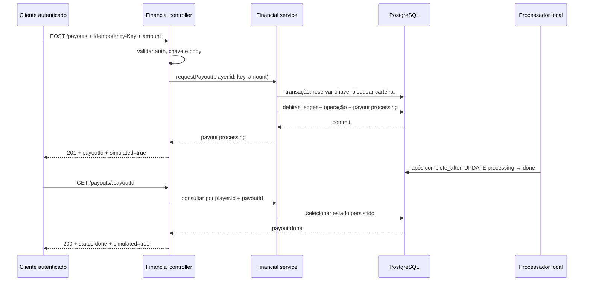

# Design: Payout local de carteira

> Requirements: @requirements.md
> Status: Approved
> Roadmap: F05 in `.ai/sdd/PLAN.md`

## 1. Resumo

Implementar o payout como uma extensão direta do módulo `financial`. A API autenticada aceita um valor em centavos e uma chave `Idempotency-Key`; o serviço debita a carteira e grava o lançamento do ledger, a operação financeira e o estado `processing` do payout na mesma transação PostgreSQL. Um processador local atualiza o estado para `done` após cinco segundos. A data de conclusão fica persistida para retomar o fluxo após reinício.

O módulo expõe `POST /payouts`, `GET /payouts/:payoutId` e `GET /payouts`. As rotas só são registradas quando `PAYOUT_MOCK_ENABLED=true` e `APP_ENV=local`. Nenhum provedor de pagamentos participa do fluxo.

## 2. Mapeamento dos requisitos

| Requisito | Cobertura no design |
|---|---|
| FR-001 | Seções 4, 6 e 7: rotas de jogador chamam `auth.requireUser`; escopo sempre deriva da identidade autenticada. |
| FR-002 | Seções 5, 9 e TD-001: débito condicional e registros financeiro, ledger e payout confirmados na mesma transação. |
| FR-003 | Seções 5, 6 e TD-001/TD-004: `Idempotency-Key` e `businessKey` por jogador; retry recupera o mesmo payout; conflito retorna `409`. |
| FR-004 | Seções 5, 8, 9 e TD-002: atraso persistido, estado monotônico e processador local recuperável. |
| FR-005 | Seções 6, 7 e 9: consulta individual inclui a identidade do jogador no filtro e responde `404` para ausente ou alheio. |
| FR-006 | Seções 5, 6 e TD-004: consulta própria ordenada e paginada por cursor estável. |
| FR-007 | Seções 6, 11, 12 e TD-003: rota opt-in, protegida por configuração local fail-closed. |
| FR-008 | Seções 5, 6 e 9: sucesso somente após commit; erros de persistência retornam `503`; recusas não criam payout. |
| NFR-001 | Seções 5, 9 e TD-001: centavos seguros, lock/condição de saldo e reuso do caminho transacional de débito. |
| NFR-002 | Seções 5, 8, 9 e TD-002: data de conclusão persistida, retomada no startup e sem novo lançamento financeiro ao concluir. |
| NFR-003 | Seções 6 e 7: autenticação, ownership, validação estrita e logs sem dados financeiros sensíveis. |
| NFR-004 | Seções 6, 11, 12 e TD-003: `simulated: true`, nenhum provedor e rota desabilitada fora do ambiente local explicitamente habilitado. |

## 3. Abordagem técnica

1. Estender `financial.service.ts` com operações de criar, consultar e listar payouts. O pedido usa o mesmo caminho interno de débito que valida valor, serializa concorrência por carteira, persiste idempotência e grava o ledger.
2. Na mesma transação, vincular o débito aplicado a uma linha `payouts` em `processing`. A referência pública do payout é o ID da operação financeira.
3. Persistir `complete_after = requested_at + 5s`. Um processador local varre payouts vencidos a cada 500 ms e muda somente `processing` para `done`.
4. Ao iniciar o módulo, executar uma varredura imediata e iniciar o processador. Assim, itens vencidos durante uma queda são concluídos após reinício.
5. Adicionar as três rotas autenticadas no controller existente. O controller valida transporte e identidade; não implementa regras de saldo ou transições.
6. Habilitar as rotas com `PAYOUT_MOCK_ENABLED`, seguindo o padrão do top-up local. Configuração inválida fora de `APP_ENV=local` impede o operador de iniciar.

## 4. Módulos e arquivos

```text
operator/src/modules/financial/
  financial.controller.ts   # POST /payouts e GET status/histórico
  financial.module.ts       # auth, configuração local e hooks de ciclo de vida
  financial.schema.ts       # tabela payouts e origem payout no ledger/operação
  financial.service.ts      # débito atômico, idempotência, consultas e conclusão
  financial.controller.test.ts
  financial.service.test.ts
operator/src/config.ts      # flag PAYOUT_MOCK_ENABLED, default false e regra local
operator/src/db.ts          # validar presença de payouts em checkSchema()
operator/drizzle/
  0003_local_payouts.sql    # migração aditiva e snapshot/journal Drizzle
docker-compose.yml          # habilitar o mock somente no serviço local operator
operator/src/server.financial.integration.test.ts
```

`operator/src/server.ts` continua como composition root sem lógica de payout. Não criar módulo financeiro paralelo, módulo genérico de pagamentos, fila externa ou camada adicional de casos de uso.

## 5. Dados e estado

### `payouts`

Nova tabela de estado do mock. A linha só existe para um débito aplicado.

| Campo | Regra / uso |
|---|---|
| `id` | UUID PK e FK para `financial_operations.id`; também é o `payoutId` público. |
| `status` | `processing` ou `done`; check constraint restringe os valores. |
| `complete_after` | `timestamptz NOT NULL`; instante UTC persistido em que o mock pode concluir. |
| `completed_at` | `timestamptz NULL`; nulo em `processing`, preenchido na transição para `done`. |

Constraint de consistência: `processing` exige `completed_at IS NULL`; `done` exige `completed_at IS NOT NULL`. Um índice parcial em `(complete_after, id)` para `status='processing'` atende a varredura de vencidos. Horário de solicitação e valor são lidos da operação financeira associada; moeda continua sendo a constante `USD`, sem campos duplicados.

### Operação e ledger existentes

- A operação do payout usa `kind='debit'`, `source='payout'`, `engine_tx_id=NULL`, `business_key='payout:<playerId>:<Idempotency-Key>'` e o resultado existente `applied` ou `insufficient_funds`.
- A entrada correspondente usa `direction='debit'` e `source='payout'`. Ela aparece também em `GET /wallet/transactions` e continua append-only.
- A migração estende os check constraints de `financial_operations.source`, `financial_operations.kind_source` e `wallet_ledger_entries.source` para permitir `payout` somente como origem de débito.
- Chaves de webhook Crashsim continuam em `engine_tx_id`; payout não reutiliza esse namespace. `business_key` já é único e distingue payout de `top-up:` e `cashout:`.
- `financial_operations` mantém valor, jogador, data, resultado e saldo de resposta. `payouts` guarda somente estado e agenda; não replica valor ou proprietário.

### Transação para solicitar

O serviço valida um inteiro JSON seguro positivo e executa uma transação PostgreSQL:

1. Bloquear a carteira do jogador autenticado com `FOR UPDATE`.
2. Reservar a operação usando `business_key`. Se a chave já existir, bloquear e comparar jogador, tipo, origem e valor.
3. Para replay aplicado, carregar a linha `payouts` vinculada e devolvê-la sem mutação. Para replay de saldo insuficiente, devolver a mesma recusa sem criar payout.
4. Para uma nova chave, verificar o saldo e fazer o débito condicional, usando o mesmo controle de saldo e a mesma criação de ledger do serviço financeiro atual.
5. Se houver saldo, gravar `financial_operations`, `wallet_ledger_entries` e `payouts(status='processing', complete_after=now()+5s)` antes do commit.
6. Se não houver saldo, persistir `outcome='insufficient_funds'` para estabilidade da chave, sem linha de ledger nem payout. O jogador pode tentar novamente após funding usando uma nova chave.

Se qualquer escrita do pedido aceito falhar, a transação inteira é revertida. A resposta de sucesso só é enviada após o commit.

### Conclusão do mock

O processador seleciona operações `processing` cujo `complete_after <= now()` e atualiza cada uma com condição atômica `status='processing'`. A mesma instrução preenche `status='done'` e `completed_at`. Não toca em carteira, ledger ou operação financeira. Se outro processador já concluiu a linha, a condição não encontra registro e não gera uma segunda transição.

## 6. API e integrações

Todas as rotas usam o escopo de jogador do controller financial, `Cache-Control: no-store`, `auth.requireUser` e validação Valibot estrita. Nenhuma rota aceita `playerId` do cliente.

| Método e rota | Entrada | Sucesso |
|---|---|---|
| `POST /payouts` | Header `Idempotency-Key` UUID; body `{ "amount": 500 }`, inteiro positivo seguro em centavos USD. | `201` com `{ id, amountCents, currency: "USD", status: "processing", requestedAt, completedAt: null, simulated: true }`. Replay retorna o mesmo ID e estado atual sem novo débito. |
| `GET /payouts/:payoutId` | `payoutId` UUID da resposta de criação. | `200` com o mesmo DTO, estado atual e `simulated: true`. |
| `GET /payouts?limit=50&cursor=...` | `limit` opcional 1–100; cursor opaco opcional. | `200 { items, nextCursor }`, somente solicitações próprias, mais novas primeiro. |

O histórico usa paginação keyset `(financial_operations.created_at, financial_operations.id)`, mesmo padrão de `GET /wallet/transactions`; limite padrão 50 e máximo 100. Cada item contém `id`, `amountCents`, `currency`, `status`, `requestedAt`, `completedAt` e `simulated`. Valores são serializados como número somente dentro de `Number.MAX_SAFE_INTEGER`.

| Caso | Resposta |
|---|---|
| Sessão ausente ou inválida | `401 { error: { code: "UNAUTHENTICATED", message } }`. |
| Body, query, UUID, valor ou chave inválidos | `400` no envelope `{ error: { code, message } }`; sem mutação. |
| Saldo insuficiente | `402 INSUFFICIENT_FUNDS`; mesma chave mantém a recusa, nova tentativa após funding exige nova chave. |
| Mesma chave com valor conflitante | `409 IDEMPOTENCY_CONFLICT`; sem nova mutação. |
| Payout inexistente ou pertencente a outro jogador | `404 PAYOUT_NOT_FOUND`; resposta uniforme. |
| Banco indisponível antes do commit | `503 SERVICE_UNAVAILABLE`; não informar aceitação. Retry usa a mesma chave. |
| Mock não habilitado | Rotas não registradas (`404`), incluindo status e histórico. |

## 7. Segurança, autorização e privacidade

- Solicitação, consulta e histórico exigem `auth.requireUser`; somente `player.id` define o proprietário.
- A consulta individual filtra por `payoutId` e `financial_operations.player_id` na mesma consulta. Ausente e pertencente a terceiro recebem o mesmo `404`.
- A chave de idempotência é UUID, escopada à identidade autenticada no `business_key`, e nunca substitui autenticação.
- Body e query rejeitam propriedades desconhecidas. `amount` precisa ser inteiro positivo e `Number.isSafeInteger` antes de abrir a transação.
- `PAYOUT_MOCK_ENABLED` defaulta a `false`; configuração verdadeira exige `APP_ENV=local`. Não aceitar `development`, `test` ou `production` como equivalentes a `local`.
- Logs usam eventos estruturados com `requestId`, `payoutId` e categoria de resultado. Não incluir token, header Authorization, chave de idempotência integral, valor, saldo ou `playerId`.
- `simulated: true` acompanha respostas para impedir que o cliente confunda `done` com uma transferência real.

## 8. Fluxos



## 9. Falhas e concorrência

| Cenário | Comportamento esperado |
|---|---|
| Mesmo jogador e chave/valor repetidos, simultaneamente | `business_key` e lock transacional selecionam um débito e um payout; chamadas seguintes retornam o mesmo payout. |
| Mesma chave repetida com valor diferente | Comparação do conteúdo salvo resulta em `409`, sem alteração de saldo. |
| Chave aplicada e resposta HTTP perdida | Retry retorna o `payoutId` existente; não cria segundo lançamento. |
| Chave recusada por saldo insuficiente e depois top-up | Replay continua `402`; nova tentativa exige nova chave, igual ao contrato atual de débito. |
| Débito de aposta concorre com payout | Ambas as operações usam lock/condição do saldo; no máximo as operações cobertas são aplicadas e saldo nunca fica negativo. |
| Falha ao inserir payout depois do débito SQL | A transação reverte também operação, saldo e ledger; não fica débito sem payout recuperável. |
| Operador cai após commit antes de iniciar o timer | `complete_after` já está persistido; a varredura no próximo startup conclui o item vencido. |
| Banco indisponível durante a varredura | Registrar falha sem dados sensíveis; a próxima varredura tenta novamente. Payout segue `processing` até confirmação persistida. |
| Duas varreduras concorrem | `UPDATE ... WHERE status='processing' AND complete_after <= now()` permite uma transição; nenhuma cria movimento financeiro. |
| ID de outro jogador consultado | Retornar `404` uniforme; não retornar valor, status ou existência. |
| Valor zero, negativo, fracionário, não seguro ou acima do saldo | Rejeitar sem payout/debito, exceto uma recusa de saldo validada que permanece idempotente pela chave. |
| `APP_ENV` diferente de `local`, flag true | Configuração inválida bloqueia startup; com flag false, rotas não são registradas. |

## 10. UX e acessibilidade

Esta spec adiciona APIs, não interface visual. O contrato fornece `processing`, `done`, timestamps e `simulated: true` para a futura integração F06. A interface deve consultar o status por REST enquanto `processing`; não há push via SSE nesta feature. O status e o histórico usam respostas `no-store` para evitar cache de estados financeiros.

## 11. Observabilidade e operação

- Emitir `financial.payout.requested`, `financial.payout.declined`, `financial.payout.replayed`, `financial.payout.conflict` e `financial.payout.completed`, sempre com `requestId` quando originado por rota; conclusão pode usar apenas `payoutId`.
- Registrar motivos como `invalid_amount`, `insufficient_funds`, `idempotency_conflict` e `storage_unavailable`; não registrar body, saldo, valor, jogador ou chave de idempotência.
- A varredura usa um único timer por instância, evita execuções sobrepostas e captura falhas para continuar tentando no próximo ciclo.
- O ciclo de vida inicia em `onReady` e limpa o timer em `onClose`. O mock roda somente quando explicitamente habilitado em local.
- Não adicionar métrica, fila ou dependência externa nesta entrega; logs estruturados e estado persistido são suficientes para desenvolvimento local.

## 12. Migração e rollout

1. Gerar a migration Drizzle `0003_local_payouts` para `payouts`, índices e constraints de origem `payout`.
2. Atualizar `financial.schema.ts`, snapshots/journal e `db.checkSchema()` para validar a nova tabela.
3. Configurar `PAYOUT_MOCK_ENABLED=true` somente no serviço `operator` do `docker-compose.yml` local; valor omitido equivale a `false`.
4. A validação de configuração falha se a flag estiver ligada fora de `APP_ENV=local`.
5. Aplicar migrations antes de iniciar a versão que habilita o endpoint. Alterações são aditivas e não reescrevem carteiras ou lançamentos anteriores.
6. Para desabilitar, desligar a flag: rotas deixam de ser registradas. Payouts já persistidos permanecem no banco e podem ser retomados quando o mock for reabilitado localmente.

## 13. Decisões técnicas

### TD-001: Operação, ledger e payout em uma única transação

- **Decisão:** adicionar um caminho `requestPayout` ao serviço `financial` que reutiliza o núcleo transacional do débito, mas usa `source='payout'` e `business_key`; inserir payout, operação, saldo e ledger no mesmo commit.
- **Por quê:** chamar o `debit()` atual e inserir payout depois em outra transação pode deixar um débito sem estado consultável. O método atual também é específico ao `engine_tx_id` e à origem `engine`.
- **Trade-off:** o núcleo existente de operação financeira precisa aceitar uma origem de débito adicional e um efeito associado ao commit.
- **Alternativas consideradas:** chamar `debit()` e gravar payout separadamente, com janela de inconsistência; duplicar código de débito, com risco de divergência na regra de concorrência.

### TD-002: Estado durável com processador local recuperável

- **Decisão:** persistir `complete_after`, executar varredura imediata ao iniciar e repetir a cada 500 ms; atraso de simulação fixo de 5 segundos. A atualização condicional promove apenas `processing` para `done`.
- **Por quê:** mantém a duração visível no mock e permite terminar solicitações após reinício sem fila ou serviço externo.
- **Trade-off:** a conclusão ocorre até 500 ms depois do prazo salvo; há uma consulta de vencidos por intervalo enquanto o mock está habilitado.
- **Alternativas consideradas:** `setTimeout` exclusivamente em memória perde conclusão ao reiniciar; scheduler/queue externo é desnecessário para o operador local de uma instância.

### TD-003: Habilitação opt-in somente local

- **Decisão:** adicionar `PAYOUT_MOCK_ENABLED`, default `false`; se `true`, exigir `APP_ENV=local`; configurar explicitamente no Compose local.
- **Por quê:** segue o padrão fail-closed já usado por `WALLET_TEST_TOPUP_ENABLED` e evita disponibilizar um endpoint de payout fora do ambiente de desenvolvimento.
- **Trade-off:** um ambiente local novo precisa habilitar a variável para usar as rotas.
- **Alternativas consideradas:** habilitar só por `APP_ENV=local`, sem opt-in; verificar apenas que o ambiente não seja production, aceitando por engano `test` ou outro ambiente futuro.

### TD-004: API própria com chave do operador

- **Decisão:** usar `POST /payouts`, `GET /payouts/:payoutId` e `GET /payouts`, com `Idempotency-Key` UUID obrigatório no POST. Replays aplicados retornam o mesmo payout e status atual; conflito de conteúdo retorna `409`.
- **Por quê:** mantém payout distinto de cashout de aposta e segue o padrão de idempotência das rotas autenticadas existentes.
- **Trade-off:** o cliente precisa guardar/reutilizar a chave até saber o resultado do POST.
- **Alternativas consideradas:** `POST /wallet/withdrawals` conflui com rotas de saldo e top-up; chave no body permite duplicar identidade do comando no payload.

### TD-005: Cursor keyset compatível com o histórico financeiro

- **Decisão:** ordenar por `requestedAt DESC, id DESC`, com cursor opaco base64url, limite padrão 50 e máximo 100.
- **Por quê:** segue a paginação existente de `GET /wallet/transactions` e evita deslocamentos/duplicatas causados por novos lançamentos durante navegação.
- **Trade-off:** cliente não solicita página numérica arbitrária; precisa carregar o cursor retornado.
- **Alternativas consideradas:** offset pagination perde estabilidade com novas solicitações; retornar todo o histórico não tem limite de memória ou payload.

## 14. Riscos

| Risco | Impacto | Mitigação |
|---|---|---|
| Migração não estende corretamente os constraints para `source='payout'` | Alto | Teste de migration e integração cobrindo operação e ledger source payout; checks permitem apenas a combinação debit/payout. |
| Um defeito no efeito idempotente permite dois débitos | Alto | Unique `business_key`, lock da carteira, replay de conteúdo validado e testes concorrentes com mesma e diferentes chaves. |
| Conclusão local fica atrasada por queda ou falha de banco | Médio | `complete_after` persistido, retomada no startup, atualização condicional e retry do próximo ciclo. |
| Variável de mock é ativada fora de local | Alto | Default false e falha de configuração se `PAYOUT_MOCK_ENABLED=true` fora de `APP_ENV=local`. |
| Cliente interpreta `done` como transferência real | Alto | Campo obrigatório `simulated: true`, sem destination/rail, e documentação explícita local. |

## 15. Estratégia de verificação

Planejada para a etapa de implementação; nenhum teste foi executado para criar este design.

- **Unitária/service:** valor seguro, retry de chave aplicada, conflito de valor, recusa persistida, novo key após recarga, leitura por dono, cursor e transição condicional.
- **PostgreSQL/concorrência:** migração 0002 → 0003; payout e debit de aposta simultâneos; duas requisições iguais simultâneas; garantia de um débito, uma entrada de ledger e um payout.
- **Controller/API:** autenticação obrigatória; rejeição de `playerId` extra; header/body estritos; status 401/400/402/404/409/503; isolamento entre dois jogadores; rotas ausentes com mock desligado.
- **Processador:** payout permanece `processing` antes de `complete_after`; torna-se `done` uma única vez depois; reinício antes/depois do prazo; falha temporária do banco seguida de recuperação.
- **Integração composta:** registrar jogador, top-up local, solicitar payout, confirmar saldo/ledger, consultar status e histórico; conferir que uma repetição não duplica a operação.
- **Comandos previstos após implementação:** `cd operator && bun run typecheck && bun test`; migrar um PostgreSQL dedicado para testes. Nenhum comando de teste foi executado nesta etapa.

## 16. FAQ de implementação

**O payout deve chamar o `debit()` público que processa webhook da engine?** Não. Deve reutilizar o núcleo transacional do serviço financeiro com origem `payout` e `business_key`, sem ocupar o namespace `engine_tx_id` nem rotular saque como débito de aposta.

**Quando exatamente o saldo diminui?** No mesmo commit que registra o payout em `processing`; o valor não fica disponível durante os cinco segundos.

**O que ocorre se o mesmo `Idempotency-Key` for repetido após o payout virar `done`?** A resposta recupera o mesmo `payoutId` com status atual `done`; saldo, ledger e payout não são escritos de novo.

**Um `402` pode ser repetido depois de adicionar saldo usando a mesma chave?** Não. A recusa fica estável para a chave original; usar uma nova chave cria uma tentativa nova.

**O que acontece se o operador cair durante o processamento?** O payout permanece persistido como `processing`; no startup o processador verifica `complete_after` e marca os vencidos como `done`.

**O que `done` confirma?** Somente o fim da simulação local. Não houve pagamento, transferência ou confirmação de destino externo.

**O cliente recebe evento SSE quando o status muda?** Não nesta feature. Ele consulta `GET /payouts/:payoutId`; F06 define a experiência e frequência de atualização.
