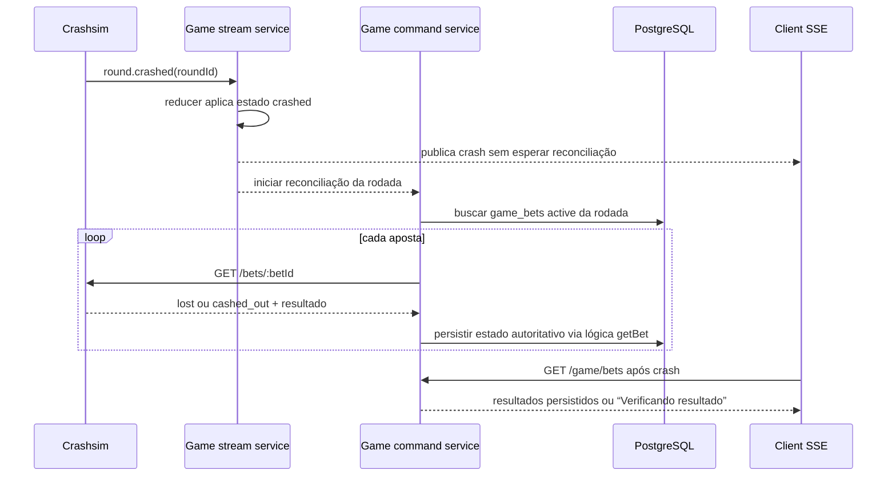
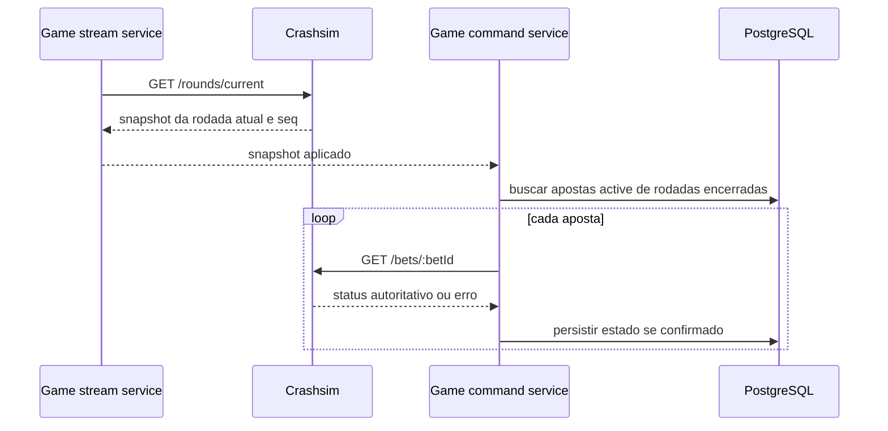

# Design: Reconciliação das apostas ao fim da rodada

> Requirements: @requirements.md
> Status: Approved
> Stack: Bun, TypeScript, Fastify, PostgreSQL, Drizzle, Valibot, React e integração direta com Crashsim

## 1. Resumo

O módulo `game` vai reconciliar as apostas persistidas quando aplicar `round.crashed` e depois de cada snapshot bem-sucedido da engine. A reconciliação consulta o estado autoritativo de cada aposta ainda `active` através do `CrashsimHttpClient` e reaproveita `GameCommandService.getBet`, que já valida propriedade/identidade da aposta, persiste o status e consulta separadamente a situação do crédito.

O snapshot também serve como recuperação: quando ele já mostra outra rodada, apostas locais `active` cuja `roundId` difere da rodada atual são candidatas a reconciliação. O browser identifica uma aposta de rodada encerrada ainda `active` como “Verificando resultado” e pode consultar `GET /game/bets/:betId`. Não será criado worker, replay histórico, endpoint novo ou adapter genérico.

## 2. Mapeamento de requisitos

| Requisito | Cobertura do design |
|-----------|---------------------|
| FR-001 | §§ 3, 4, 8 e TD-001: evento de crash dispara consulta autoritativa para as apostas abertas daquela rodada |
| FR-002 | §§ 3, 5, 6 e 9: cashout, payout e settlement continuam usando os fluxos existentes; crash não cria crédito |
| FR-003 | §§ 3, 4, 8 e TD-002: snapshot de outra rodada dispara catch-up das apostas locais abertas de rodadas encerradas |
| FR-004 | §§ 5, 8, 10 e TD-003: a UI deriva “Verificando resultado” quando conhece o fim da rodada, sem inventar estado final |
| FR-005 | §§ 3, 5, 9 e TD-001: GET por aposta, persistência condicional e chamadas repetidas não reabrem estado terminal nem duplicam dinheiro |
| NFR-001 | §§ 3, 5, 6 e 9: engine segue como autoridade; status do jogo e liquidação financeira ficam separados |
| NFR-002 | §§ 3, 4, 8 e 11: reconciliação roda no crash e em snapshot; falhas deixam o resultado pendente |

## 3. Abordagem técnica

Adicionar ao `GameCommandService` uma operação interna para reconciliar apostas abertas cujas rodadas já terminaram. Ela busca as linhas `game_bets` com `engineStatus = 'active'`, seleciona as da rodada crashada ou, após snapshot, as que não pertencem à rodada atual e consulta cada uma pelo método existente `getBet({ playerId, betId })`.

`getBet` já chama `engine.getBet`, valida `betId`, `playerId`, `roundId` e valor, atualiza `game_bets` com condição de estado e determina `settlementStatus` por meio do contrato público do módulo `financial`. Reaproveitar esse caminho evita duplicar validação, precisão de payout ou integração financeira. A reconciliação não chama `POST /cashout`, não concede crédito e não altera comandos de aposta.

Cada aposta é tratada isoladamente. Um erro ou timeout em uma consulta deixa aquela linha no último estado persistido, registra pendência e não impede a reconciliação das outras apostas. Uma nova sincronização da stream ou um `GET /game/bets/:betId` tenta novamente. O caminho é idempotente: atualizações só podem avançar de `active` para o estado autoritativo, e estados terminais não voltam a `active`.

O callback de reconciliação é disparado sem aguardar chamadas HTTP de aposta dentro do processamento/publicação do evento de stream. Assim, o `round.crashed` e o novo snapshot chegam aos clientes sem esperar uma lista inteira de consultas externas.

## 4. Componentes e arquivos

```text
operator/src/modules/game/
  game.module.ts                    # liga callbacks de stream ao serviço de comandos
  game-stream.service.ts             # chama reconciliação após crash aplicado e snapshot sincronizado
  game-command.service.ts            # busca apostas abertas e reaproveita getBet para atualizar estado
  game.schema.ts                     # índice parcial para localizar apostas active
  game-command.service.test.ts       # resultado lost/cashed_out, falhas e idempotência
  game-stream.service.test.ts        # gatilhos de crash e snapshot/catch-up
  game.module.test.ts                # composição do callback
  drizzle/0004_*.sql                 # migração aditiva do índice

client/src/
  game-screen.tsx                    # label pending e verificação de aposta encerrada
  bet-status.ts                      # regra pura para projetar estado/label da aposta
  bet-status.test.ts                 # rodada ativa, crashada e snapshot em rodada seguinte
```

`game.module.ts` continua como composition root do módulo `game`. Ele conecta callbacks do serviço de stream a uma referência criada do serviço de comandos; a stream só inicia depois que ambos estiverem montados. Não se adicionam um event bus paralelo, um módulo novo, use cases por evento nem tipos para outros jogos.

## 5. Dados e estado

Não é necessário criar estado persistido `reconciling`. O status durável da aposta continua sendo `active`, `lost` ou `cashed_out`, e a liquidação continua em `settlementStatus`. Enquanto a engine não confirmar o resultado, a linha permanece sem resultado final; a UI deriva “Verificando resultado” do status local `active` combinado com a fase/rodada conhecida pelo snapshot.

Adicionar um índice parcial em `game_bets(round_id) WHERE engine_status = 'active'`. Ele acelera a consulta das apostas abertas de uma rodada e permite encontrar, no snapshot de recuperação, o conjunto limitado às apostas ainda não resolvidas. A migração é aditiva e não altera linhas existentes.

O resultado `active` devolvido pela engine para uma rodada já conhecida como encerrada não é convertido em `lost` por inferência. A aposta permanece pendente e visível como em verificação. `404 bet_not_found`, timeout, falha de rede ou banco também não provam perda: a engine pode ter reiniciado e perdido seu mapa em memória, conforme a limitação já documentada em F04.

## 6. Contrato de integração

Não há mudança de rota ou payload público.

| Origem | Sinal | Ação |
|--------|-------|------|
| Stream Crashsim | `round.crashed` aplicado pelo reducer | reconciliar apostas `active` do mesmo `roundId` |
| Stream Crashsim | snapshot sincronizado com rodada `crashed` | reconciliar apostas `active` da rodada e de rodadas anteriores |
| Stream Crashsim | snapshot sincronizado com rodada `betting` ou `running` | reconciliar apostas `active` com `roundId` diferente do snapshot atual |
| Browser | `GET /game/bets` | ler o estado persistido depois do fluxo de reconciliação |
| Browser | `GET /game/bets/:betId` | consultar a engine e atualizar uma aposta própria, inclusive após falha de uma reconciliação automática |

O evento `bet.cashed_out` contém informação privada de jogador/aposta e não é encaminhado aos browsers por esta mudança. A lista de tipos aceitos pelo stream permanece com os eventos públicos de rodada; um gap de sequência continua resolvido pelo snapshot atual, que também aciona o catch-up de apostas.

## 7. Segurança e autorização

- A reconciliação global usa `playerId`, `betId` e `roundId` já persistidos pelo operador; o browser não escolhe identidades para o fluxo interno.
- As consultas upstream passam pelo `CrashsimHttpClient` server-side e usam a chave privada existente.
- O endpoint individual continua autenticando o jogador e verificando a propriedade antes da consulta à engine.
- Não transmitir o `bet.cashed_out` privado na SSE pública; emitir apenas os estados de rodada já permitidos pelo contrato atual.
- Não registrar valores de aposta/payout, chave da engine ou dados de autenticação nos logs da reconciliação.

## 8. Fluxos

### Crash recebido ao vivo



### Reconexão com a rodada já avançada



## 9. Consistência, falhas e concorrência

| Caso | Comportamento esperado |
|------|------------------------|
| Bet já `cashed_out` antes do crash | permanece `cashed_out`; payout e estado do crédito são preservados/consultados via financial |
| Cashout desconhecido ou ainda sendo persistido quando chega o crash | reaproveitar a resolução existente de comando/cashout em `getBet`; não marcar `lost` por simples regra de rodada |
| Crash duplicado ou reconciliação simultânea com snapshot | chamadas podem se sobrepor, mas persistência condicional e estado terminal tornam o resultado idempotente |
| Evento fora de ordem / gap por evento não reconhecido | reducer mantém a regra monotônica; snapshot sincroniza estado e inicia reconciliação de todas as apostas de rodadas encerradas |
| Operador desconectado durante o crash e engine já em nova rodada | comparar `roundId` opaco, sem ordenar IDs; resolver bets de IDs diferentes do snapshot atual |
| Engine retorna `active` para rodada que já terminou | não inferir `lost`; manter pendente, expor verificação e permitir novo GET |
| Engine reiniciou e retorna 404 para aposta antiga | manter último estado, não inventar perda; a limitação de retenção em memória permanece explícita |
| Engine, database ou financial indisponível para uma aposta | isolar a falha, registrar referência segura e continuar as outras; próxima sincronização/consulta pode tentar novamente |
| Rodada atual ainda está `betting` ou `running` | nunca reconciliar bets `active` dessa rodada como encerradas |

## 10. UX

- A tela já recarrega bets quando observa `crashed`; também deve recarregar quando um snapshot conectado troca de `roundId`, cobrindo a recuperação sem evento histórico.
- Se a linha da aposta estiver `active`, mas a rodada conhecida estiver `crashed` ou já não for a rodada do snapshot, mostrar “Verificando resultado” em vez de “Em andamento”.
- Nessa linha, oferecer “Verificar resultado”, que chama o GET individual existente. Em sucesso, substituir a linha pela resposta nova; em falha, manter “Verificando resultado” e permitir nova consulta manual.
- Não declarar perda nem sucesso enquanto o resultado for incerto. A faixa global de conexão continua indicando quando o snapshot está stale.
- `cashed_out` e `settlementStatus` continuam apresentados separadamente; texto e estado não dependem apenas da cor.

## 11. Observabilidade e operação

Usar o logger existente com eventos estruturados por `roundId`, `betId`, resultado e motivo categorizado: reconciliação iniciada/concluída, estado atualizado e resultado pendente. Não logar playerId, valores, chave privada ou body bruto da engine. Uma falha individual não deve cancelar o restante do lote; falha na consulta à base gera log do lote e será tentada novamente na próxima sincronização ou consulta explícita.

## 12. Migração e rollout

Adicionar uma migração Drizzle somente para o índice parcial de apostas `active`. Não alterar enums/status, dados existentes, contratos REST nem schema do engine. A funcionalidade passa a valer quando a versão do operador com a migração aplicada inicia o stream.

## 13. Decisões técnicas

### TD-001: Consultar cada aposta na engine, não inferir pelo crash

- **Decisão:** usar `GET /bets/:betId` para confirmar bets `active` encontradas para uma rodada fechada; persistir pelo fluxo existente de `getBet`.
- **Motivo:** `round.crashed` informa o fim da rodada, mas não contém betIds nem distingue um cashout confirmado de uma aposta perdida. Um cashout pode estar concorrente com o processamento do evento.
- **Trade-off:** cria chamadas HTTP por aposta e a conclusão pode levar mais que uma atualização SQL única.
- **Alternativas consideradas:** marcar diretamente todo status local `active` como `lost` (mais simples, mas pode sobrescrever um cashout concorrente); adicionar uma rota de lote à engine (exige alterar o engine, fora do escopo).

### TD-002: Acionar pelo crash e pelo snapshot, sem replay ou worker

- **Decisão:** a stream informa o serviço de comandos após aplicar o crash e após cada snapshot bem-sucedido; a operação executa em background e o browser tem GET individual como recuperação sob demanda.
- **Motivo:** atende tanto ao caminho ao vivo quanto ao gap inevitável do stream sem adicionar worker/infraestrutura para o MVP.
- **Trade-off:** se uma chamada individual falhar e não houver outra sincronização ou consulta, o resultado permanece em verificação até nova tentativa.
- **Alternativas consideradas:** worker periódico (mais recuperação autônoma, com fila/observabilidade extra); replay da engine (não existe no contrato atual).

### TD-003: Derivar estado visual de verificação sem novo status de banco

- **Decisão:** manter `engineStatus` como contrato persistido e derivar “Verificando resultado” quando o snapshot prova que a rodada encerrou mas o banco ainda guarda `active`.
- **Motivo:** evita um novo estado persistido que duplicaria informação da rodada/conexão.
- **Trade-off:** o browser precisa do snapshot para distinguir aposta corrente de antiga; enquanto não houver snapshot, já mostra o estado global de sincronização.
- **Alternativas consideradas:** incluir um status `reconciling` em `game_bets` e novos estados na API (mais explícito, porém redundante e com migração maior).

### TD-004: Index parcial para apostas abertas

- **Decisão:** criar índice parcial `game_bets(round_id) WHERE engine_status = 'active'`.
- **Motivo:** a reconciliação busca apenas apostas abertas por rodada, e a lista atual de índices é orientada a jogador.
- **Trade-off:** pequena escrita e espaço extras para manter o índice; reduz a leitura dos registros terminais em cada crash/snapshot.
- **Alternativas consideradas:** varrer a tabela inteira (aceitável apenas enquanto os dados forem poucos).

## 14. Riscos

| Risco | Impacto | Mitigação |
|------|--------|-----------|
| Engine GET indisponível durante crash | Médio | preservar o estado anterior como pendente, não inferir resultado, registrar falha e permitir nova tentativa |
| Lote grande atrasa a reconciliação | Médio | não bloquear SSE; processar em concorrência limitada e por aposta |
| Snapshot durante crash não inclui bets | Alto | recuperar candidatos pela tabela local e validar um a um por `GET /bets/:id` |
| UI exibe “Em andamento” usando estado local velho | Médio | derivar “Verificando resultado” da fase/roundId e oferecer consulta sob demanda |
| Engine reiniciada apagou bets em memória | Médio | não inventar estado; manter verificação pendente, limitação documentada em F04 |

## 15. Estratégia de verificação

- **Unitário/serviço:** bet `active` reconcilia para `lost` ou `cashed_out`; payout/settlement é preservado; falha de uma bet não impede outras; retries não reabrem terminal.
- **Stream:** crash aplicado dispara uma vez; snapshot de rodada crashed ou de uma rodada nova dispara catch-up; sequence gap leva ao snapshot; snapshot da rodada corrente running/betting não encerra bets dessa mesma rodada.
- **API/integração:** `GET /game/bets` reflete o estado persistido e `GET /game/bets/:betId` continua autenticado, próprio e reconciliador.
- **Client:** testes da regra de projeção cobrem status ativo em rodada corrente versus encerrada; verificação manual confirma label e ação de retry.
- **Comandos:** `cd operator && bun run typecheck`; `cd operator && bun test` com `TEST_DATABASE_URL` dedicado; `cd client && bun run typecheck`; `cd client && bun test`; `cd client && bun run build`.
- **E2E manual:** usar Crashsim, fazer aposta, observar uma rodada com loss e outra com auto-cashout, testar `DROP_WS_EVERY`/`REORDER`, recuperar snapshot em rodada seguinte e confirmar no GET/listagem.

## 16. FAQ de implementação

**O evento `round.crashed` já contém a lista de apostas?** Não. Ele identifica a rodada e o crash; a engine continua sendo consultada por betId para cada resultado.

**Pode atualizar todas as apostas active para lost direto no banco?** Não. Isso pode classificar incorretamente cashout concorrente. Use o resultado autoritativo de cada `GET /bets/:id`.

**E se a engine retornar 404 porque reiniciou?** Preserve o último estado e deixe a aposta em verificação. Um 404 após reinício não distingue aposta perdida de cashout antigo.

**A reconciliação deve bloquear a publicação do crash no SSE?** Não. A tela recebe o crash imediatamente e apresenta bets antigas como em verificação enquanto as consultas terminam.

**O crash cria um crédito?** Não. A liquidação do cashout continua pertencendo ao fluxo financeiro existente e a reconciliação apenas consulta/persiste o estado confirmado.
