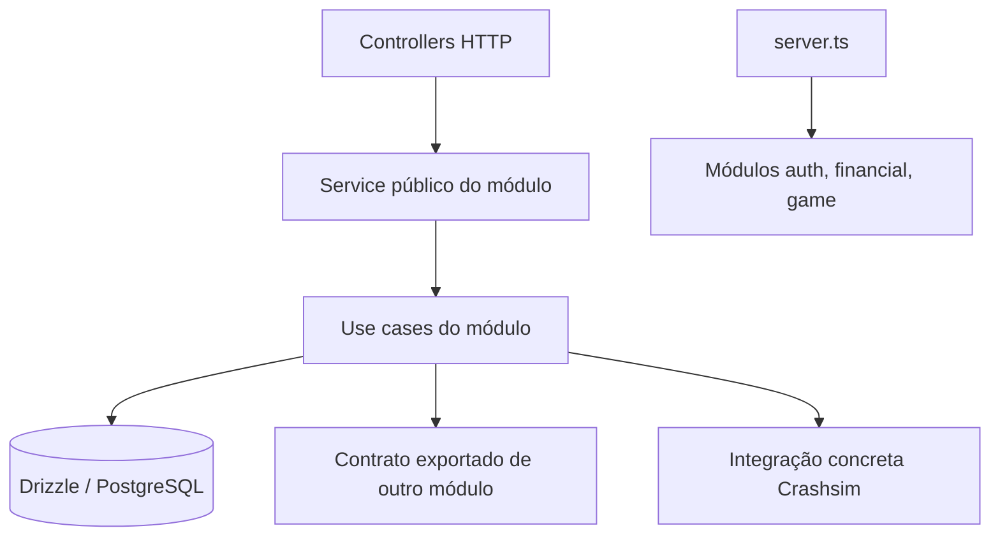
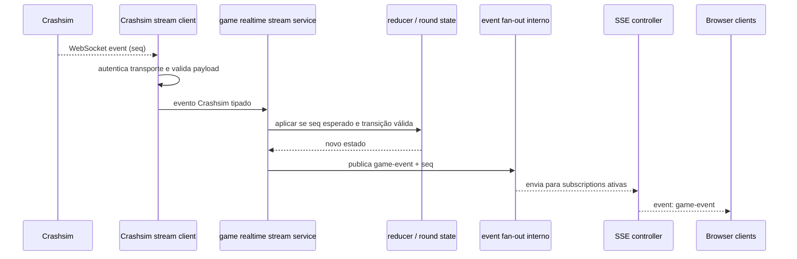
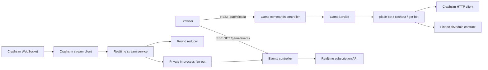

# Design: Refatoração arquitetural do Operator

> Requirements: @requirements.md
> Status: Approved
> Stack: Bun, TypeScript, Fastify, PostgreSQL, Drizzle, Valibot, React e integração concreta com Crashsim

## 1. Resumo

Organizar `auth`, `financial` e `game` com uma pasta `usecases/` por módulo e manter um único service público como fachada de cada módulo. Cada caso de uso implementa um fluxo real; o service monta e expõe esses fluxos sem reimplementar suas regras. Controllers cuidam de HTTP e chamam a fachada.

No `game`, separar comandos de negócio do ciclo realtime. Mover o protocolo específico Crashsim para `operator/src/integrations/crashsim/`, sem criar ports ou uma arquitetura de providers. A stream continua com uma conexão upstream por processo, enquanto uma peça interna de fan-out atende múltiplos SSE. O controller SSE passa a depender da API de subscription do serviço realtime, sem conhecer a implementação do fan-out.

A composição continua em `server.ts`; schemas e dados persistidos não mudam. A refatoração não altera os contratos atuais nem o comportamento de retry, ordem, reconexão, reconciliação e liquidação.

## 2. Mapeamento de requisitos

| Requisito | Cobertura do design |
|-------------|---------------------|
| FR-001 | §§ 3–5: `usecases/` nos três módulos, com uma estrutura previsível e arquivos por fluxo real |
| FR-002 | §§ 3–5 e TD-001: `*.service.ts` expõe a API pública e encapsula a composição dos casos de uso |
| FR-003 | §§ 3–5: cada caso de uso recebe dependências explícitas e implementa um fluxo coeso; sem helpers encaminhadores |
| FR-004 | §§ 6–7 e TD-002: protocolo HTTP, WebSocket e HMAC fica em `integrations/crashsim/` |
| FR-005 | §§ 4–6: identidade em auth, wallet/ledger/payout em financial, comandos/estado/reconciliação em game |
| FR-006 | §§ 8–10 e TD-003: stream service coordena estado e publicação; SSE controller conhece apenas subscription/snapshot |
| FR-007 | §§ 11–12: rotas, eventos, envelopes e protocolo externo permanecem iguais |
| FR-008 | §§ 8–10: snapshot inicial sem corrida, seq, buffering, backoff, health e regra monotônica permanecem |
| FR-009 | §§ 5, 11 e 13: use cases financeiros preservam transação, dedupe por `txId` e débito atômico |
| FR-010 | §§ 6–7 e 11: integração guarda chave da Engine no servidor; valida payloads e HMAC/frescor no limite de entrada |
| FR-011 | § 3: `server.ts` continua raiz de composição e módulos só se comunicam por contratos exportados |
| FR-012 | §§ 14–15: atualizar README, steering e diagramas após implementação da arquitetura aprovada |
| NFR-001 | §§ 8–13 e 15: testes existentes e novos testes de fronteira preservam casos críticos |
| NFR-002 | §§ 3–6: fluxo localizável sem cadeias de wrappers, repositories ou DI genérico |
| NFR-003 | §§ 11–14: sem alteração de contrato, banco ou Engine |

## 3. Princípios e direção das dependências



- `server.ts` instancia database, logger e módulos e conecta seus contratos. Não contém regra de negócio.
- `*.module.ts` registra controllers, monta a fachada de service e liga dependências locais do módulo.
- `*.service.ts` é a interface pública do módulo. Expõe operações nomeadas de negócio; não é um segundo lugar para implementar lógica.
- `usecases/<verbo>-<objeto>.ts` implementa um fluxo identificável, como `register-player`, `apply-debit` ou `place-bet`.
- Use cases recebem apenas suas dependências necessárias. Mantêm acesso direto a Drizzle onde já há uma operação transacional; não se cria camada repository genérica.
- Um módulo importa outro somente pelo arquivo de entrada/contrato exportado do outro módulo. Detalhes privados de controllers, use cases ou schema não atravessam módulos.
- `integrations/crashsim/` contém código concreto do protocolo externo. Não exporta interface genérica de engine e não decide regras de negócio do Operator.

## 4. Estrutura alvo dos módulos de negócio

```text
operator/src/
  server.ts                         # composição e ciclo de vida da aplicação
  integrations/
    crashsim/                       # protocolo Crashsim concreto, compartilhado
      http.client.ts
      stream.client.ts
      webhook-auth.ts
      contracts.ts                  # formatos externos validados
  modules/
    auth/
      auth.module.ts                # wiring e rotas
      auth.controller.ts            # REST e tradução de erros
      auth.service.ts               # fachada pública dos use cases
      auth.schema.ts
      auth.validation.ts
      usecases/
        register-player.ts
        login-player.ts
        logout-player.ts
        get-current-player.ts
        resolve-session.ts           # usado por auth.requireUser
    financial/
      financial.module.ts
      financial.service.ts
      controllers/
        wallet.controller.ts         # rotas autenticadas de wallet/ledger/payout
        engine-webhook.controller.ts # rotas de debit/credit e parser raw-body
      financial.schema.ts
      usecases/
        get-wallet.ts
        list-ledger.ts
        top-up-wallet.ts
        request-payout.ts
        get-payout.ts
        list-payouts.ts
        process-debit-webhook.ts
        process-cashout-credit.ts
        complete-due-payouts.ts
    game/
      game.module.ts
      game.service.ts                # fachada dos comandos de jogo
      controllers/
        commands.controller.ts       # REST autenticada
        events.controller.ts         # SSE, sem acesso ao fan-out interno
      usecases/
        ensure-player-session.ts
        place-bet.ts
        cashout-bet.ts
        get-bet.ts
        list-bets.ts
        reconcile-bets.ts
        record-cashout-credit.ts
      realtime/
        stream.service.ts            # lifecycle, sync, reducer e publicação
        event-fanout.ts              # inscrição e distribuição in-process
        round-state.ts               # snapshot, estado e reducer puros
        contracts.ts                 # snapshot, mensagem e subscription SSE
```

Esta árvore expressa os limites, não uma exigência de criar um arquivo vazio por nome. Durante a decomposição, uma operação só vira arquivo próprio quando há fluxo coeso, dependências ou testes que justifiquem o limite. Operações pequenas relacionadas podem compartilhar um caso de uso nomeado. Os nomes dos use cases podem ser ajustados para refletir o código real, mantendo a cobertura descrita abaixo.

Os controllers auth e game commands já são relativamente pequenos; podem continuar como um arquivo de controller por área. Financial fica dividido porque hoje mistura endpoints de jogador, validação de webhook e registro de parsers/rotas num único arquivo muito grande. Cada controller continua fino: valida/decodifica transporte, chama service e mapeia resposta/erro.

## 5. Fachadas e casos de uso

### Auth

`AuthService` mantém as operações consumidas por `auth.controller` e o contrato `requireUser`. A fachada delega registro, login, logout, consulta do jogador atual e resolução de sessão para funções em `usecases/`. `resolve-session` é também usado pela resolução request-scoped de identidade; o cache `WeakMap` permanece no módulo/fachada de auth, pois pertence ao ciclo da requisição.

Hashes de senha/token, normalização de email, limite de sessão, mensagens de erro e tratamento de conflito permanecem junto ao fluxo que os utiliza. Não se muda formato de token, armazenamento nem semântica de login.

### Financial

`FinancialService` exporta a API já consumida por auth/game/controllers: leitura de wallet e ledger, top-up local, solicitação/leitura/listagem de payout, débito/crédito idempotentes, busca de débito associado a bet e sweep de payouts devidos. Os controllers chamam essa API; o game usa somente o contrato público financeiro.

Os use cases de débito e crédito mantêm a transação Drizzle que grava ledger e atualiza wallet. Unicidade por `txId`, chave `cashout:<betId>`, limite seguro de valor, lock/atualização atômica e respostas atuais ficam no mesmo fluxo. O sweep de payout continua no ciclo de vida do módulo, chamando `completeDuePayouts`; timer, proteção contra sweeps sobrepostos, log e encerramento ordenado permanecem em `financial.module.ts` como wiring operacional.

`engine-webhook.controller` lê o body cru, chama a autenticação concreta Crashsim e só então chama a fachada financial. `wallet.controller` resolve `auth.requireUser` e não recebe acesso direto ao banco.

### Game

`GameService` é a fachada dos comandos. Ela expõe as operações que já aparecem em `game-commands.controller` e no contrato usado por `financial` para registrar um crédito de cashout. Os arquivos em `usecases/` separam criação/recuperação de sessão, place bet, cashout, leitura/listagem e reconciliação.

Separar use cases não muda coordenação crítica: comandos persistidos, estado `unknown`, checagem de rodada sincronizada, limite de uma aposta por rodada, idempotência do cashout, leitura `GET /bets/:id` após resultado desconhecido, propriedade da aposta e liquidação continuam no mesmo caminho lógico. `reconcile-bets` mantém concorrência limitada e consulta autoritativa por aposta.

O logger e acesso a DB/Financial/Crashsim são passados explicitamente ao use case que os usa. Helpers puros de conversão/normalização ficam no use case responsável ou em módulo local compartilhado somente quando há mais de um consumidor real.

## 6. Integração concreta Crashsim

O protocolo deixa os diretórios dos módulos e passa para `operator/src/integrations/crashsim/`. O nome `integrations` explicita que são clientes de uma dependência externa; evita um `lib/` genérico de utilitários. Não há provider registry, interface intercambiável, factory multi-engine ou adapter para jogo hipotético.

- `http.client.ts`: endpoints `/rounds/current`, sessão, bet, cashout e consulta de bet; operador key, timeout, validação Valibot, conversão de valores e classificação de falhas.
- `stream.client.ts`: WebSocket upstream, autenticação por operator key, validação dos frames, reconexão e backoff do transporte.
- `webhook-auth.ts`: valida assinatura HMAC dos bytes originais e frescor do timestamp conforme o contrato Crashsim atual.
- `contracts.ts`: schemas/tipos de payload externo compartilhados pelos clientes. Estado da rodada publicado pelo Operator continua no domínio do `game/realtime`, sem expor tipos internos do engine ao controller.

Os use cases do game chamam o cliente HTTP concreto. `stream.service.ts` consome o stream concreto e o cliente HTTP de snapshot. O controller de webhook financeiro chama `webhook-auth.ts`. A dependência é de mão única: a integração conhece protocolo e entrega valores validados; ela não importa módulos de negócio, banco ou controllers.

`server.ts` continua a fornecer `config.engine` à composição de game e financial. Segredos nunca atravessam contratos para browser, mensagens SSE ou logs.

## 7. Composition roots e contratos entre módulos

`server.ts` constrói `auth`, depois `financial`, depois `game`, como atualmente. Auth exporta `requireUser` e os tipos mínimos de identidade. Financial exporta `FinancialModule` com operações explicitamente usadas por game e rotas. Game exporta lifecycle (`start`, `stop`) e o callback público de crédito já aplicado.

O feedback de cashout continua com callback injetado na criação de financial e ligado a game pelo `gameRef` no composition root. Essa conexão fica visível em `server.ts`, não cria import circular entre módulos e não deve crescer para um event bus genérico.

Cada `*.module.ts` recebe dependências pelo options object, monta seus use cases/fachada/controllers e devolve o contrato público. Test seams continuam explícitos nas factories; não se adiciona container de dependency injection.

## 8. Realtime Engine → Operator



O `stream.service.ts` é o único dono da conexão upstream e do estado corrente. No `onOpen`, busca `GET /rounds/current`, sincroniza snapshot e aplica em ordem eventos bufferizados durante a busca. Eventos abaixo de `seq` são ignorados; gap dispara nova sincronização. O reducer mantém transições monotônicas e não aplica `tick` após `crashed`.

Ao fechar/errar socket, o estado fica congelado; `connection` muda para `reconnecting`. O retry reconecta, busca snapshot atual e volta para `connected` somente depois da sincronização. A stream não tem replay: nenhum evento perdido é reconstruído; o snapshot restaura apenas o estado corrente e `seq`.

Callbacks de reconciliação financeira/de apostas continuam assíncronos e não bloqueiam a publicação do evento nem a transição da conexão. Erro é registrado com motivo seguro e o caminho já existente de consulta/reconciliação permanece disponível.

## 9. Realtime Operator → SSE

`event-fanout.ts` continua necessário para manter subscribers em memória, mas deixa de ser uma dependência pública do controller. Ele é um detalhe privado do realtime. A fachada realtime do game expõe `subscribe()` que registra o subscriber e captura `{state, connection}` sincronamente; retorna snapshot e `activate(onMessage)`.

O SSE controller faz apenas:

1. solicita subscription ao serviço realtime;
2. escreve o evento `snapshot` inicial;
3. ativa entrega da fila que acumulou enquanto o snapshot era escrito;
4. serializa mensagem em frame SSE e encerra a subscription no close/error/backpressure.

A captura síncrona mais a fila evita perder eventos publicados entre ler o snapshot e começar a escrever no socket. Mensagens de estado da conexão podem ser encaminhadas na fila; mensagens de jogo com `seq <= snapshot.seq` são descartadas para que o subscriber não receba estado anterior ao snapshot. Não existe replay histórico nem persistência no hub.

O fan-out é por processo. Um processo Operator mantém uma conexão com a Engine e atende N clients SSE. Escalar horizontalmente, exigir sticky sessions ou propagar eventos entre instâncias está fora desta entrega; Redis e event bus distribuído continuam adiados.

## 10. Fronteira entre realtime e comandos



Comandos REST e estado SSE continuam caminhos separados. Ações de bet/cashout leem snapshot/health pelo contrato interno de realtime antes de chamar Engine. O stream não executa controller, e o SSE não acessa comando de bet. O service público do módulo é a fronteira entre controller e fluxo de negócio.

## 11. Contratos, estado e dados

- Não há migration ou mudança de schema.
- Não há mudança de rota REST, autenticação, status code, response DTO, nome/envelope de evento SSE ou estrutura de webhook.
- Não há mudança no wire protocol de Crashsim nem no nome/configuração dos segredos.
- Drizzle continua sendo usado diretamente nos use cases que precisam compor lock, leitura e escrita numa transação; não se cria repository genérico.
- Tipos internos de estado/snapshot SSE pertencem a `game/realtime`; payloads recebidos da Engine pertencem a `integrations/crashsim`.
- As APIs exportadas por cada módulo listam somente operações realmente consumidas externamente ou por controllers do próprio módulo. Implementações de use cases continuam privadas.

## 12. Segurança e autorização

- A fachada de auth mantém identidade derivada de bearer session validado e request-scoped memoization.
- Controllers autenticados chamam `requireUser`; `playerId` não é aceito de browser como autoridade.
- Controllers financeiros de webhook usam bytes originais, validação de HMAC e janela de timestamp atuais antes de invocar o caso de uso.
- Payloads REST, webhooks e respostas HTTP/WebSocket da Engine continuam validados na fronteira. Schemas podem mudar de arquivo, mas não de semântica.
- Crashsim operator key e webhook secret permanecem server-only e redigidos pelo logger.
- Os use cases financeiros preservam atomicidade e idempotência; os de game preservam validação de propriedade/estado e tratam respostas incertas sem retry às cegas.

## 13. Casos de falha e consistência

| Caso | Comportamento após a refatoração |
|------|----------------------------------|
| Engine WebSocket fecha | congelar estado; publicar `reconnecting`; reconectar com backoff e ressincronizar por snapshot antes de voltar a `connected` |
| Eventos perdidos durante desconexão | não declarar replay; snapshot e `seq` restauram somente estado corrente |
| Evento duplicado/seq antigo | ignorar sem reduzir estado nem publicar transição regressiva |
| Gap/out-of-order com `REORDER=1` | buffer durante snapshot; gap fora do buffer inicia resync; nunca aceitar tick após crash |
| Vários browsers SSE | uma subscription por browser em fan-out local; um upstream compartilhado |
| Browser conecta ao mesmo tempo que chega evento | snapshot capturado sincronamente; mensagens concorrentes ficam enfileiradas até `activate` |
| Browser desconecta/backpressure | subscription é removida e a resposta SSE é encerrada; os outros subscribers não são afetados |
| Webhook HMAC inválido ou timestamp antigo | rejeitar antes do use case financeiro; não mutar wallet/ledger |
| Webhook repetido | transação com chave idempotente faz repetição retornar sem duplicar saldo/ledger |
| Dois débitos concorrentes | atualização atômica/lock existente mantém saldo não negativo |
| Cashout HTTP com resultado desconhecido | consulta autoritativa de bet continua no use case; não repetir mutation às cegas |
| Erro no listener de crédito game após crédito aplicado | engine recebe resposta atual de retry; repetição do webhook converge por idempotência e listener pode completar bet |
| Shutdown enquanto conectado | `game.stop()` fecha stream/timers; fechamento do app encerra recursos e database como hoje |

## 14. Documentação e rollout

Após implementação aprovada:

- atualizar `.ai/steering/conventions.md` para refletir a arquitetura realmente adotada, removendo regras anteriores que proíbem use cases e registrando os limites de módulo/integration/realtime;
- atualizar `.ai/steering/product.md` para descrever o estado atual do produto, removendo afirmações antigas de que auth/wallet/client ainda não existem;
- atualizar README com a árvore de alto nível, diagrama Engine → Operator → SSE e responsabilidades de `integrations/crashsim`, use cases e fan-out;
- ajustar diagramas existentes sem apagar os diagramas de edge cases já úteis;
- manter `server.ts` como referência de wiring.

O rollout é uma troca interna de imports e localização em um único release. Não precisa de feature flag, migração ou deploy coordenado com Engine/client. Os testes atuais de rota e fluxo protegem os contratos durante a movimentação.

## 15. Verificação

- **Unitário de use cases:** cada caso de uso crítico tem testes próximos cobrindo sucesso, validação/erro e side effects relevantes; reusar os testes atuais na extração, preservando assertions financeiras e de estado.
- **Facades e módulos:** testes confirmam que a fachada encaminha operações e que `*.module.ts` registra rotas e constrói dependências/contracts sem expor internals.
- **Realtime:** manter testes de reducer, fan-out, snapshot-first, queue/activate, sequência/gap, crash monotônico, reconexão, retry, limpeza de subscription e callback de reconciliação.
- **Financial:** manter testes para raw-body HMAC/frescor, webhook duplicado, crédito/débito atômicos, concorrência de saldo, payout e integração financeira/game.
- **Compatibilidade HTTP/SSE:** controller e testes de integração preservam status, payloads, nomes de eventos e comportamento de auth.
- **Verificação local após implementação:** `cd operator && bun run typecheck`, `cd operator && bun test`; `cd client && bun run typecheck && bun test && bun run build` se o client ou os contratos consumidos forem tocados. E2E do Operator quando as rotas/composição de módulos forem alteradas.
- Falhas de rede reais e Chaos flags são verificações operacionais, não substituem testes determinísticos de regras e corridas.

## 16. Decisões técnicas

### TD-001: Service fino como fachada e caso de uso como fluxo

- **Decisão:** cada módulo mantém um `*.service.ts` que expõe operações públicas e monta funções/objetos dos `usecases/`; regra de negócio fica nos use cases.
- **Por quê:** controllers e módulos consumidores precisam de contrato estável, mas a regra fica em unidades com escopo e testes menores.
- **Trade-off:** acrescenta arquivos e um nível de chamada; limitar a um use case por fluxo verdadeiro evita criar wrappers sem valor.
- **Alternativas consideradas:** manter services grandes (mais simples na árvore, mas conserva arquivos monolíticos); injetar use cases direto nos controllers (reduz fachada, mas espalha composição e amplia a superfície pública).

### TD-002: `integrations/crashsim` em vez de `lib/crashsim`

- **Decisão:** usar `operator/src/integrations/crashsim/` para HTTP, WebSocket e HMAC concretos.
- **Por quê:** `integrations` declara que é código de fronteira de um sistema externo; `lib` tende a virar pasta utilitária sem ownership claro. O escopo segue somente Crashsim.
- **Trade-off:** financial importa um pacote fora do módulo para autenticação do protocolo; os use cases de wallet continuam isolados dentro de financial.
- **Alternativas consideradas:** manter clientes em `game` e HMAC em `financial` (ownership fragmentado do protocolo); `lib/crashsim` (válido, mas menos explícito sobre papel da pasta); provider port/adapter genérico (mais complexidade sem segundo provider real).

### TD-003: Fan-out privado atrás da subscription realtime

- **Decisão:** manter um componente in-process de fan-out, renomeado de EventHub para `event-fanout`, e expor `subscribe()`/snapshot pela API realtime consumida pelo controller SSE.
- **Por quê:** distribuição para múltiplos browsers e a garantia snapshot-first precisam de estado de subscribers e fila concorrente; remover o mecanismo sem substituto reintroduziria perda de eventos na conexão.
- **Trade-off:** continua existindo uma peça privada além do stream service, mas controller e outros módulos não conhecem sua mecânica.
- **Alternativas consideradas:** expor `GameEventHub` diretamente ao controller (a implementação vaza para transporte); duplicar subscribers/fila no controller ou stream service (mistura responsabilidades e piora testes); Redis/pubsub (desnecessário para o processo único atual).

### TD-004: Controllers financeiros separados por confiança/transporte

- **Decisão:** separar endpoints autenticados de wallet dos webhooks HMAC em controllers distintos; manter auth e game controllers como arquivos únicos enquanto forem coesos.
- **Por quê:** o controller financial atual mistura corpo raw, HMAC, parsers de Fastify, sessão do jogador e APIs de payout em um arquivo de quase mil linhas.
- **Trade-off:** registro de rotas fica dividido e a composição precisa chamar os dois registradores.
- **Alternativas consideradas:** manter controller único e só mover regras para use cases (melhora negócio, mas conserva o ponto mais confuso de integração); um controller por rota (fragmentação excessiva).

### TD-005: Sem repositories ou DI genéricos

- **Decisão:** usar dependências explícitas e Drizzle diretamente onde a transação exige atomicidade; compor tudo em `*.module.ts`/`server.ts`.
- **Por quê:** reduz layers que apenas encaminhariam chamadas e mantém claras as transações financeiras.
- **Trade-off:** alguns use cases recebem objetos DB/clients em vez de interfaces de repository substituíveis.
- **Alternativas consideradas:** repositories por tabela ou container DI (abstrações de infraestrutura sem necessidade atual).

## 17. Riscos

| Risco | Impacto | Mitigação |
|------|--------|-----------|
| Mover use cases altera inadvertidamente transações ou ordem dos side effects | Alto | mover comportamento em unidades pequenas; preservar testes financeiros, de comando e de integração antes de apagar os caminhos antigos |
| Quebrar corrida de snapshot inicial SSE | Alto | manter teste explícito subscribe/capture/publish/activate e encerrar controller ao depender da nova API |
| Import cycles ao centralizar Crashsim | Médio | integração depende apenas de config/types wire e não importa módulos; módulos importam clientes concretos unilateralmente |
| Facade/service vira novo monólito | Médio | service só constrói/expoe operações; lógica e tipos de cada fluxo ficam no use case correspondente |
| Sobrefatiar em use cases minúsculos | Médio | dividir por fluxo de negócio coeso, não por query ou helper; validar tamanho e duplicação durante tasks |
| Steering continua ensinando arquitetura antiga | Médio | atualização explícita de convenções/product e README após a refatoração, como item verificável das tasks |

## 18. FAQ de implementação

**O service deve conter toda a lógica depois da refatoração?** Não. Ele mantém a API pública e delega a use cases coesos; não deve se tornar um agregador de regras.

**Cada método do service precisa de um arquivo próprio?** Só se representar um fluxo de negócio que merece ownership/teste separado. Não crie arquivos para forwarding ou query trivial sem justificativa; tarefas podem agrupar operações pequenas coerentes.

**O EventHub será removido?** Seu nome e visibilidade mudam: permanece a mecânica privada de fan-out/queue, pois garante snapshot antes das atualizações concorrentes. O controller conversa com `subscribe()` da API realtime.

**O realtime é um use case?** Não. É coordenação contínua de conexão/snapshot/estado/publicação, mantida em `game/realtime/`; casos de negócio iniciados por requisição ou gatilho, como place bet e reconcile bets, ficam em `usecases/`.

**Onde fica o HMAC do webhook?** A verificação do protocolo Crashsim fica em `integrations/crashsim/webhook-auth.ts`; receber a rota e executar débito/crédito continuam em `financial`.

**A integração Crashsim decide qual wallet creditar?** Não. Ela valida e traduz o protocolo; o caso de uso financeiro aplica as regras e transação.

**Podemos aproveitar a refatoração para mudar respostas ou corrigir regras?** Não dentro desta spec. Um bug encontrado deve ser registrado separadamente; só corrigir aqui se for necessário para preservar o comportamento existente durante uma movimentação sem mudança de contrato.

**Por que manter o callback financial → game no composition root?** O crédito nasce no webhook financial e atualiza também a aposta no game. O callback público mantém a dependência visível, idempotente e sem ciclo de imports; não há necessidade de um bus interno genérico.
