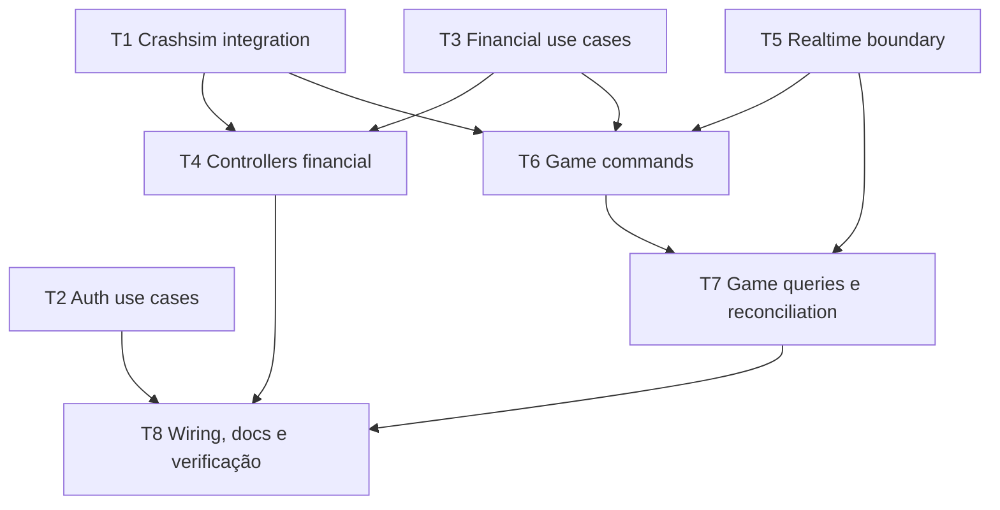

# Tasks: Refatoração arquitetural do Operator

> Requirements: @requirements.md
> Design: @design.md
> Status: Approved

## Cobertura dos requisitos

| Requisito | Tasks | Observação |
|-----------|-------|------------|
| FR-001 | T2, T3, T6, T7 | use cases nos três módulos |
| FR-002 | T2, T3, T6, T7, T8 | fachadas públicas preservadas e compostas pelos módulos |
| FR-003 | T2, T3, T6, T7 | fluxos coesos, sem wrappers vazios |
| FR-004 | T1 | protocolo Crashsim concreto localizado |
| FR-005 | T2, T3, T4, T6, T7 | limites auth/financial/game e webhook mantidos |
| FR-006 | T5, T8 | API realtime explícita e documentação do caminho |
| FR-007 | T1, T4, T5, T6, T7, T8 | compatibilidade Engine, REST, webhook e SSE |
| FR-008 | T5, T8 | conexão, snapshot, seq, ordem e subscription |
| FR-009 | T3, T4, T6, T7 | transações financeiras e resultado desconhecido |
| FR-010 | T1, T4, T8 | segredo, schema externo, raw body, HMAC e frescor |
| FR-011 | T8 | composition root e contratos exportados |
| FR-012 | T8 | README e steering atualizados |
| NFR-001 | T1, T3, T4, T5, T6, T7, T8 | preservar e executar testes de falhas críticas |
| NFR-002 | T1–T8 | limites e dependências visíveis, sem layers genéricos |
| NFR-003 | T1, T3–T8 | sem mudança de contrato, dados ou Engine |

## Verificação de prontidão

| Verificação | Status | Observação |
|-------------|--------|------------|
| Todos os requisitos Must Have têm tasks | Pass | FR-001–FR-011 cobertos na tabela acima |
| Requirements estão cobertos pelo design | Pass | Requirements Mapping em `design.md` §§ 2–18 |
| Perguntas críticas estão respondidas | Pass | requirements.md declara que não há questão bloqueadora |
| Cada task tem dependências, aceite, arquivos e verificação | Pass | detalhado abaixo |
| Comandos de verificação são conhecidos | Pass | `bun run typecheck`, `bun test`, `bun run test:e2e` existem em `operator/package.json` |
| A implementação pode iniciar | Pass | requirements, design e tasks estão aprovados; executar task por task na ordem indicada |

## Ordem e dependências

T2 é independente das demais até a integração final. As outras tarefas têm dependências para que a movimentação de clientes, interfaces e callbacks permaneça compilável e verificável.

## Task T1: Centralizar a integração concreta Crashsim

**Prioridade:** P1  
**Estimativa:** 2–4h  
**Dependências:** nenhuma  
**Cobre:** FR-004, FR-007, FR-010, NFR-002, NFR-003, TD-002

### Trabalho

- [x] Criar `operator/src/integrations/crashsim/` e mover o cliente HTTP e o cliente WebSocket concretos, schemas de protocolo e tipos externos.
- [x] Mover a verificação HMAC/frescor do webhook para `integrations/crashsim/webhook-auth.ts` sem alterar o cálculo ou as respostas de segurança.
- [x] Ajustar imports dos módulos game/financial e dos testes; evitar que a integração importe módulos de negócio.
- [x] Manter credenciais server-only, timeouts, classificação de erro, validação Valibot, reconexão e logs redigidos.

### Critérios de aceite

- [x] Não há implementação duplicada de transporte/schema Crashsim sob `modules/game` ou `modules/financial`.
- [x] Clientes HTTP/stream e webhook continuam obedecendo exatamente os contratos atuais.
- [x] A integração depende apenas de configuração e tipos/schemas do protocolo, sem acesso a DB ou regra financeira.

### Arquivos prováveis

- `operator/src/integrations/crashsim/http.client.ts` — criar/mover
- `operator/src/integrations/crashsim/stream.client.ts` — criar/mover
- `operator/src/integrations/crashsim/webhook-auth.ts` — criar/mover
- `operator/src/integrations/crashsim/contracts.ts` — criar, se necessário para tipos externos compartilhados
- `operator/src/modules/game/crashsim-http.client.ts` — remover após mover
- `operator/src/modules/game/crashsim-stream.client.ts` — remover após mover
- `operator/src/modules/financial/crashsim-webhook-auth.ts` — remover após mover
- testes correspondentes em `operator/src/integrations/crashsim/`

### Verificação

- [x] `cd operator && bun run typecheck` — exit code 0.
- [x] `cd operator && bun test src/integrations/crashsim/http.client.test.ts src/integrations/crashsim/webhook-auth.test.ts src/modules/game/game-stream.service.test.ts` — 22 testes passaram.
- [x] Teste do stream confirmou operator key server-side e ausente dos logs; HMAC permanece validado sobre o body cru.

## Task T2: Extrair os casos de uso de Auth

**Prioridade:** P1  
**Estimativa:** 2–3h  
**Dependências:** nenhuma  
**Cobre:** FR-001, FR-002, FR-003, FR-005, FR-007, FR-010, NFR-001, NFR-002, NFR-003, TD-001

### Trabalho

- [x] Criar `modules/auth/usecases/` para registro, login, logout e resolução/consulta de sessão.
- [x] Reduzir `auth.service.ts` a fachada tipada que constrói/exibe esses casos de uso sem duplicar regras.
- [x] Manter `requireUser` e o cache request-scoped `WeakMap` na composição de auth, usando a fachada para resolver a sessão.
- [x] Manter no fluxo correspondente normalização de email, hash de senha/token, limite de concorrência de hash, TTL e mapeamento de email único.
- [x] Reorganizar os testes existentes sem perder os casos de autenticação e segurança.

### Critérios de aceite

- [x] `auth.controller.ts` continua usando a API do `AuthService`, sem importar use cases diretamente.
- [x] Registro, login, logout e resolução de bearer token mantêm respostas, sessões e tratamento de erros atuais.
- [x] Os use cases implementam operações reais e têm dependências explícitas; não são wrappers de forwarding.

### Arquivos prováveis

- `operator/src/modules/auth/auth.service.ts`
- `operator/src/modules/auth/auth.module.ts`
- `operator/src/modules/auth/usecases/*.ts` — criar
- `operator/src/modules/auth/auth.service.test.ts`
- `operator/src/modules/auth/auth.module.test.ts` ou testes de controller, se necessários para contrato

### Verificação

- [x] `cd operator && bun run typecheck` — exit code 0.
- [x] `cd operator && bun run test:e2e` — exit code 0, 162 testes e 940 expectativas passaram em PostgreSQL temporário.
- [x] Testes confirmaram hash de sessão persistido, resposta genérica para credenciais inválidas, expiração/revogação e limite de hashing.

## Task T3: Extrair os casos de uso Financial e sua fachada

**Prioridade:** P1  
**Estimativa:** 4h  
**Dependências:** nenhuma  
**Cobre:** FR-001, FR-002, FR-003, FR-005, FR-007, FR-009, NFR-001, NFR-002, NFR-003, TD-001, TD-005

### Trabalho

- [x] Criar `modules/financial/usecases/` para provisioning/leitura de wallet, ledger, top-up, payout, débito/crédito de webhook, consultas de operações associadas a bet e conclusão de payouts devidos.
- [x] Transformar `financial.service.ts` na fachada pública dos fluxos efetivamente usados por controllers e game.
- [x] Separar helpers de erro/normalização junto ao fluxo responsável; compartilhar somente utilitários realmente usados por mais de um use case.
- [x] Preservar Drizzle e a transação atômica que reserva idempotency key, atualiza wallet e registra ledger.
- [x] Manter tipos de entrada/saída públicos atuais no contrato de `FinancialModule` sem expor detalhes internos dos use cases.
- [x] Mover/adaptar testes atuais para cobrir os use cases e a fachada, incluindo duplicidade, concorrência e limites de valor.

### Critérios de aceite

- [x] O contrato consumido por auth/game e pelos endpoints financeiros não muda.
- [x] Webhook repetido com o mesmo `txId` não gera saldo/ledger duplicado; dois débitos concorrentes não deixam saldo negativo.
- [x] Crédito de cashout, status de crédito e lookup de débito associado a comando preservam o comportamento atual.
- [x] `financial.service.ts` apenas compõe e expõe a API, sem reter o fluxo de negócio monolítico.

### Arquivos prováveis

- `operator/src/modules/financial/financial.service.ts`
- `operator/src/modules/financial/financial.module.ts`
- `operator/src/modules/financial/financial.schema.ts` — somente imports/types, sem mudança de schema
- `operator/src/modules/financial/usecases/*.ts` — criar
- `operator/src/modules/financial/financial.service.test.ts`
- `operator/src/modules/financial/financial.module.test.ts`

### Verificação

- [x] `cd operator && bun run typecheck` — exit code 0.
- [x] `cd operator && bun run test:e2e` — exit code 0, 162 testes e 940 expectativas passaram em PostgreSQL temporário.
- [x] Suíte financeira confirmou dedupe por `txId`, `cashout:<betId>`, atomicidade saldo/ledger, rollback e saldo nunca negativo.

## Task T4: Separar controllers Financial por confiança e transporte

**Prioridade:** P1  
**Estimativa:** 2–3h  
**Dependências:** T1, T3  
**Cobre:** FR-002, FR-005, FR-007, FR-009, FR-010, FR-011, NFR-001, NFR-002, NFR-003, TD-004

### Trabalho

- [x] Separar rotas autenticadas de wallet/ledger/top-up/payout das rotas de webhook Engine em dois controllers registráveis.
- [x] Manter parsing do body raw, validação HMAC/frescor e limite de tamanho junto à fronteira HTTP de webhook; executar operações somente pela fachada financial.
- [x] Manter `auth.requireUser`, cursor/paginação, rate limits, códigos/status/payloads atuais e tradução de erros.
- [x] Atualizar `financial.module.ts` para registrar ambos os controllers e manter lifecycle do payout local, timer, prevenção de sweep concorrente e shutdown.
- [x] Preservar testes de rota autenticada e de webhook em duplicidade, assinatura inválida e retry.

### Critérios de aceite

- [x] Nenhum controller importa use case privado ou acessa DB diretamente.
- [x] Rotas e wire payloads REST/webhook permanecem idênticos, inclusive comportamento de erros e respostas.
- [x] HMAC é calculado sobre os bytes originais e timestamp antigo/inválido é rejeitado antes de qualquer mutação financeira.
- [x] `financial.module.ts` continua compondo os dois controllers e o job local sem introduzir worker/queue.

### Arquivos prováveis

- `operator/src/modules/financial/financial.controller.ts` — substituir/remover ao migrar
- `operator/src/modules/financial/controllers/wallet.controller.ts` — criar
- `operator/src/modules/financial/controllers/engine-webhook.controller.ts` — criar
- `operator/src/modules/financial/financial.module.ts`
- `operator/src/modules/financial/financial.controller.test.ts`
- `operator/src/modules/financial/financial.module.test.ts`

### Verificação

- [x] `cd operator && bun run typecheck` — exit code 0.
- [x] `cd operator && bun run test:e2e` — exit code 0, 162 testes e 940 expectativas passaram em PostgreSQL temporário.
- [x] Testes verificaram raw-body, HMAC, frescor, duplicidade, status HTTP, autenticação e rotas locais de top-up/payout.

## Task T5: Encapsular realtime e contrato SSE

**Prioridade:** P1  
**Estimativa:** 3–4h  
**Dependências:** T1  
**Cobre:** FR-002, FR-006, FR-007, FR-008, FR-010, NFR-001, NFR-002, NFR-003, TD-003

### Trabalho

- [ ] Agrupar estado/reducer, stream coordinator, fan-out e tipos realtime sob `modules/game/realtime/`.
- [ ] Renomear o EventHub para uma peça privada de fan-out, sem alterar a semântica de subscriber, fila, `seq` ou cleanup.
- [ ] Expor `subscribe()` e snapshot pelo serviço realtime; remover do controller SSE a dependência direta do fan-out.
- [ ] Fazer o controller escrever snapshot antes de ativar o recebimento de mensagens concorrentes e manter tratamento de close/error/backpressure.
- [ ] Manter uma conexão Crashsim upstream por processo, sincronização HTTP por `GET /rounds/current`, buffer durante snapshot, backoff e comportamento stale/connected.
- [ ] Adaptar testes do reducer, stream, fan-out, controller SSE e composição.

### Critérios de aceite

- [ ] O controller SSE não importa `event-fanout` e só conhece contrato de subscription, mensagens e logger.
- [ ] Snapshot é capturado sincronamente; eventos concorrentes são enfileirados e entregues após o snapshot, sem gap nem evento antigo.
- [ ] Disconnect, sequence gap, stale tick após crash, reconnect, ausência de replay e health mantêm o comportamento atual.
- [ ] Múltiplas conexões SSE compartilham um único upstream; encerrar um subscriber não afeta os demais.

### Arquivos prováveis

- `operator/src/modules/game/game-stream.service.ts` → `realtime/stream.service.ts`
- `operator/src/modules/game/game-event-hub.ts` → `realtime/event-fanout.ts`
- `operator/src/modules/game/round-state.ts` → `realtime/round-state.ts`
- `operator/src/modules/game/game-events.controller.ts` → `controllers/events.controller.ts`
- `operator/src/modules/game/game.module.ts`
- testes `game-stream.service`, `game-event-hub`, `round-state`, `game-events.controller` e `game.module`

### Verificação

- [ ] `cd operator && bun run typecheck`
- [ ] `cd operator && bun test src/modules/game`
- [ ] Cobrir snapshot-first com publicação concorrente, seq antiga/gap, tick após crash, reconnect e unsubscribe/backpressure.

## Task T6: Extrair sessão, aposta e cashout do Game

**Prioridade:** P1  
**Estimativa:** 4h  
**Dependências:** T1, T3, T5  
**Cobre:** FR-001, FR-002, FR-003, FR-005, FR-007, FR-009, FR-010, NFR-001, NFR-002, NFR-003, TD-001

### Trabalho

- [ ] Criar `modules/game/usecases/` e mover garantia/criação de sessão, normalização e criação de aposta e cashout para fluxos nomeados.
- [ ] Introduzir a fachada pública `game.service.ts` e atualizar controllers para chamá-la sem importar implementações privadas.
- [ ] Manter no fluxo de bet a reserva de comando, idempotency key/hash, regra de uma aposta por jogador/rodada, débito, chamada Crashsim, persistência e tratamento de resultado desconhecido.
- [ ] Manter no fluxo de cashout as validações de ownership/rodada/status, reserva idempotente, consulta após timeout e sem retry às cegas.
- [ ] Passar somente contratos públicos de auth/financial/realtime e o client Crashsim concreto como dependências explícitas.
- [ ] Reorganizar testes de comando sem remover os casos de erro/concorrência existentes.

### Critérios de aceite

- [ ] `game-commands.controller` permanece fina e não conhece Drizzle, Engine key, schema ou transações.
- [ ] Bet não é duplicada em resposta perdida; tentativa desconhecida continua reconciliável e bloqueia repetição insegura.
- [ ] Cashout ambíguo consulta `GET /bets/:id` e não reporta falha/repete mutation antes de reconciliar.
- [ ] Rotas e respostas atuais continuam idênticas.

### Arquivos prováveis

- `operator/src/modules/game/game-command.service.ts` — reduzir e renomear a fachada
- `operator/src/modules/game/game.service.ts` — criar
- `operator/src/modules/game/usecases/ensure-player-session.ts`
- `operator/src/modules/game/usecases/place-bet.ts`
- `operator/src/modules/game/usecases/cashout-bet.ts`
- `operator/src/modules/game/game-commands.controller.ts`
- `operator/src/modules/game/game-command.service.test.ts`
- `operator/src/modules/game/game-commands.controller.test.ts`

### Verificação

- [ ] `cd operator && bun run typecheck`
- [ ] `cd operator && bun test src/modules/game/game-command.service.test.ts src/modules/game/game-commands.controller.test.ts`
- [ ] Preservar testes de idempotência, débito confirmado/recusado, bet/cashout unknown, timeout, ownership e corrida com mudança da rodada.

## Task T7: Extrair consulta, reconciliação e callback de crédito do Game

**Prioridade:** P1  
**Estimativa:** 3–4h  
**Dependências:** T5, T6  
**Cobre:** FR-001, FR-002, FR-003, FR-005, FR-007, FR-008, FR-009, NFR-001, NFR-002, NFR-003, TD-001

### Trabalho

- [ ] Mover listagem de bets, consulta de comando, consulta de bet, reconciliação por crash/snapshot e registro de cashout credit para use cases próprios ou grupos coesos.
- [ ] Deixar em `game.service.ts` somente composição e API pública desses fluxos, removendo a implementação monolítica original.
- [ ] Preservar queries por jogador/ownership e a integração financeira para estado de settlement.
- [ ] Manter reconciliação limitada em concorrência, isolada por bet e acionada sem bloquear publicação SSE.
- [ ] Adaptar callbacks do stream e teste de integração do módulo para chamar a fachada.

### Critérios de aceite

- [ ] O fluxo de crash/snapshot confirma resultado pela consulta Crashsim e nunca deduz loss nem cria crédito a partir de `round.crashed`.
- [ ] Estado persistido terminal não regride; falha/404/time-out conserva o estado anterior e permite consulta/reconciliação posterior.
- [ ] Listener de crédito continua atualizando bet após crédito financeiro idempotente e preserva o comportamento de retry do webhook.
- [ ] `game.service.ts` não contém a antiga sequência monolítica de comandos e reconciliação.

### Arquivos prováveis

- `operator/src/modules/game/game.service.ts`
- `operator/src/modules/game/usecases/get-bet.ts`
- `operator/src/modules/game/usecases/list-bets.ts`
- `operator/src/modules/game/usecases/reconcile-bets.ts`
- `operator/src/modules/game/usecases/record-cashout-credit.ts`
- `operator/src/modules/game/game.module.ts`
- testes de `game-command.service`, `game-stream.service` e `game.module`

### Verificação

- [ ] `cd operator && bun run typecheck`
- [ ] `cd operator && bun test src/modules/game`
- [ ] Preservar testes de crash e snapshot, cashout reconciliado, resultado desconhecido/404, concorrência limitada e settlement confirmado.

## Task T8: Consolidar composição, contratos, documentação e validação final

**Prioridade:** P1  
**Estimativa:** 2–4h  
**Dependências:** T2, T4, T7  
**Cobre:** FR-002, FR-006, FR-007, FR-008, FR-010, FR-011, FR-012, NFR-001, NFR-002, NFR-003, TD-001–TD-005

### Trabalho

- [ ] Revisar exports de auth/financial/game e atualizar `server.ts` para compor somente contratos públicos, sem imports em pastas privadas.
- [ ] Confirmar que wiring do callback de cashout continua visível em `server.ts`, sem ciclo entre módulos ou novo bus genérico.
- [ ] Atualizar `.ai/steering/conventions.md` e `.ai/steering/product.md` removendo orientações factualmente superadas e documentando a arquitetura aprovada.
- [ ] Atualizar diagramas e explicação do README: módulos, integração Crashsim, serviço realtime, fan-out privado e SSE; preservar os diagramas dos edge cases existentes.
- [ ] Remover imports/arquivos/testes obsoletos e confirmar que nenhuma dependência cruza para arquivos privados de outro módulo.
- [ ] Executar a suíte e typecheck finais e registrar qualquer ambiente E2E indisponível sem declarar esse teste como aprovado.

### Critérios de aceite

- [ ] `server.ts` é o único composition root da aplicação e consome interfaces exportadas dos módulos.
- [ ] README e steering descrevem a estrutura que existe após a refatoração, inclusive fluxo Engine → Operator → SSE.
- [ ] Nenhuma alteração externa de REST/SSE/webhook/Crashsim ou migration foi introduzida.
- [ ] Verificação final termina sem erros nos comandos disponíveis; qualquer limitação de E2E está explícita.

### Arquivos prováveis

- `operator/src/server.ts`
- `operator/src/modules/{auth,financial,game}/*.module.ts`
- `README.md`
- `.ai/steering/conventions.md`
- `.ai/steering/product.md`
- testes de composição de módulos e `operator/src/server.integration.test.ts`

### Verificação

- [ ] `cd operator && bun run typecheck`
- [ ] `cd operator && bun test`
- [ ] `cd operator && bun run test:e2e` com banco e serviços locais de teste configurados.
- [ ] `git diff --check`
- [ ] Revisar diff contra FR-001–FR-012, NFR-001–NFR-003 e decisões TD-001–TD-005.

## Fatiamento de implementação

### Slice A — Integrações e módulos de negócio

- **Objetivo:** localizar os fluxos e as dependências por módulo sem mudar comportamento.
- **Tasks:** T1–T4.
- **Validação independente:** typecheck e testes dos módulos Crashsim, auth e financial após cada task.

### Slice B — Game e realtime

- **Objetivo:** tornar legível o caminho Engine → estado → fan-out → SSE e dividir os comandos de jogo em use cases.
- **Tasks:** T5–T7.
- **Validação independente:** testes realtime/game com assertions de sequenciamento e resultado financeiro.

### Slice C — Contratos e manutenção

- **Objetivo:** concluir os limites públicos, atualizar documentação e verificar compatibilidade total.
- **Tasks:** T8.
- **Validação independente:** typecheck, suíte Operator, E2E quando o ambiente estiver disponível e inspeção dos diagramas.
