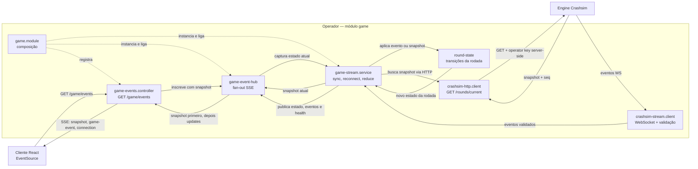

# O que eu entendi da arquitetura e do desafio

- A engine é o core da parte da aposta. Esse serviço é o que controla todo o fluxo de vida do jogo da bet. No caso atual, o jogo é o crash.
- A engine tem uma API rest para: Iniciar sessao de um jogador, fazer BET, Cashout, verificar o estado atual.
- A engine comunica os eventos de bet pela stream, mandando os eventos.
- Eventos relacionados a carteira (credito e débito) são enviados pelo webhook
- A stream é autenticada com operator key
- O webhook é autenticada com webhook key
- O objetivo do desafio é criar o serviço do operador (backend) e um pequeno client frontend.
- O operador é o serviço que vai se comunicar com o a engine, tratar da autenticacao dos jogadores, controlar a carteira e as transações (ledger financeiro), integrado a engine.
- No desafio atual temos apenas 1 engine de 1 jogo (crash), porém em um ambiente real poderemos ter varios tipos de jogos e engines

# Arquitetura e Decisões

## Arquitetura Geral

Player Client -> Operador (Auth, Game, Financial, DB) <-> Crashsim Engine

## Operador

- O operador expõe comandos e autenticação por API REST (Fastify); o estado realtime é distribuído por SSE.
- A comunicacao da engine com o operador deve ser idempotente
- Vamos utilizar filas assincronas para processar os webhooks vindos da engine
- Operacoes financeiras e que podem mexer com dinheiro devem usar lock, para tratar 2 debitos sendo feitos ao mesmo tempo, por exemplo. Evitando ficar com saldo errado.
- Implementar cache em operações pesadas, pois em uma aplicacao de multiplos usuarios pode degradar o desempenho. Exemplo: Calculo do balance. Em um sistema de milhoes de transacoes por usuario, pode ficar mt pesado fazer o calculo de todo o resultado transacional sempre que, por exemplo, precisar exibir o balance no front
- Na conexão operador -> cliente, decidi user SSE invez de websocket pois como a direcao da mensagem é unica, apenas servidor para cliente, não tem necessidade de websocket. SSE é mais leve para esse caso.

### Arquitetura banco de dados

- Teremos as tabelas de autenticação. Tabela de User, por exemplo.
- Teremos tambem as tabelas relacionadas a finanças. Wallet, Transaction, fazer um mini ledger.

#### Auth

User

- id
- name
- email
- passwordHash
- walletId

Poderia ter Account e tal mas para o escopo desse desafio não precisa

#### Financial

OBS: Todos os valores de dinheiro serao INT, sendo o valor em CENTAVOS

Wallet

- id: uuid
- document: String
- currency: String / Enum

Transaction

- id: uuid
- transactionKey: String
- value: Integer
- type: String / Enum (credit | debit)
- currency: String / ENUM
- description: String

Payout

- id
- value: Integer
- tax: Integer
- netValue: Integer

# Fluxos de Casos de Uso (Fazer diagramas)

TODO: Fazer diagramas

## Login

## Registro

## Current User

## Iniciar sessão do jogo

Player Cliente -> POST /game/crashsim (Header Berarer Auth Token) (Operator) -> Engine | POST /players/:id/session -> Redirect to /session/:sessionId or /game/crashsim?sessionId=:sessionId

## Criar transacao por PlayerId

Verifica se saldo vai ficar menor que 0 -> Lock no banco -> Criar transação -> Commit -> Recalcula balance -> Atualiza cache

##

# Fluxo de Desenvolvimento

- Vou usar SDD para o desenvolivmento assistido por IA
- Primeiro, montar as SPECS do Operador e do front, para depois iniciar a desenvolver de fato.
- Com o SDD, consigo pensar nos requisitos e nos edge cases antes de colocar em código
- Vou usar o meu prório framework de SDD https://www.npmjs.com/package/@banhosdev/sdd

# Notas de desenvolvimento

3/10 - sabado

- Estruturei os projetos iniciais (operator e cliente)
- Defini, junto com a IA, possíveis edge cases que geralmente acontecem em aplicações real time (desconexao, eventos duplicados, etc)
- Inicializei o framework SDD no repositorio
- Criei a primeira spec, definindo arquitetura do operador, do cliente, pensando já na expansão, edge cases, etc.

## Como o realtime atravessa o operador



O browser faz um `GET /game/events` para abrir SSE. Depois da requisição, os dados fluem do operador para o browser; o browser não conecta à engine. Dentro do operador, o serviço mantém uma única conexão WebSocket upstream, busca o snapshot por HTTP ao conectar ou ressincronizar, aplica o reducer e publica eventos e saúde no hub. O hub atende vários clientes SSE e entrega a cada novo cliente o snapshot antes dos eventos concorrentes. Esta entrega não inclui comandos de jogo.

# Crashsim realtime proxy (spec 001) — local run

Services (all local-only):

- engine on `http://localhost:4000`
- operator on `http://127.0.0.1:3000` (loopback-only until player auth exists)
- debug client on `http://127.0.0.1:5173` (loopback-only, proxies `/game/events` to the operator)

```bash
docker compose up --build
```

Open `http://localhost:5173` and confirm: upstream status, the current snapshot, and the live event log.

## Fault verification (reconnect, reorder, snapshot recovery)

```bash
DROP_WS_EVERY=8 REORDER=1 docker compose up --build
```

Expected in the debug client:

1. Upstream status flips to `reconnecting` on each forced drop, and the snapshot freezes (stale indicator) instead of projecting forward.
2. After reconnect, the operator resynchronizes from `GET /rounds/current` and the snapshot recovers to the engine's current state.
3. No tick for a round already marked `crashed` moves state backward, including late ticks delivered out of order.
4. The operator key never appears in browser payloads or in operator logs.
