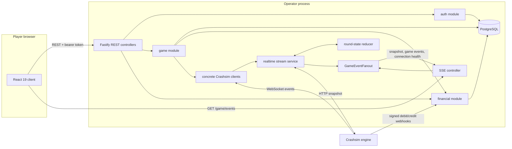
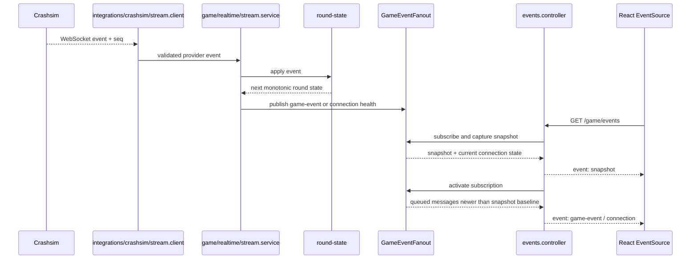
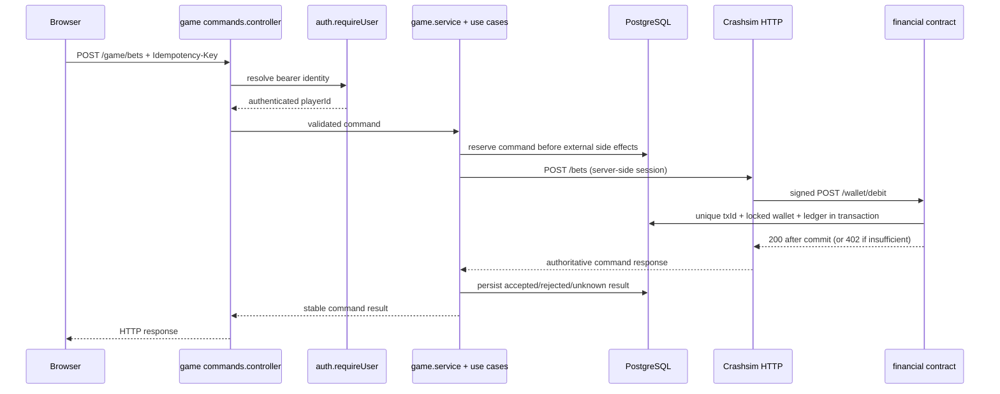

# Architecture and code map

## System boundary



The browser never connects directly to Crashsim. `ENGINE_OPERATOR_KEY` and `ENGINE_WEBHOOK_SECRET` are server-side configuration. `server.ts` creates the database, logger, and three business modules; modules exchange capabilities through exported contracts.

## Repository map

```text
.
├── client/                         # React 19 + Vite player application
│   └── src/
│       ├── app/                    # session boot and authenticated shell
│       ├── pages/                  # auth, game, and wallet screens
│       ├── features/
│       │   ├── auth/               # player session and auth commands
│       │   ├── game/               # SSE, game commands, proof and UI
│       │   └── wallet/             # wallet/payout queries and UI
│       └── lib/
│           ├── operator/           # typed, validated HTTP boundary
│           ├── query/              # React Query client and cache keys
│           └── money/              # integer-cent parsing and formatting
├── operator/
│   ├── src/server.ts               # application composition root
│   ├── src/config.ts               # validated env and redacted logging
│   ├── src/db.ts                   # PostgreSQL and Drizzle connection
│   ├── src/migrate.ts              # migration entrypoint for Compose
│   ├── drizzle/                    # checked-in SQL migrations
│   └── src/
│       ├── integrations/crashsim/  # concrete HTTP, WS, HMAC protocol code
│       └── modules/
│           ├── auth/               # identity, sessions, auth use cases
│           ├── financial/          # wallet, ledger, payouts, webhook routes
│           └── game/               # Crashsim commands and realtime state
├── engine/                         # simulated third-party provider
├── docs/                           # architecture, API, decisions, failures
└── docker-compose.yml              # local development stack
```

### Operator module responsibilities

| Path | Responsibility |
|---|---|
| `operator/src/server.ts` | Composition root, readiness/liveness, startup and graceful shutdown. It imports only public module contracts. |
| `operator/src/integrations/crashsim/` | Provider-specific HTTP and WebSocket transport, schemas, operator-key handling, and HMAC verification. This code does not own wallet or game business rules. |
| `modules/auth/` | Registration, login, session resolution/revocation, and request-scoped authenticated identity. `auth.service.ts` composes the auth use cases. |
| `modules/financial/` | Wallet, integer-cent ledger, top-up/payout flows, idempotent engine callbacks, and callback HTTP boundary. `financial.service.ts` composes the financial use cases. |
| `modules/game/controllers/` | Thin REST and SSE transport boundaries. The command controller authenticates and validates; the SSE controller writes the captured snapshot and then activates subscription delivery. |
| `modules/game/usecases/` | Session creation, bet/cashout commands, command reads, reconciliation, and recording a financially confirmed cashout. |
| `modules/game/game.service.ts` | Public game facade and composition point for game use cases. It connects shared dependencies and returns the stable module API. |
| `modules/game/realtime/stream.service.ts` | One upstream stream lifecycle, snapshot sync, reconnect/backoff, sequence-gap recovery, reduction, and event publication. |
| `modules/game/realtime/round-state.ts` | Pure state reducer. Duplicate/old sequence values are ignored; a crashed round cannot return to running. |
| `modules/game/realtime/event-fanout.ts` | Private in-process subscription fan-out. It captures a snapshot and queues concurrent events until the subscriber activates. |

`service.ts` files are not intended to duplicate business logic. They compose use cases and expose the operations controllers or another module need. A use case is introduced for a coherent business flow, rather than as a forwarding wrapper. Persistence uses Drizzle directly where a flow needs a transaction; there is no generic repository or dependency-injection framework.

## Realtime path: Engine to browser



There is one upstream WebSocket per Operator process, regardless of the number of browsers. A new browser receives a consistent snapshot first. Events published while the snapshot is being written are queued and then delivered only if newer than its `seq` baseline.

After an upstream disconnect or a sequence gap, the stream service keeps the last state but marks the connection as `reconnecting` or `synchronizing`. It gets the present state from `GET /rounds/current`, applies that snapshot as the new baseline, then accepts newer events. Crashsim provides no history endpoint, so missed ticks are not replayed. Clients freeze the last known state and disable bet/cashout until synchronization completes.

On `round.crashed`, the stream service schedules bet reconciliation in the background. Publishing the crash event does not wait for database reads or per-bet engine requests. Reconciliation reads each persisted bet from Crashsim and never infers a loss or creates a payout solely from a round event.

## Command and money path



The financial service processes engine webhooks synchronously. It does not answer success until the wallet operation is committed. A cashout result in the game and its wallet credit are separate facts: the financial module applies the credit, then calls the game module through a late-bound exported callback so the bet can reflect confirmed settlement without a module import cycle.

For an ambiguous bet or cashout timeout, the command remains `unknown` until a read-only reconciliation determines the engine state. Repeating the original idempotency key returns the stored outcome; a new key cannot bypass an unresolved command. See the [API reference](api-reference.md) for route contracts and the [failure scenarios](failure-scenarios.md) for recovery details.

## Client organization

The browser uses React Query for REST reads and mutations. Its API boundary under `client/src/lib/operator/` validates response shapes and maps errors. Auth, game, and wallet features own their query/mutation hooks and UI components. SSE stays outside the REST query cache because it has its own snapshot, ordering, and connection-health semantics. The game screen uses it to freeze state during recovery and gate commands; after a reload, persisted game command reads restore the player's recent bets.

The client verifies a finished round locally: the engine publishes `SHA-256(serverSeed)` before betting, reveals `serverSeed` after crash, and computes the crash point with `HMAC-SHA256(key=serverSeed, message=roundId)`. The browser reproduces both checks using Web Crypto and integer arithmetic.
