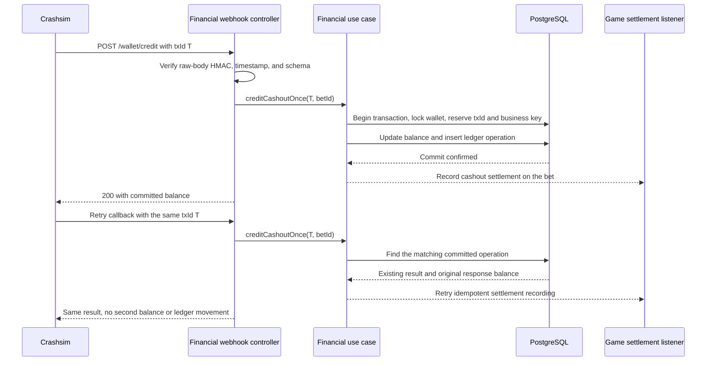
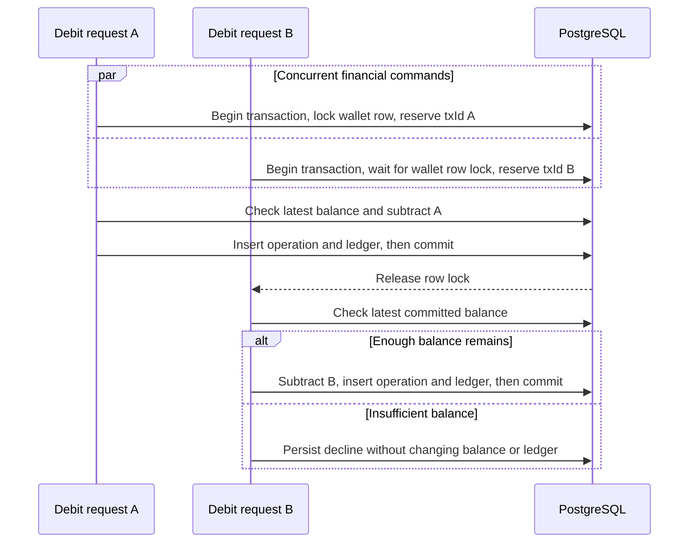
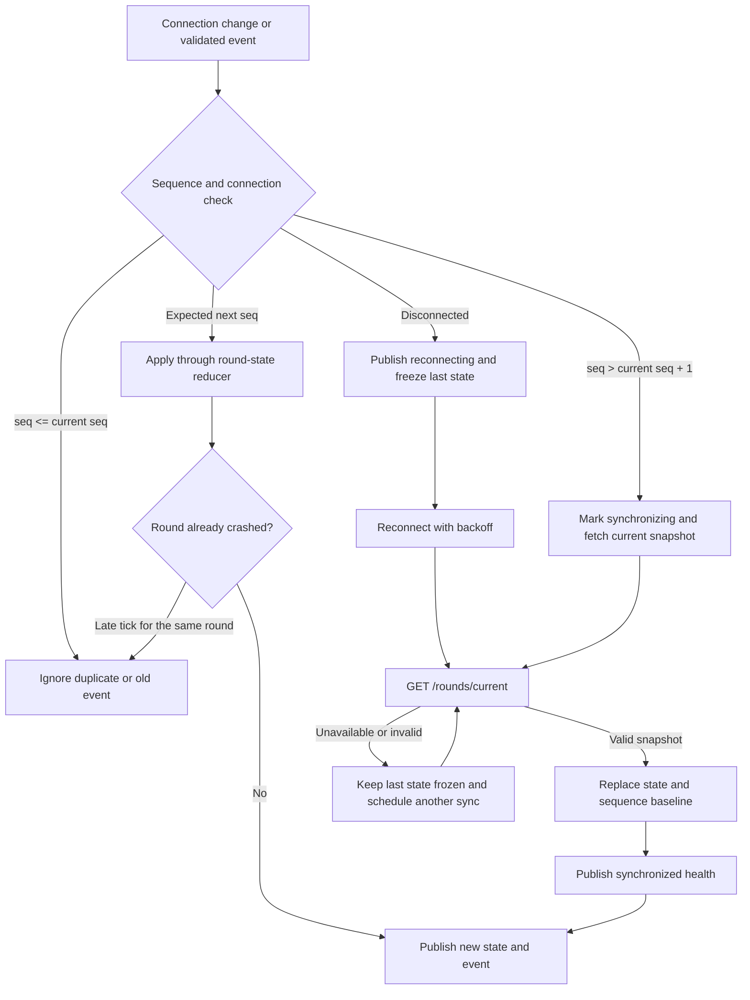
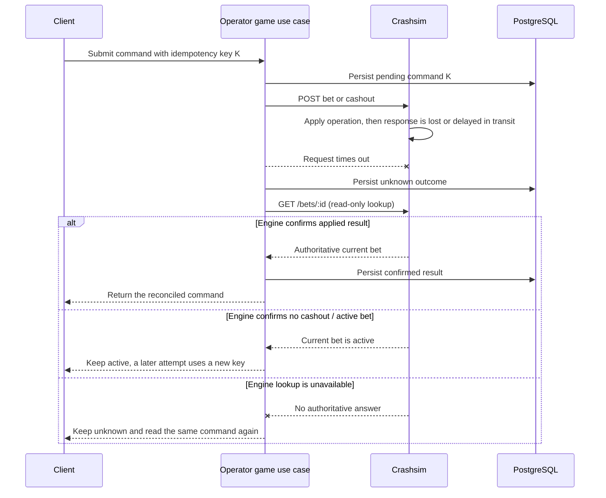

# Failure scenarios and recovery guarantees

A crash-game Operator sits between a browser, a stateful external engine, and a wallet. The design assumes callbacks can be delivered more than once, network responses can be lost after an operation succeeds, streams can disconnect, and event order can differ from send order. This document describes those risks and how the current implementation responds.

## Protection and verification map

| Failure mode | Protection | Evidence in the codebase |
|---|---|---|
| The same wallet callback is delivered more than once | Unique engine `txId`, matching request validation, and an atomic operation/wallet/ledger transaction. A replay returns the original persisted outcome and balance without another ledger entry. Cashout credits also converge on `cashout:<betId>`. | `operator/src/modules/financial/financial.service.test.ts`, `financial.controller.test.ts`, and `server.financial.integration.test.ts`. |
| Two different debits race against one wallet | Lock the wallet row inside the transaction, check the latest balance, then update balance and insert the ledger row before commit. The insufficient outcome is persisted without a balance or ledger change. | `operator/src/modules/financial/financial.service.test.ts` and `financial.controller.test.ts`. |
| A webhook has invalid signature, stale timestamp, or malformed body | Verify HMAC-SHA256 over the exact raw bytes and enforce the ±60 second timestamp window before parsing/financial mutation. Validate a strict schema and body-size limit. | `operator/src/integrations/crashsim/webhook-auth.test.ts` and `operator/src/modules/financial/financial.controller.test.ts`. |
| Engine WebSocket disconnects or becomes unavailable | Publish connection health, freeze the last known state, reconnect with backoff, and synchronize from `GET /rounds/current`. Game actions remain disabled until the synchronized state is live. | `operator/src/modules/game/realtime/stream.service.test.ts`; client SSE/recovery tests under `client/src/features/game/`. |
| Stream events are duplicated, delayed, or arrive out of order | Ignore duplicates and old sequence numbers, request a fresh snapshot for a sequence gap, and keep `crashed` terminal for the current round even if a later tick arrives. | `operator/src/modules/game/realtime/round-state.test.ts` and `stream.service.test.ts`; client stream reducer tests under `client/src/features/game/data/`. |
| Browser SSE disconnects while events continue | Unsubscribe the closed response. On reconnect, capture and write a new snapshot first; queue concurrent events and deliver only those above the snapshot sequence. No historical replay is claimed. | `operator/src/modules/game/controllers/events.controller.test.ts` and `realtime/event-fanout.test.ts`. |
| Bet/cashout request times out after the engine may have applied it | Persist the command before the external mutation. Keep the result `unknown`, perform a read-only `GET /bets/:id` reconciliation, and do not repeat a non-idempotent POST blindly. An unresolved command blocks a new key for that bet/round. | `operator/src/modules/game/game.service.test.ts` and `operator/src/integrations/crashsim/http.client.test.ts`. |
| The round crashes but the bet result has not been confirmed | Do not infer `lost` from `round.crashed`. Reconcile persisted active bets against authoritative engine reads in bounded background work; preserve the last result on active/failed reads. | `operator/src/modules/game/game.service.test.ts`, `realtime/stream.service.test.ts`, and `server.game.integration.test.ts`. |
| Cashout is confirmed by the game but its wallet credit is delayed | Track game result separately from settlement. Confirm settlement only after the matching financial ledger entry exists. If the callback's game-side recording fails, return failure so the engine retries; the wallet `txId` makes that retry safe. | `operator/src/modules/financial/financial.service.test.ts`, `financial.controller.test.ts`, and `game.service.test.ts`. |

The automated tests exercise the financial and realtime guarantees with deterministic test doubles; they do not replace a live-provider smoke test.

## Duplicate callback and financial atomicity

The listener runs after the financial transaction. If settlement recording fails after the wallet credit commits, the callback does not report full success. A retry reuses the committed financial operation and repeats only the idempotent game-side recording.

## Concurrent debits

The wallet balance and ledger are changed in the same database transaction. A duplicate transaction ID resolves to the existing operation; distinct debits serialize against the wallet row. These rules keep the balance from going negative and prevent the ledger from diverging from the committed balance.

## Engine stream recovery and event ordering

Crashsim does not expose a historical event log. The snapshot restores its present state and sequence; missed transient ticks are not replayed. The downstream SSE controller also sends a fresh snapshot before live events after a browser reconnect.

## Unknown bet or cashout outcome

A timeout only proves that the Operator did not receive a response. It does not prove that the engine rejected the operation. The persisted `unknown` status prevents a second mutation from being sent while that uncertainty remains.

## Crash and bet result reconciliation

A `round.crashed` event marks the round as ended, but it is not proof that every bet lost. The Operator queries each persisted active bet from Crashsim in bounded background work. Only the engine's bet response can change that bet to `lost` or `cashed_out`; an `active` response or failed read preserves the prior persisted result and allows a later reconciliation. This path never creates wallet credit from the round event.

## Known recovery limits

- There is no cross-process stream fan-out, shared session store, or distributed lock; this build supports one Operator instance.
- A current snapshot cannot reconstruct transient events or historical ticks missed during an outage.
- The MVP does not automatically compensate a committed bet debit if the engine later reports rejection after the command response was lost. It records the conflict for investigation instead of applying a guessed reversal.
- A production rollout would need explicit alerting/replay procedures with the real provider, database backup/recovery, and operational ownership for unresolved financial exceptions.
